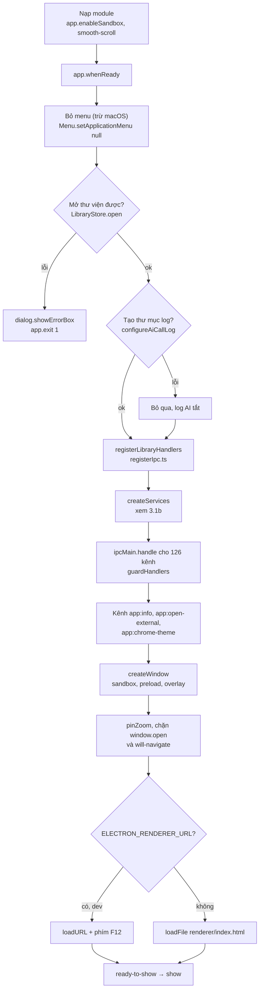
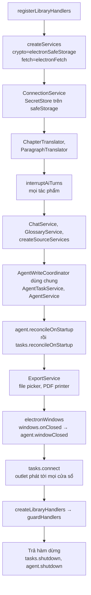
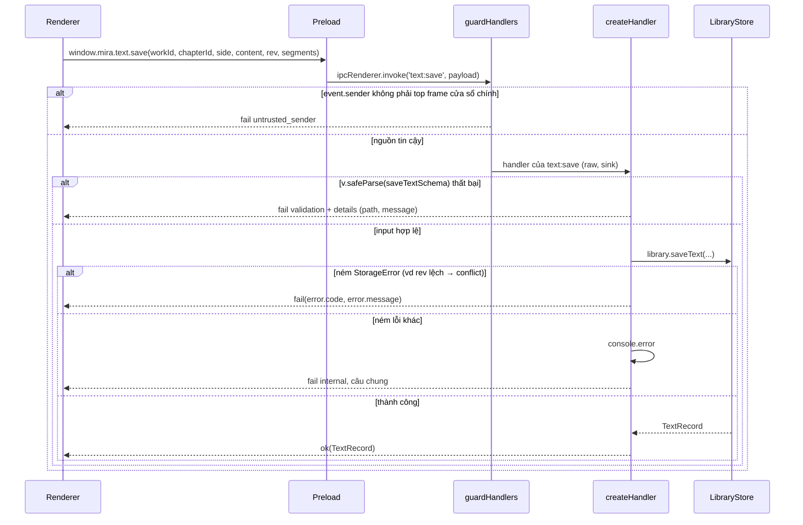
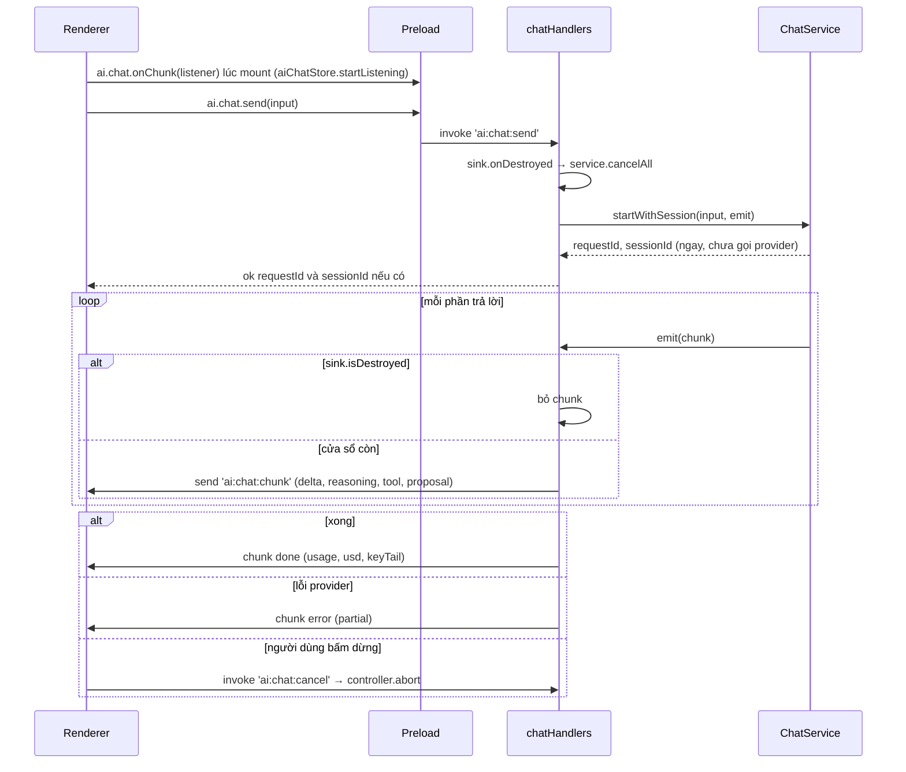
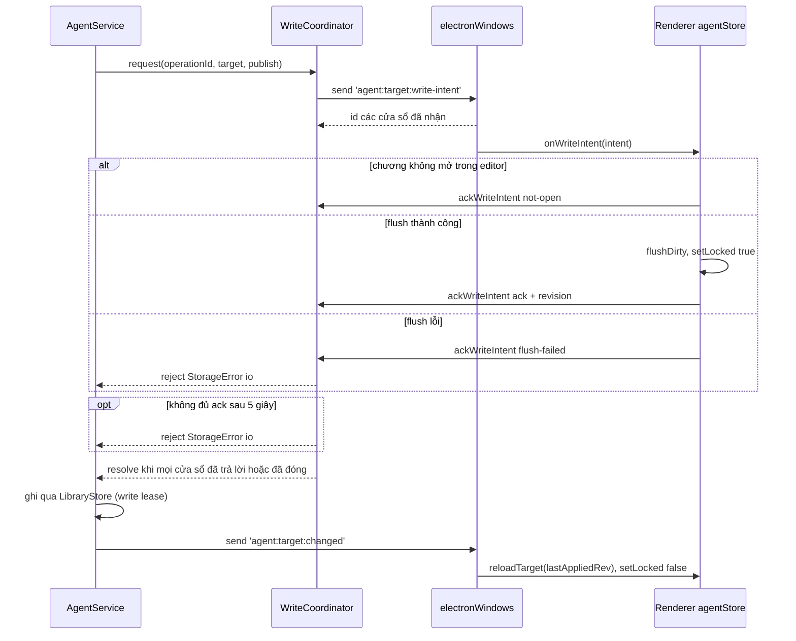
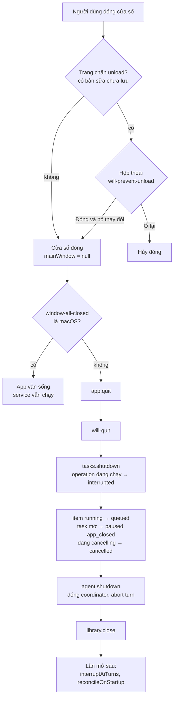
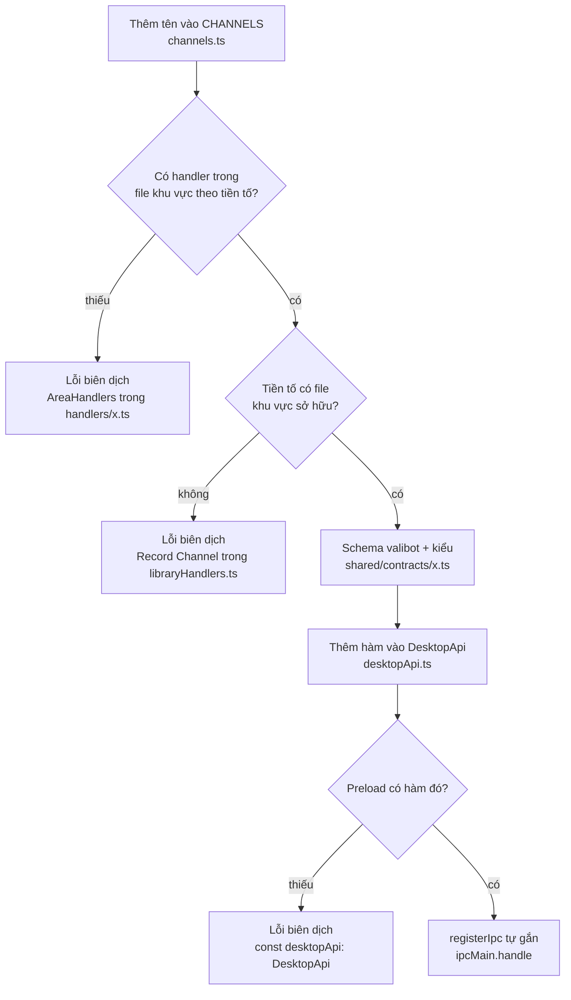
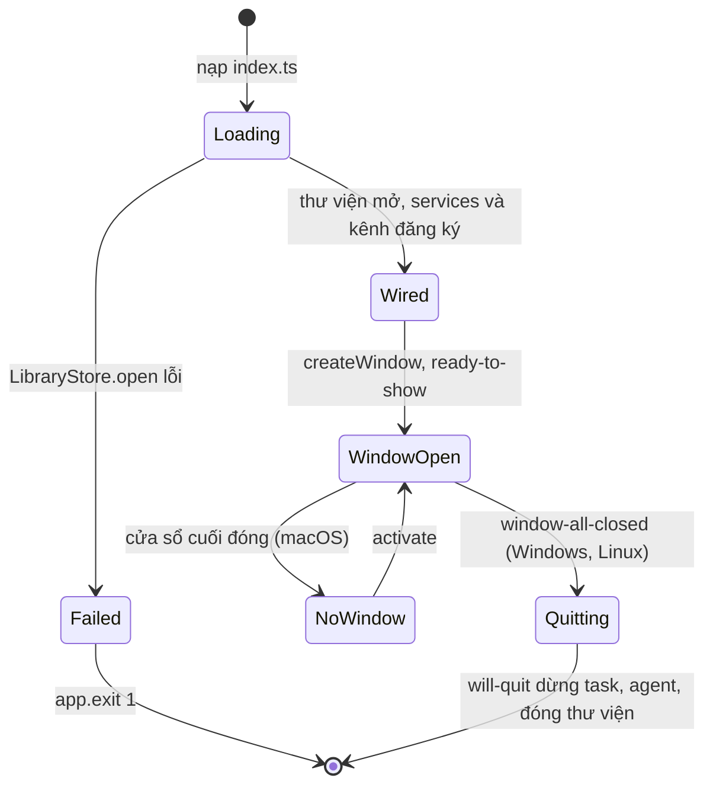

# Process, preload và IPC

> **Một câu:** vùng này dựng cửa sổ Electron, lắp mọi service của main, và là đường ống có kiểu duy nhất
> giữa React (renderer) và Node (main): `window.mira.*` → preload → `ipcMain` handler → service → `Result`.
> Cập nhật: 2026-10-15 · Nguồn: đọc code tại commit db2455f.

## 1. Vì sao vùng này tồn tại

Mira là app Electron. Renderer chạy React trong Chromium, có sandbox, có CSP `connect-src 'self'`. Nó không
đọc được SQLite, khóa API hay mạng. Mọi thứ cần quyền (thư viện SQLite, `safeStorage`, gọi provider AI, hộp
thoại hệ thống, xuất PDF) nằm ở main process. Vùng này giải quyết ba việc: (1) khởi động: mở thư viện, lắp
service, đăng ký kênh, dựng cửa sổ; (2) cho renderer gọi main qua một API có kiểu, với dữ liệu được
validate và lỗi đi về dưới dạng dữ liệu; (3) cho main đẩy sự kiện ngược về renderer (chunk chat, tiến độ,
sự kiện agent). Mọi vùng khác (lưu trữ, AI, dịch, agent, nguồn, xuất) đều đi qua đây để tới UI. Vùng này gọi
`LibraryStore` và các service; renderer gọi vùng này qua `window.mira`.

## 2. Bản đồ file

**Gốc lắp ráp và tích hợp Electron** (chỉ ở đây được `import 'electron'`)

| File | Làm gì | Symbol chính |
| --- | --- | --- |
| [index.ts](../../src/main/index.ts) | Điểm vào main: `whenReady`, mở thư viện, tạo cửa sổ, kênh `app:*`, `will-quit` | `createWindow`, `isTrustedSender`, `dataDir`, `MIRA_DATA_DIR` |
| [electron/registerIpc.ts](../../src/main/electron/registerIpc.ts) | Gọi `createServices`, dựng `ExportService`, nối `ipcMain.handle` cho mọi `CHANNELS`, trả hàm dừng | `registerLibraryHandlers`, `electronFilePicker`, `electronWindows` |
| [electron/safeStorage.ts](../../src/main/electron/safeStorage.ts) | `SecretCrypto` thật trên `safeStorage` async (DPAPI ở Windows) | `electronSafeStorage` |
| [electron/netFetch.ts](../../src/main/electron/netFetch.ts) | `fetch` cho tầng AI qua `net.fetch` (theo proxy, kho chứng chỉ hệ thống) | `electronFetch` |
| [electron/zoom.ts](../../src/main/electron/zoom.ts) | Khóa zoom 100%, chặn Ctrl+=/-/0, Ctrl+cuộn, chụm | `pinZoom`, `isZoomShortcut`, `ZOOM_FACTOR` |
| [electron/titleBar.ts](../../src/main/electron/titleBar.ts) | Hằng số title bar overlay, màu nút cửa sổ, màu nền lúc boot | `OVERLAY_TITLE_BAR`, `CHROME_COLORS`, `BOOT_BACKGROUND`, `TOP_BAR_HEIGHT` |
| [electron/exportElectron.ts](../../src/main/electron/exportElectron.ts) | Hộp thoại lưu xuất và in PDF bằng một `BrowserWindow` ẩn | `electronExportFilePicker`, `electronPdfPrinter` |

**Tầng IPC thuần** (không import Electron, test gọi trực tiếp)

| File | Làm gì | Symbol chính |
| --- | --- | --- |
| [ipc/handler.ts](../../src/main/ipc/handler.ts) | Bọc handler: validate valibot, bắt lỗi, trả `Result`; định nghĩa sink/broadcast | `createHandler`, `createAsyncHandler`, `createSinkHandler`, `ChunkSink`, `WindowBroadcast`, `sinkBroadcast` |
| [ipc/libraryHandlers.ts](../../src/main/ipc/libraryHandlers.ts) | Gộp handler mọi khu vực thành `Record<Channel, …>`; chặn nguồn gửi lạ | `createLibraryHandlers`, `guardHandlers` |
| [ipc/handlers/deps.ts](../../src/main/ipc/handlers/deps.ts) | Kiểu deps và kiểu ép đủ kênh theo tiền tố | `HandlerDeps`, `AreaHandlers<Prefix>`, `connectionsOf`, `unavailable` |
| [ipc/handlers/*.ts](../../src/main/ipc/handlers/) | Một file một nhóm kênh (17 file), xem bảng tra cứu ở 3.6 | `worksHandlers`, `aiHandlers`, `agentHandlers`, … |
| [ipc/filePicker.ts](../../src/main/ipc/filePicker.ts) | Interface hộp thoại sao lưu; bản giả luôn "hủy" | `FilePicker`, `noFilePicker` |

**Lắp service, bridge, contract**

| File | Làm gì | Symbol chính |
| --- | --- | --- |
| [services/createServices.ts](../../src/main/services/createServices.ts) | Lắp mọi service trên một `LibraryStore`; dọn lượt chat/agent/task dang dở | `createServices`, `Services` |
| [preload/index.ts](../../src/preload/index.ts) | Dựng object `DesktopApi`, `contextBridge.exposeInMainWorld('mira', …)` | `desktopApi` |
| [shared/contracts/channels.ts](../../src/shared/contracts/channels.ts) | 126 kênh invoke và 8 kênh sự kiện | `CHANNELS`, `EVENT_CHANNELS`, `Channel`, `EventChannel` |
| [shared/contracts/desktopApi.ts](../../src/shared/contracts/desktopApi.ts) | Kiểu của `window.mira` | `DesktopApi`, `AiApi`, `AgentApi`, … |
| [shared/contracts/result.ts](../../src/shared/contracts/result.ts) | Kết quả đi qua IPC | `Result<T>`, `IpcError`, `ErrorCode`, `ok`, `fail` |
| `shared/contracts/*.ts` khác | Schema valibot của input + kiểu output theo domain (vd `saveTextSchema` trong `text.ts`) | `*Schema` |
| [renderer/src/env.d.ts](../../src/renderer/src/env.d.ts) | Khai `window.mira: DesktopApi` cho renderer | `Window.mira` |

**Test và hàng rào**

| File | Làm gì | Symbol chính |
| --- | --- | --- |
| [main/testing/](../../src/main/testing/) | Thư mục tạm, ảnh/bìa giả cho test; mã chạy thật bị cấm import | `createTempDirs`, `fakeJpegDataUrl` |
| [preload/preloadContract.test.ts](../../src/preload/preloadContract.test.ts) | Khóa bề mặt preload: không lộ SQL, fs, shell hay IPC tổng quát | — |
| [biome.json](../../biome.json) | `noRestrictedImports` theo từng vùng (`overrides`) | — |
| [scripts/check-renderer-boundaries.mjs](../../scripts/check-renderer-boundaries.mjs) | Ranh giới bên trong renderer: module/app/foundation, `public.ts`, chu trình | `inspect` |

## 3. Luồng chính

### 3.1 Khởi động app: `app.whenReady` → cửa sổ hiện

Kích hoạt khi người dùng mở Mira (hoặc `pnpm dev`). Kết quả: thư viện mở, mọi kênh đã đăng ký, cửa sổ hiện
đúng màu theme, không chớp.

Đọc sơ đồ:

- Thư mục dữ liệu là `MIRA_DATA_DIR` nếu có, không thì `app.getPath('userData')` (`dataDir` trong
  [index.ts](../../src/main/index.ts)). Test và Lab dùng biến này để trỏ sang thư mục khác.
- Không mở được thư viện thì app **từ chối chạy** (`showErrorBox` + `app.exit(1)`). Không mở được thư mục
  log thì app vẫn chạy, chỉ tắt log gọi model ([aiCallLog.ts](../../src/main/infra/storage/aiCallLog.ts)).
- Kênh đăng ký **trước** `createWindow`, nên renderer không bao giờ gọi vào kênh chưa có handler.
- `createWindow` đặt `backgroundColor` theo `nativeTheme` (`BOOT_BACKGROUND`) và màu nút cửa sổ theo
  `CHROME_COLORS`. Sau khi trang chọn theme khác, renderer gọi `setChromeTheme` → `app:chrome-theme` →
  `setTitleBarOverlay`.
- `pinZoom` khóa zoom = 1 vì chiều cao nút overlay (`TOP_BAR_HEIGHT = 40 - 1`) tính theo zoom.
- DevTools (F12, Ctrl+Shift+I) chỉ gắn khi có `ELECTRON_RENDERER_URL`, tức chỉ ở dev. Reload không được gắn
  lại để tránh mất bản sửa chưa lưu.
- `app.on('activate')` (macOS) tạo lại cửa sổ khi không còn cửa sổ nào.

#### 3.1b Bên trong `createServices` và `registerLibraryHandlers`

Đọc sơ đồ:

- `createServices` **không** import Electron. Nó nhận `crypto`, `fetch`, `userAgent`, `openExternal` làm tham
  số. Test truyền `SecretCrypto` giả và `fetch` thường.
- `interruptAiTurns` đóng mọi lượt chat "đang chạy" còn sót từ lần tắt trước (lượt chat không được dọn lúc
  tắt, xem 3.4).
- Thứ tự dọn agent cố định: operation trước (journal thắng), task sau; cả hai không gọi provider
  ([createServices.ts](../../src/main/services/createServices.ts), comment trước `reconcileOnStartup`).
- Chat và task dùng **một** `AgentWriteCoordinator`, nên mọi lần ghi của agent đều flush editor qua cùng
  một cơ chế (3.3b). Chi tiết agent ở [06-tro-ly-agent.md](06-tro-ly-agent.md).
- `ExportService` dựng ở `registerIpc.ts`, không ở `createServices`, vì nó cần hộp thoại và PDF printer
  của Electron.

### 3.2 Một lời gọi invoke: renderer → `window.mira` → handler → service → `Result`

Kích hoạt khi một component gọi bất kỳ hàm `window.mira.*` trả `Promise<Result<T>>`. Ví dụ: editor lưu bản
dịch bằng `window.mira.text.save(...)` ([ChapterScreen.tsx](../../src/renderer/src/modules/workspace/chapter-screen/ChapterScreen.tsx)).
Kết quả: renderer nhận `{ ok: true, value }` hoặc `{ ok: false, error: { code, message, details? } }`,
không bao giờ một exception trần.

Đọc sơ đồ:

- Preload chỉ map tham số vị trí thành một object rồi `ipcRenderer.invoke(CHANNELS.x, payload)`. Không có
  logic. Kiểu trả về được **ép** bằng `as Promise<Result<T>>` ([preload/index.ts](../../src/preload/index.ts)).
- `registerIpc.ts` gắn `ipcMain.handle(channel, (event, raw) => handlers[channel](event, raw))` cho mọi giá
  trị của `CHANNELS`. `guardHandlers` ([libraryHandlers.ts](../../src/main/ipc/libraryHandlers.ts)) kiểm
  `isTrustedSender` **trước** validate và trước khi chạm storage.
- `isTrustedSender` ([index.ts](../../src/main/index.ts)) chỉ nhận `event.sender === mainWindow.webContents`
  và `event.senderFrame === mainFrame`. Iframe hay cửa sổ khác bị từ chối.
- Ba wrapper trong [handler.ts](../../src/main/ipc/handler.ts) có cùng nhánh validate/lỗi: `createHandler`
  (đồng bộ), `createAsyncHandler` (chờ hộp thoại, gọi mạng), `createSinkHandler` (cần cửa sổ để đẩy sự kiện).
  Schema `null` nghĩa là kênh không nhận input.
- Service báo lỗi nghiệp vụ bằng `StorageError(code, message)`
  ([errors.ts](../../src/main/infra/storage/errors.ts)). `code` thuộc `ErrorCode`: `validation`,
  `not_found`, `conflict`, `unsupported_version`, `corrupt`, `io`, `cancelled`, `untrusted_sender`, `internal`.
- Hủy hộp thoại cũng là lỗi có cấu trúc: `backup:export` trả `fail('cancelled')` khi `FilePicker` trả `null`
  ([handlers/backup.ts](../../src/main/ipc/handlers/backup.ts)).
- Ngoại lệ: ba kênh `app:info`, `app:open-external`, `app:chrome-theme` đăng ký thẳng trong `index.ts`,
  **không** qua `Result`; chúng `throw new Error` và renderer nhận promise bị reject.

### 3.3 Sự kiện đẩy ngược main → renderer

Có hai kiểu đích, chọn theo "sự kiện thuộc về ai":

| Kiểu | Cơ chế | Kênh sự kiện | Ai phát |
| --- | --- | --- | --- |
| Về **đúng cửa sổ đã gọi** | `ChunkSink` (bọc `event.sender`) | `ai:chat:chunk`, `export:progress`, `source:sync:progress`, `sources:download:progress` | chat, export, sources handler |
| Tới **mọi cửa sổ** | `WindowBroadcast` (`BrowserWindow.getAllWindows()`) | `agent:stream:event`, `agent:target:write-intent`, `agent:target:changed`, `agent:task:changed` | `AgentService`, `AgentTaskService` |

Phía renderer, preload đóng cứng từng tên kênh và trả hàm hủy đăng ký: `ai.chat.onChunk`,
`export.onProgress`, `sources.sync.onProgress`, `sources.catalog.onDownloadProgress`, `agent.onStreamEvent`,
`agent.coordinator.onWriteIntent`, `agent.coordinator.onTargetChanged`, `agent.tasks.onChanged`.

#### 3.3a Lượt chat "Hỏi AI": trả `requestId` ngay, chữ về qua sự kiện

Kích hoạt khi người dùng gửi câu hỏi trong panel AI ([useAiChat.ts](../../src/renderer/src/modules/workspace/assistant/useAiChat.ts)).
Kết quả: chữ trả lời hiện dần, kết thúc bằng chunk `done` hoặc `error`.

Đọc sơ đồ:

- `ai.chat.send` trả `ok({ requestId, sessionId? })`; production có `sessionId` vì đã tiêm kho lịch sử.
  Nội dung câu trả lời chỉ đi qua sự kiện `ai:chat:chunk`, không qua giá trị trả về của `invoke`
  ([handlers/chat.ts](../../src/main/ipc/handlers/chat.ts)).
- Chunk có thể tới **trước** khi `send` resolve. `aiChatStore.receiveChunk` giữ chunk lạ trong
  `earlyChunks` (tối đa 100 requestId) đến khi `attachRequestIdForWork` gắn id
  ([aiChatStore.ts](../../src/renderer/src/modules/workspace/store/aiChatStore.ts)).
- Đóng hoặc reload cửa sổ giữa lượt → `cancelAll()`. Comment trong `chat.ts` nói rõ giả định "một cửa sổ".
- Chunk `proposal` làm renderer phát `window` event `mira:proposals-changed` để hàng chờ đề xuất tải lại.

#### 3.3b Bắt tay ghi của agent: broadcast → ack → ghi → báo đã đổi

Kích hoạt khi một lượt Trợ lý hoặc một tác vụ bền sắp ghi vào bản dịch của một chương. Kết quả: editor đang
mở flush bản sửa, bị khóa trong lúc agent ghi, rồi tải lại ở revision mới.

Đọc sơ đồ:

- `ackWriteIntent` là một kênh **invoke** (`agent:target:write-ack`) dùng `createSinkHandler` để biết
  `sink.senderId`, tức cửa sổ nào vừa trả lời ([handlers/agent.ts](../../src/main/ipc/handlers/agent.ts)).
- Cửa sổ đóng giữa chừng được tính là đã trả lời: `electronWindows().onClosed` → `agent.windowClosed(id)`
  → `AgentWriteCoordinator.windowClosed` ([writeCoordinator.ts](../../src/main/services/agent/writeCoordinator.ts)).
- Tác vụ bền không có cửa sổ "đã hỏi", nên `tasks.connect` trong `registerIpc.ts` luôn broadcast.
- Khi không có `deps.windows` (trong test), `sinkBroadcast(sink)` coi cửa sổ đã gọi là cửa sổ duy nhất.

### 3.4 Tắt app và dọn dẹp

Kích hoạt khi người dùng đóng cửa sổ hoặc thoát app. Kết quả: operation đang chạy được ghi gián đoạn,
item/task được đưa về trạng thái có thể phục hồi, rồi SQLite đóng sạch.

Đọc sơ đồ:

- Không thể chờ lưu trong lúc cửa sổ đang đóng, nên người dùng phải chọn: ở lại hoặc mất thay đổi
  (comment `will-prevent-unload` trong [index.ts](../../src/main/index.ts)).
- Thứ tự dừng do hàm trả về của `registerLibraryHandlers` quyết: **task trước** để nó ghi
  `paused(app_closed)` khi thư viện còn mở, rồi agent, rồi `library.close()`.
- `ChatService`, đồng bộ nguồn và xuất **không** có bước dừng ở đây. Lượt chat đang chạy được dọn ở lần
  mở sau bằng `interruptAiTurns` trong `createServices`.
- Tắt đột ngột (crash, kill) cũng hội tụ về cùng chỗ: `reconcileOnStartup` của agent và task, và
  `reconcileStartupOperations` trong `LibraryStore.open`.

### 3.5 Thêm một kênh mới: trình biên dịch dẫn đường

Kích hoạt khi lập trình viên thêm tính năng cần main. Kết quả: kênh có tên, schema, handler, preload và kiểu
`DesktopApi`; thiếu bước nào thì `tsc` báo.

Đọc sơ đồ:

- `AreaHandlers<'works'>` = `Record<Extract<Channel, 'works:${string}'>, RawHandler>`
  ([deps.ts](../../src/main/ipc/handlers/deps.ts)). Thiếu handler hoặc handler thừa kênh khu vực khác đều
  lỗi.
- Kênh sự kiện mới đi vào `EVENT_CHANNELS`, **không** vào `CHANNELS`, và cần một hàm `onX` trong preload trả
  hàm hủy đăng ký.
- Kiểu **giá trị trả về** không được kiểm từ đầu tới cuối: handler là `RawHandler<unknown>`, preload ép
  `as Promise<Result<T>>`. Lệch kiểu giữa service và preload sẽ không bị `tsc` bắt.

### 3.6 Bảng tra cứu: nhóm kênh → handler → service

Mọi file handler nằm trong [src/main/ipc/handlers/](../../src/main/ipc/handlers/). Đường dẫn service tính
từ `src/main/`.

| Nhóm kênh (số kênh) | `window.mira.*` | Handler | Service xử lý | Sự kiện kèm theo |
| --- | --- | --- | --- | --- |
| `works:*` (6) | `works` | `works.ts` | `LibraryStore` ([library.ts](../../src/main/services/library/library.ts)) | — |
| `workspace:*` (2) | `workspace` | `workspace.ts` | `WorkspaceService` ([workspaceService.ts](../../src/main/services/workspace/workspaceService.ts)) | — |
| `chapters:*` (6) | `chapters` | `chapters.ts` | `LibraryStore` | — |
| `text:*` (2) | `text` | `text.ts` | `LibraryStore.readText/saveText` | — |
| `images:*` (3) | `images` | `images.ts` | `LibraryStore` | — |
| `backup:*` (2) | `backup` | `backup.ts` | `FilePicker` + `LibraryStore.exportWork/restoreWork` | — |
| `ai:connections:*`, `ai:models:*`, `ai:preferences:*` (19) | `ai`, `ai.models`, `ai.preferences` | `ai.ts` | `ConnectionService` ([connectionService.ts](../../src/main/services/ai/connectionService.ts)) | — |
| `ai:translate:*` (5) | `ai.translate` | `ai.ts` | `ParagraphTranslator`; `plan`/`batch` gọi `ChapterTranslator` (không có trong preload, xem mục 7) | — |
| `ai:accounts:*` (6) | `ai.accounts` | `accounts.ts` | `ConnectionService` (đăng nhập subscription) | — |
| `ai:chat:*` (2) | `ai.chat` | `chat.ts` | `ChatService` ([chatService.ts](../../src/main/services/ai/chatService.ts)) | `ai:chat:chunk` |
| `ai:proposals:*` (6) | `ai.proposals` | `proposals.ts` | `services/proposals/proposalService` + `infra/storage/aiProposals` qua `library.withWork` | — |
| `ai:sessions:*` (2) | `ai.sessions` | `sessions.ts` | `infra/storage/aiSessions` (thẳng xuống infra) | — |
| `glossary:*` (11) | `glossary` | `glossary.ts` | `GlossaryService` ([glossaryService.ts](../../src/main/services/context/glossaryService.ts)) | — |
| `addressing:*` (11) | `addressing` | `addressing.ts` | `AddressingService` ([addressingService.ts](../../src/main/services/context/addressingService.ts)) | — |
| `export:*` (4) | `export` | `export.ts` | `ExportService` ([exportService.ts](../../src/main/services/export/exportService.ts)) | `export:progress` |
| `sources:*` (19) | `sources` | `sources.ts` | `SourceServices` ([sourceServices.ts](../../src/main/sources/sourceServices.ts)) + `infra/storage/sourceStorage` | `source:sync:progress`, `sources:download:progress` |
| `agent:sessions/turn/operation/target:*` (9) | `agent`, `agent.coordinator` | `agent.ts` | `AgentService` ([agentService.ts](../../src/main/services/agent/agentService.ts)) | `agent:stream:event`, `agent:target:write-intent`, `agent:target:changed` |
| `agent:task:*` (7) | `agent.tasks` | `agent.ts` | `AgentTaskService` ([taskService.ts](../../src/main/services/agent/taskService.ts)) | `agent:task:changed` |
| `app:info`, `app:open-external`, `app:chrome-theme` (3) | `getAppInfo`, `openExternal`, `setChromeTheme` | thẳng trong `index.ts` | Electron `app`, `shell`, `setTitleBarOverlay` | — |

Tổng: 126 kênh invoke trong `CHANNELS` + 3 kênh `app:*` + 8 kênh sự kiện.

## 4. Dữ liệu và trạng thái

- **`Result<T>` / `IpcError` / `ErrorCode`** ([result.ts](../../src/shared/contracts/result.ts)): mọi kênh trong
  `CHANNELS` trả kiểu này. `details: FieldError[]` chỉ có ở lỗi `validation` (dot path từ valibot).
- **`ChunkSink`** ([handler.ts](../../src/main/ipc/handler.ts)): `send`, `isDestroyed`, `onDestroyed`,
  `senderId`. `registerIpc.ts` dựng nó từ `event.sender` cho **mỗi lời gọi**. `noChunkSink` là bản rỗng.
- **`WindowBroadcast`**: `send` trả mảng id cửa sổ đã nhận (coordinator đếm ack theo mảng này); `onClosed`.
- **`HandlerDeps`** ([deps.ts](../../src/main/ipc/handlers/deps.ts)): mọi service AI/agent/export/sources là
  optional; thiếu thì `xxxOf(deps)` ném `StorageError('io')`. Production luôn truyền đủ; optional chỉ phục
  vụ test dựng một phần.
- **`Services`** ([createServices.ts](../../src/main/services/createServices.ts)): tám service sống suốt
  vòng đời app, trong bộ nhớ main.
- **Trạng thái trong bộ nhớ**: main giữ `mainWindow`, `library`, `stopServices`, `chromeTheme`
  (`index.ts`), `logDir` (`aiCallLog.ts`), `pending` intent (`AgentWriteCoordinator`). Renderer giữ hàm hủy
  đăng ký sự kiện và `earlyChunks` của `aiChatStore`. Dữ liệu bền ở SQLite: [02-luu-tru.md](02-luu-tru.md).

Vòng đời process main:

## 5. Tại sao code viết như vậy

- **Tách process để renderer không có quyền.** `contextIsolation: true`, `sandbox: true`,
  `nodeIntegration: false`, `app.enableSandbox()`, CSP `connect-src 'self'`
  ([electron.vite.config.ts](../../electron.vite.config.ts)). Nội dung truyện, prompt và HTML xuất là dữ liệu
  không tin cậy; nếu renderer có Node thì một lỗi XSS là đọc được khóa API. **[code]** + **[suy luận]** về
  động cơ bảo mật.
- **Lỗi đi qua IPC dưới dạng dữ liệu.** Electron rút exception ném từ handler thành một chuỗi message trần,
  mất `code`. Vì vậy wrapper bắt mọi lỗi và trả `fail(code, …)`. **[commit]** `f84cbd5`, **[code]** comment
  `createHandler`.
- **Chỉ tin top frame của cửa sổ chính, và kiểm trước validate.** **[commit]** `f84cbd5`, **[code]**
  `guardHandlers`.
- **Tầng `ipc/` không import Electron.** `ChunkSink`, `WindowBroadcast`, `FilePicker` là interface hẹp để
  hơn chục file `src/main/ipc/*.test.ts` gọi `createLibraryHandlers` trực tiếp, không cần cửa sổ. **[code]**
  comment `ChunkSink`; rule Biome cho `src/main/ipc/**`.
- **Bốn tầng `infra < services < ipc < electron`, và chỉ `index.ts` + `electron/` được import Electron.**
  Mục tiêu: vi phạm là lỗi lint, và giữ đường mở cho việc chuyển service sang `utilityProcess` sau này (chưa
  làm). **[docs]** [refactor-electron-structure/design.md](../../openspec/changes/archive/2026-10-03-refactor-electron-structure/design.md)
  D1, D3. Luật ban đầu viết bằng ESLint, nay chuyển sang Biome **[commit]** `95e278a`.
- **Đủ kênh theo kiểu.** `Record<Channel, RawHandler>` + `AreaHandlers<Prefix>` biến "quên handler" thành lỗi
  biên dịch; cấu trúc lại năm 2026-10-03 phải giữ tính chất này. **[docs]** cùng design.md, mục Context 7;
  **[code]** comment `AreaHandlers`.
- **`EVENT_CHANNELS` tách khỏi `CHANNELS`.** Main lặp `CHANNELS` để `ipcMain.handle`; để kênh sự kiện trong
  đó sẽ đăng ký handler vô nghĩa và phá bảo đảm "đủ kênh". **[code]** comment trên `EVENT_CHANNELS`.
- **Preload đóng cứng tên kênh sự kiện, không có `on(channel, cb)` tổng quát.** Một `on` tổng quát cho
  renderer nghe mọi thứ main gửi. **[code]** comment `onChunk`; test `preloadContract.test.ts` khóa bề mặt.
- **`channels.ts` không có import runtime** để preload (chạy sandbox, chỉ `require('electron')` được) đóng
  gói độc lập. **[code]** comment đầu file.
- **`net.fetch` cho AI** để đi theo proxy và kho chứng chỉ hệ thống; an toàn vì handler chỉ đăng ký sau
  `whenReady`. **[code]** [netFetch.ts](../../src/main/electron/netFetch.ts). Nguồn truyện thì dùng `undici`
  riêng trong [broker.ts](../../src/main/sources/broker.ts); lý do khác biệt chưa thấy ghi **[suy luận]**: cần
  điều khiển redirect và giới hạn byte.
- **`safeStorage` bản async** vì bản sync có thể bị bỏ và bản async báo `shouldReEncrypt`. Giới hạn: DPAPI chặn
  người dùng khác, không chặn app khác cùng tài khoản. **[code]** [safeStorage.ts](../../src/main/electron/safeStorage.ts).
- **Khóa zoom 100% và title bar overlay.** OS vẽ ba nút cửa sổ đè lên thanh trên của trang; chiều cao nút
  tính theo zoom nên zoom phải cố định. Màu glyph sao chép từ token CSS, có test bắt lệch. **[commit]**
  `e62fe48`, **[code]** `zoom.ts`, `titleBar.ts`.
- **Lượt Trợ lý thuộc main, sự kiện tới mọi cửa sổ**, còn chat cũ hủy khi cửa sổ đóng. **[docs]**
  [add-agent-conversation/design.md](../../openspec/changes/archive/2026-10-13-add-agent-conversation/design.md) D8;
  **[code]** comment trong `handlers/chat.ts`.
- **Không mở được thư viện thì không chạy.** Chạy không có storage nguy hiểm hơn. **[code]** comment trong
  `whenReady`.

## 6. Đọc code bắt đầu từ đâu

1. [shared/contracts/channels.ts](../../src/shared/contracts/channels.ts): danh sách mọi việc renderer có thể
   nhờ main, và mọi sự kiện main đẩy về.
2. [preload/index.ts](../../src/preload/index.ts): ánh xạ `window.mira.*` → tên kênh; tra từ UI xuống.
3. [main/ipc/handler.ts](../../src/main/ipc/handler.ts): ba wrapper quyết định mọi nhánh lỗi.
4. [main/ipc/libraryHandlers.ts](../../src/main/ipc/libraryHandlers.ts) + [handlers/deps.ts](../../src/main/ipc/handlers/deps.ts):
   cách gộp và chặn nguồn gửi; rồi mở file khu vực cần tìm.
5. [main/electron/registerIpc.ts](../../src/main/electron/registerIpc.ts) và [main/index.ts](../../src/main/index.ts):
   lắp ráp thật, broadcast, thứ tự tắt.

## 7. Điểm đáng ngờ / nợ kỹ thuật

1. **Kênh dịch chương cũ không còn lối vào.** `ai:translate:plan` và `ai:translate:batch` vẫn đăng ký trong
   [handlers/ai.ts](../../src/main/ipc/handlers/ai.ts) và `ChapterTranslator` vẫn được dựng trong
   `createServices`, nhưng preload không có hàm nào gọi hai kênh này (bị bỏ từ commit `6daab56`).
   Renderer không còn đường gọi chúng; Bench vẫn gọi trực tiếp `services.translator` ngoài IPC.
   Không suy từ kênh không có consumer renderer rằng lớp này đã hết consumer trong repository.
2. **`GlossaryService` dựng hai lần.** `createServices` tạo `glossary` với `library.appNow()`, nhưng
   `registerIpc.ts` không lấy nó và truyền `undefined, undefined` cho glossary/addressing. `glossaryOf` và
   `addressingOf` trong [deps.ts](../../src/main/ipc/handlers/deps.ts) tự `new` bản khác với `Date.now`.
   `createLibraryHandlers` nhận 13 tham số vị trí, dễ truyền nhầm chỗ.
3. **Thông báo lỗi sai ngữ cảnh.** `unavailable()` luôn nói "Chưa mở được kho cài đặt kết nối AI", kể cả khi
   thiếu `exportService`, `sources`, `agent` hay `tasks`. Trong production các service này không bao giờ
   thiếu (kiểu `Services` không optional), nên nhánh này chỉ còn ý nghĩa cho test.
4. **Comment và wrapper lệch nhau.** Comment `createSinkHandler` nói "Chỉ lượt chat dùng tới", nhưng `agent.ts`
   và `sources.ts` cũng dùng. `exportWork` trong [handlers/export.ts](../../src/main/ipc/handlers/export.ts)
   không dùng nó mà dựng một `createAsyncHandler` mới mỗi lời gọi. Đoạn validate valibot lặp nguyên văn ba
   lần trong `handler.ts`.
5. **`handlers/sources.ts` (635 dòng) chứa nghiệp vụ.** Vòng tải dải chương, `identify`, `segment`, chuyển đổi
   bản ghi đều nằm trong tầng IPC, import thẳng `infra/storage/sourceStorage`. Điều này trái với
   [ARCHITECTURE.md](../../ARCHITECTURE.md) ("`ipc` chỉ adapter contract"). File này cũng dùng chuỗi
   `'sources:…'` thay vì `CHANNELS.*`. `sessions.ts` và `proposals.ts` cũng gọi thẳng infra. Riêng thư mục
   `src/main/sources/` không có override nào trong `biome.json`.
6. **Ba kênh `app:*` nằm ngoài khuôn chung.** Không có trong `CHANNELS`, không qua `guardHandlers`, không trả
   `Result`. Chúng ném `Error` và lặp tay `isTrustedSender` ba lần ([index.ts](../../src/main/index.ts)).
7. **Khởi động và tắt không đối xứng.** `registerLibraryHandlers` (gồm `createServices` và hai
   `reconcileOnStartup`) không nằm trong `try`. Nếu nó ném, promise `whenReady` reject, không có hộp thoại và
   không có cửa sổ; `LibraryStore.open` thì được bọc. Lúc tắt, chỉ task và agent được dừng. Chat, đồng bộ
   nguồn và xuất đang chạy không được hủy trước `library.close()`.
8. **Broadcast trúng cả cửa sổ ẩn.** `electronWindows().send` gửi tới `BrowserWindow.getAllWindows()`, gồm cả
   cửa sổ ẩn mà `electronPdfPrinter` tạo để in PDF (cửa sổ này không có preload). `browser-window-created`
   cũng theo dõi nó. **[suy luận]**: nếu agent ghi đúng lúc đang xuất PDF, coordinator sẽ chờ ack từ cửa sổ
   ẩn đến khi nó bị hủy, hoặc tới timeout 5 giây.

## 8. Liên kết

- Quy tắc: [ARCHITECTURE.md](../../ARCHITECTURE.md) (ranh giới process, hướng phụ thuộc),
  [AGENTS.md](../../AGENTS.md) (lệnh kiểm `node scripts/check.mjs`).
- Thiết kế đã lưu trữ: [refactor-electron-structure](../../openspec/changes/archive/2026-10-03-refactor-electron-structure/design.md),
  [add-agent-conversation](../../openspec/changes/archive/2026-10-13-add-agent-conversation/design.md),
  [window-chrome spec](../../openspec/specs/window-chrome/spec.md).
- Tài liệu module: [frontend-architecture](../modules/frontend-architecture/README.md),
  [workspace](../modules/workspace/README.md) (bảo vệ bản sửa chưa lưu),
  [proposals](../modules/proposals/README.md) (Trợ lý, write coordinator),
  [ai-connections](../modules/ai-connections/README.md).
- Code-tour khác: [README.md](README.md) (hành trình tổng), [02-luu-tru.md](02-luu-tru.md) (`LibraryStore`,
  `StorageError`), [03-ket-noi-ai.md](03-ket-noi-ai.md) (`ConnectionService`, `net.fetch`),
  [04-dich-chuong.md](04-dich-chuong.md) (`ai:translate:*`), [05-ngu-canh-dich.md](05-ngu-canh-dich.md)
  (`glossary:*`, `addressing:*`), [06-tro-ly-agent.md](06-tro-ly-agent.md) (`agent:*`, write intent),
  [07-thu-vien-nguon-xuat.md](07-thu-vien-nguon-xuat.md) (`sources:*`, `export:*`, `backup:*`),
  [08-giao-dien-renderer.md](08-giao-dien-renderer.md) (store gọi `window.mira`),
  [09-do-luong-va-cong-cu.md](09-do-luong-va-cong-cu.md) (`scripts/check.mjs`, hàng rào).
