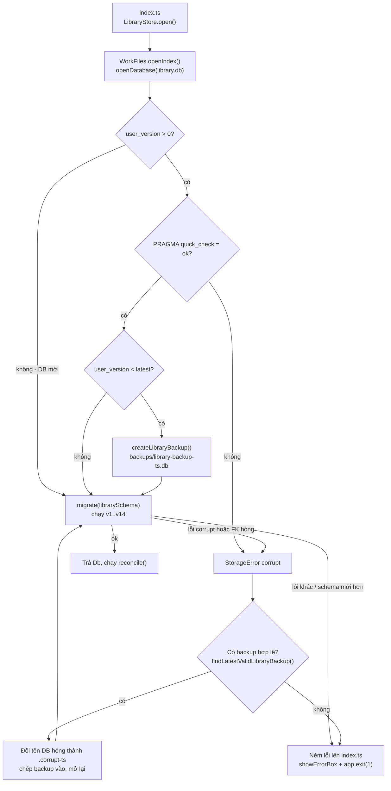
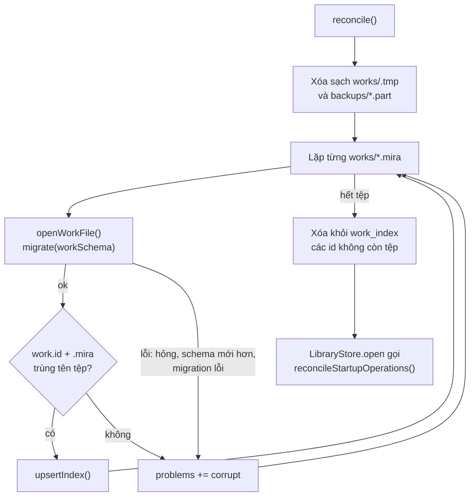
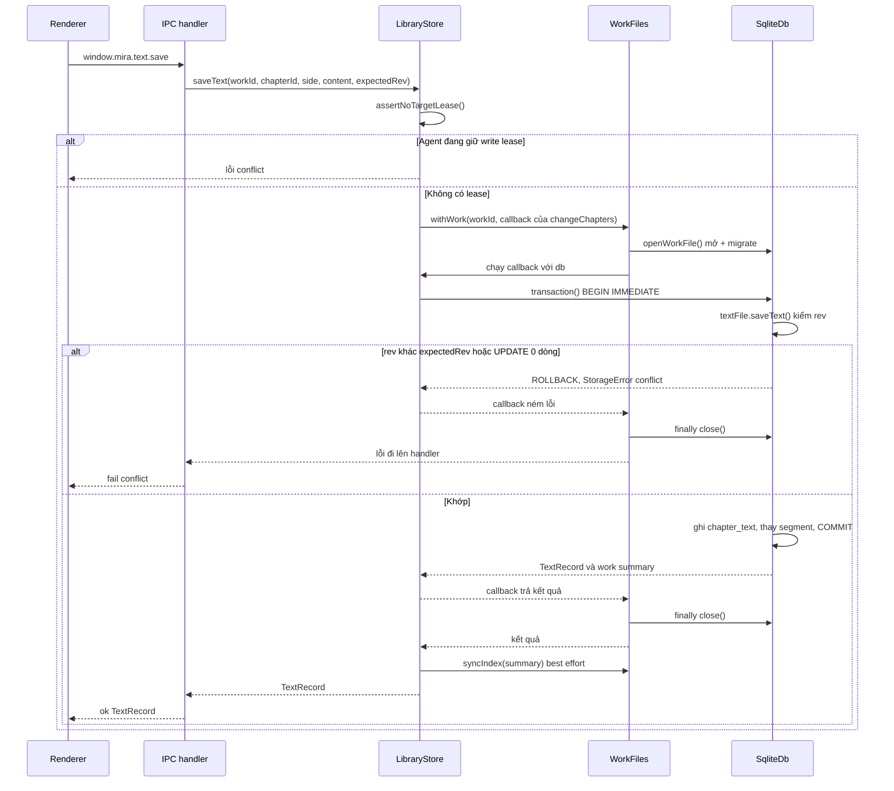
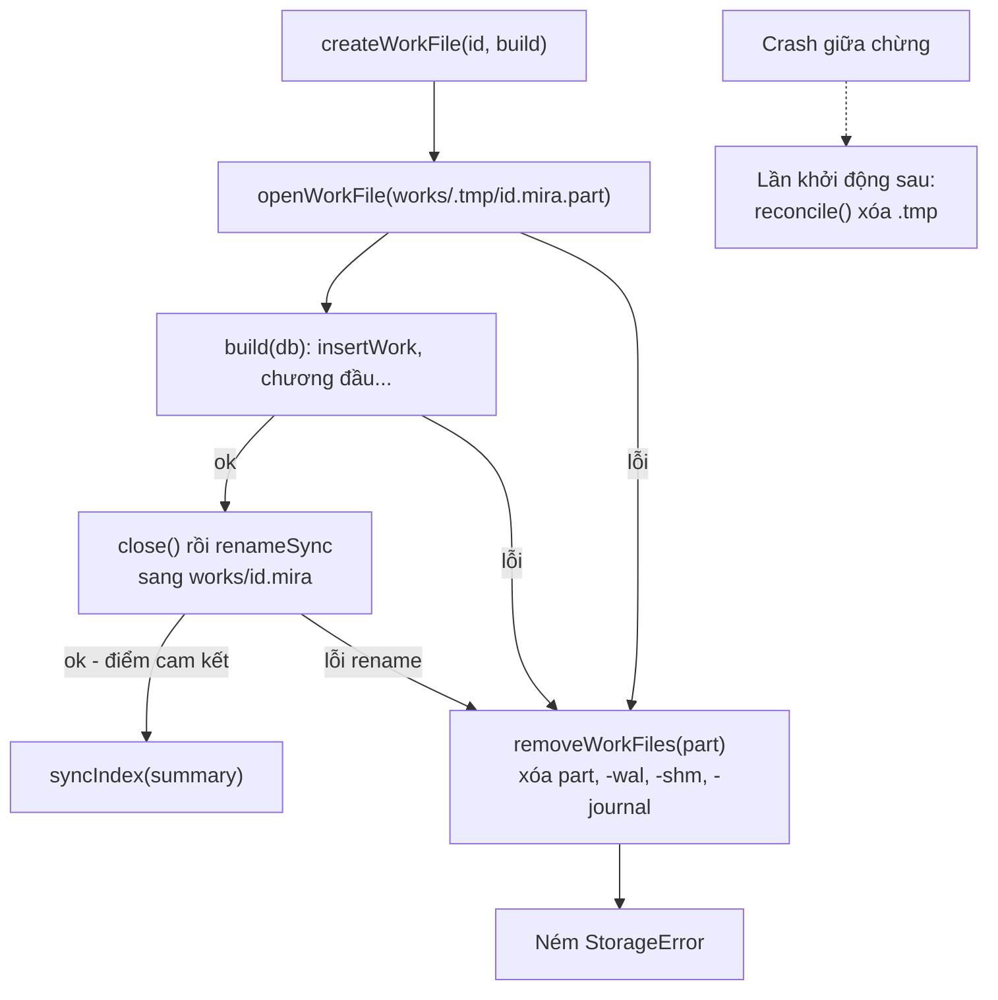
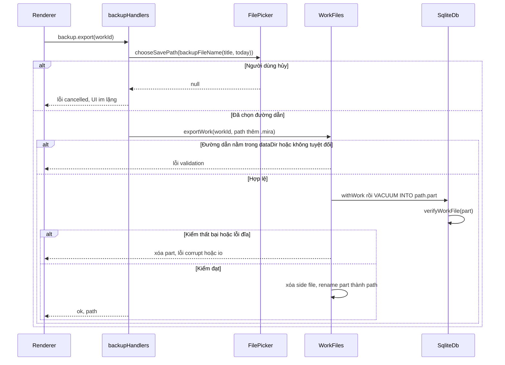
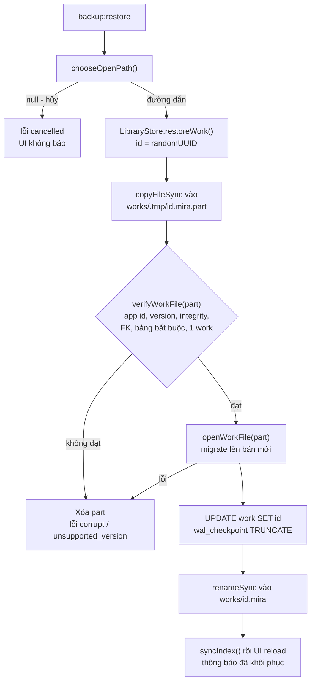
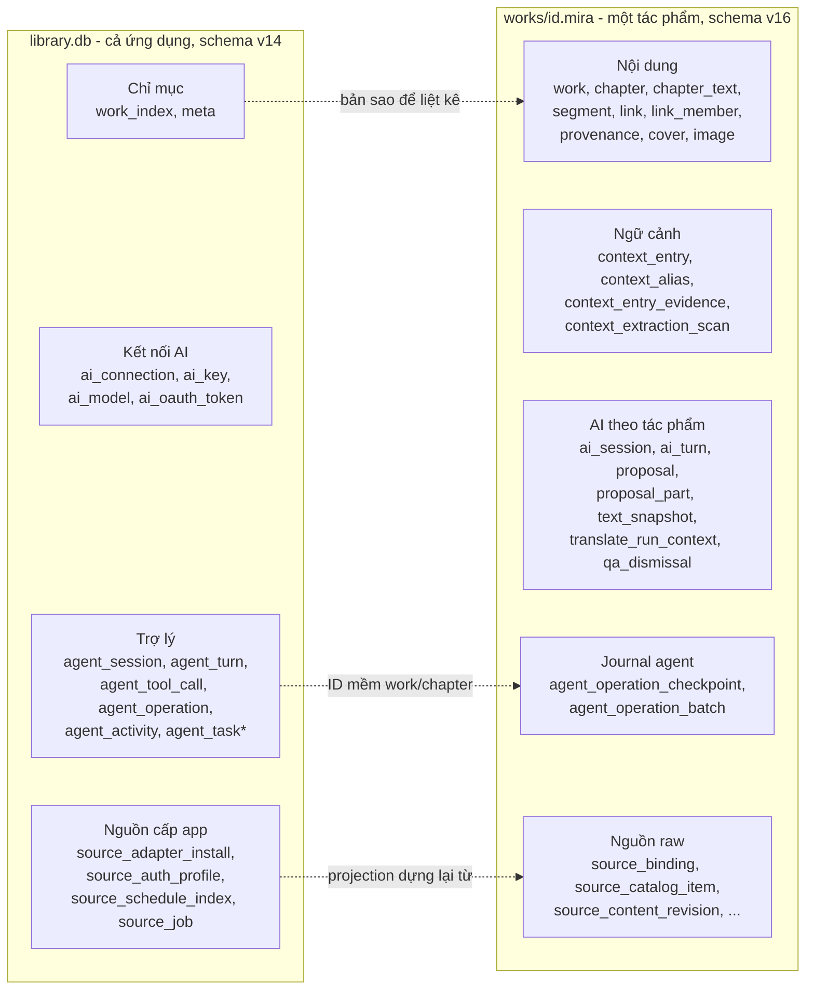
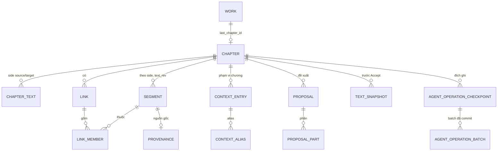
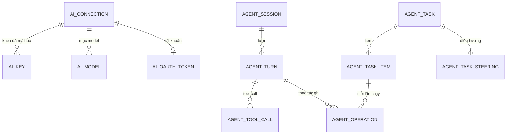
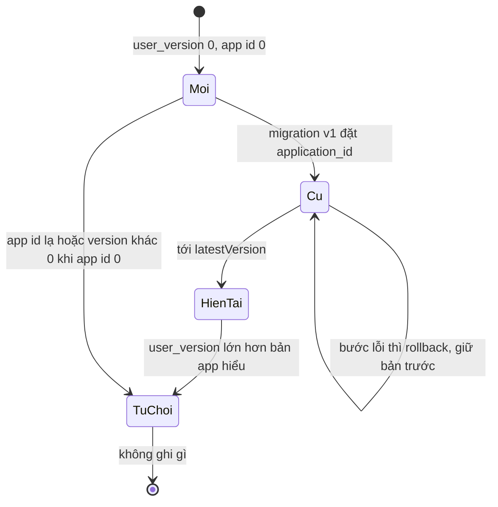

# Lưu trữ: SQLite, tệp tác phẩm và sao lưu

> **Một câu:** vùng này giữ mọi dữ liệu bền của Mira trong SQLite (`library.db` cho cả ứng dụng, một
> tệp `.mira` cho mỗi tác phẩm), lo migration, ghi nguyên tử, phục hồi sau crash và sao lưu/khôi phục.
> Cập nhật: 2026-10-15 · Nguồn: đọc code tại commit db2455f.

## 1. Vì sao vùng này tồn tại

Mira là app offline. Truyện, bản dịch, ngữ cảnh, lịch sử Trợ lý và cài đặt AI phải sống sót qua crash,
mất điện và nâng phiên bản app. Vùng này là tầng thấp nhất của main process. Nó chỉ biết SQL, tệp và
đường dẫn; không biết nghiệp vụ dịch hay AI. Người gọi chính là `LibraryStore`
([library.ts](../../src/main/services/library/library.ts)): nó dựng `WorkFiles`, mở transaction và trả
`library.db` cho các service khác qua `appDb`. Các service AI, agent, sources dùng hàm SQL ở đây
thông qua `library.withWork(...)` hoặc `library.appDb`. Vùng này chỉ gọi `node:sqlite` và `node:fs`.
Riêng hai hộp thoại chọn tệp sao lưu nằm ở tầng Electron và được tiêm vào handler.

## 2. Bản đồ file

Đường dẫn gốc: `src/main/infra/storage/` (viết tắt `storage/`).

**Lõi engine và vòng đời tệp**

| File | Làm gì | Symbol chính |
| --- | --- | --- |
| [sqlite.ts](../../src/main/infra/storage/sqlite.ts) | Module duy nhất chạm `node:sqlite`. Đặt PRAGMA, bọc `transaction()` (BEGIN IMMEDIATE + savepoint) | `openDatabase`, `Db`, `SqliteDb.transaction` |
| [migrate.ts](../../src/main/infra/storage/migrate.ts) | Chạy migration theo `PRAGMA user_version`, mỗi bước một transaction; nhận diện tệp bằng `application_id` | `migrate`, `readPragmas`, `latestVersion`, `SchemaSpec` |
| [errors.ts](../../src/main/infra/storage/errors.ts) | Lỗi có mã cho UI; đổi mã SQLite 11/26 thành `corrupt`, còn lại `io` | `StorageError`, `toStorageError` |
| [workFiles.ts](../../src/main/infra/storage/workFiles.ts) | Bố cục thư mục, mở/khôi phục `library.db`, mở tệp tác phẩm, tạo/nhập/xuất nguyên tử, đối soát chỉ mục | `WorkFiles`, `openIndex`, `reconcile`, `createWorkFile`, `importWorkFile`, `withWork` |
| [workFile.ts](../../src/main/infra/storage/workFile.ts) | Thao tác trên một tệp `.mira`: mở + migrate, dòng `work`, bìa, ảnh | `openWorkFile`, `readWork`, `assertWorkId`, `writeCover`, `insertImage` |

**Schema**

| File | Làm gì | Symbol chính |
| --- | --- | --- |
| [librarySchema.ts](../../src/main/infra/storage/librarySchema.ts) | Schema `library.db`, hiện v14, `application_id` = "MIRL" | `librarySchema`, `LIBRARY_APPLICATION_ID` |
| [workSchema.ts](../../src/main/infra/storage/workSchema.ts) | Schema tệp `.mira`, hiện v16, `application_id` = "MIRA" | `workSchema`, `WORK_APPLICATION_ID`, `migrateChatActions`, `segmentBareSources` |
| [`__fixtures__/`](../../src/main/infra/storage/__fixtures__) + [schemaSnapshot.test.ts](../../src/main/infra/storage/schemaSnapshot.test.ts) | Ảnh chụp DDL của từng phiên bản; test hỏng nếu ai sửa migration đã phát hành | `MIRA_UPDATE_SNAPSHOTS` |

**Sao lưu**

| File | Làm gì | Symbol chính |
| --- | --- | --- |
| [backupFile.ts](../../src/main/infra/storage/backupFile.ts) | Backup một tác phẩm bằng `VACUUM INTO`; kiểm một tệp `.mira` lạ trước khi tin | `exportToFile`, `verifyWorkFile` |
| [libraryBackup.ts](../../src/main/infra/storage/libraryBackup.ts) | Backup `library.db` trước migration; tìm bản backup hợp lệ mới nhất khi DB hỏng | `createLibraryBackup`, `verifyLibraryDatabase`, `findLatestValidLibraryBackup` |
| [backupName.ts](../../src/main/infra/storage/backupName.ts) | Tên tệp gợi ý `<tên> — yyyy-mm-dd.mira`, an toàn trên Windows | `backupFileName` |
| [ipc/handlers/backup.ts](../../src/main/ipc/handlers/backup.ts) | Kênh `backup:export`, `backup:restore`; mở hộp thoại ở main | `backupHandlers` |
| [shared/contracts/backup.ts](../../src/shared/contracts/backup.ts) | Renderer chỉ gửi `workId` | `backupExportSchema`, `BackupExported` |

**Repository trong tệp `.mira`** (mọi hàm nhận `db: Db` đã mở; người gọi mở transaction)

| File | Làm gì | Symbol chính |
| --- | --- | --- |
| [chapterFile.ts](../../src/main/infra/storage/chapterFile.ts) | Chương, thứ tự `position` liền 0..n-1 | `listChapters`, `insertChapterAt`, `moveChapter`, `deleteChapter` |
| [textFile.ts](../../src/main/infra/storage/textFile.ts) | Văn bản một bên + segment, kiểm `expectedRev` | `readText`, `saveText`, `readSideContents` |
| [textRules.ts](../../src/main/infra/storage/textRules.ts) | Kiểm offset segment (không cắt cặp surrogate) | `checkText` |
| [linkFile.ts](../../src/main/infra/storage/linkFile.ts), [sentenceRows.ts](../../src/main/infra/storage/sentenceRows.ts) | Liên kết n:m giữa segment hai bên, nguồn gốc theo câu | `createLink`, `setProvenance`, `saveRow` |
| [contextEntries.ts](../../src/main/infra/storage/contextEntries.ts), [addressingEntries.ts](../../src/main/infra/storage/addressingEntries.ts) | Glossary, nhân vật, cặp xưng hô, bằng chứng trích xuất | `getEffectiveGlossary`, `saveExtraction`, `setDyad`, `getEffectiveDyadsForChapter` |
| [aiSessions.ts](../../src/main/infra/storage/aiSessions.ts), [aiProposals.ts](../../src/main/infra/storage/aiProposals.ts) | Phiên chat theo tác phẩm, đề xuất, ảnh chụp văn bản trước khi Accept | `startAiTurn`, `interruptAiTurns`, `createProposal`, `insertTextSnapshot` |
| [translateRunContext.ts](../../src/main/infra/storage/translateRunContext.ts) | Ngữ cảnh đã đóng băng của một lần dịch chương | `createRunContext`, `pruneOrphanRunContexts` |
| [agentOperationJournal.ts](../../src/main/infra/storage/agentOperationJournal.ts) | Journal/checkpoint cho thao tác ghi của agent, Undo | `prepareAgentOperation`, `applyAgentTranslationBatch`, `undoAgentOperation` |
| [sourceStorage.ts](../../src/main/infra/storage/sourceStorage.ts) | Binding nguồn raw, catalog, revision nội dung | `insertSourceBinding`, `insertContentRevision` |
| [qaDismissals.ts](../../src/main/infra/storage/qaDismissals.ts) | "Bỏ qua cảnh báo" theo đoạn | `addDismissal`, `listDismissalKeys` |
| [cover.ts](../../src/main/infra/storage/cover.ts), [image.ts](../../src/main/infra/storage/image.ts) | Giải mã/kiểm data URL; MIME lấy từ byte, không từ tên tệp | `decodeCover`, `decodeImage` |

**Repository trong `library.db`**

| File | Làm gì | Symbol chính |
| --- | --- | --- |
| [connections.ts](../../src/main/infra/storage/connections.ts), [oauthTokens.ts](../../src/main/infra/storage/oauthTokens.ts) | Kết nối AI, khóa (đã mã hóa), model, token đăng nhập | `listConnections`, `insertConnection`, `writeToken` |
| [secretStore.ts](../../src/main/infra/storage/secretStore.ts) | Mã hóa khóa qua `safeStorage` được tiêm; không có kho khóa thì từ chối lưu | `SecretStore.seal`, `SecretStore.open` |
| [aiPreferences.ts](../../src/main/infra/storage/aiPreferences.ts) | Model chính/dự phòng trong bảng `meta` (JSON theo key) | `readAiPreferences`, `pruneAiPreferences` |
| [agentRepository.ts](../../src/main/infra/storage/agentRepository.ts), [agentTaskRepository.ts](../../src/main/infra/storage/agentTaskRepository.ts) | Session/turn/tool call/operation/task của Trợ lý | `AgentRepository`, `AgentTaskRepository` |

**Ngoài DB và công cụ**

| File | Làm gì | Symbol chính |
| --- | --- | --- |
| [aiCallLog.ts](../../src/main/infra/storage/aiCallLog.ts) | Log JSONL các lượt dịch có truyền `log` và trích ngữ cảnh qua `ContextExtractionService`, theo tác phẩm, giữ 30 ngày; không bao phủ chat, probe hay từng HTTP attempt | `configureAiCallLog`, `appendAiCall`, `pruneAiCallLogs` |
| [scripts/smoke-sqlite.mjs](../../scripts/smoke-sqlite.mjs) | Chạy trong Electron thật: WAL, Unicode, `VACUUM INTO`, `backup()` còn chạy sau khi nâng Electron | `pnpm smoke:sqlite` |

## 3. Luồng chính

### 3.1 Khởi động: mở `library.db`

Kích hoạt bởi `app.whenReady` → `LibraryStore.open` → `WorkFiles.open`. Kết quả: một kết nối
`library.db` đã ở schema mới nhất, hoặc app hiện hộp lỗi và thoát.



Đọc sơ đồ:
- DB mới (`user_version = 0`, `application_id = 0`) đi thẳng vào `migrate`; bước v1 tự đặt `application_id`.
- Chỉ DB đã có dữ liệu và cần nâng mới được backup trước (`openAndMigrateIndex`). Backup ghi vào `.part`,
  kiểm `integrity_check`, `foreign_key_check`, bảng bắt buộc, rồi mới đổi tên (`createLibraryBackup`).
- `migrate` từ chối tệp có `application_id` lạ, hoặc `user_version` lớn hơn bản app hiểu
  (`unsupported_version`). Không có gì bị ghi trong hai nhánh này.
- Nhánh khôi phục chỉ bắt lỗi mã `corrupt`. Nó tìm trong `backups/` trước rồi tới `dataDir`, xếp theo
  `mtime`, lấy bản đầu tiên qua được `verifyLibraryDatabase`. Lần mở lại sau khôi phục không được bắt lỗi
  nữa: hỏng lần hai thì app dừng.
- Không có backup thì từ chối khởi động, không tạo DB trống. Lý do: `library.db` giữ khóa API, phiên
  Trợ lý, task (commit `eb2fb8a`).

### 3.2 Khởi động: đối soát `works/` và migrate từng tác phẩm

Kích hoạt ngay sau 3.1 (`WorkFiles.reconcile`). Kết quả: `work_index` khớp với các tệp `.mira` trên
đĩa; tệp không mở được nằm trong `problems` thay vì làm hỏng cả danh sách.



Đọc sơ đồ:
- Mọi tác phẩm được migrate **lúc khởi động**, không phải lúc mở lần đầu. Một bước hỏng thì rollback,
  tệp ở nguyên phiên bản cũ, và tác phẩm hiện là "không mở được" (`WorkProblem` trong `list()`).
- Tệp `.mira` **không** được backup trước migration. `library.db` thì có (xem mục 7).
- `.tmp` luôn bị xóa, vì mọi thứ trong đó là lần tạo/khôi phục dở dang, kể cả `-wal`, `-shm`.
- Sau đó `reconcileStartupOperations` ([operationReconciler.ts](../../src/main/services/agent/operationReconciler.ts))
  đối chiếu operation agent đang treo với journal trong tệp tác phẩm. `createServices` gọi
  `interruptAiTurns` cho các lượt chat đang chạy dở. Chi tiết ở [06](06-tro-ly-agent.md).

### 3.3 Một lần lưu văn bản vào tác phẩm

Kích hoạt khi lưu văn bản chương (`text:save`). Riêng đường này, `LibraryStore.changeChapters` cung cấp
callback mở transaction rồi làm mới chỉ mục sau commit. Một lần đọc thông thường không đi qua các bước ghi này.



Đọc sơ đồ:
- `WorkFiles.withWork` chỉ mở **một kết nối mới cho mỗi lời gọi**, chạy callback rồi đóng; nó không tự
  tạo transaction hay cập nhật chỉ mục. Trong `text:save`, `LibraryStore.changeChapters` sở hữu hai bước đó.
  Không có pool. `withWorkAsync` giữ kết nối qua các `await`, nhưng `transaction()` vẫn phải đồng bộ
  (nó ném lỗi nếu callback trả Promise).
- Ba lớp chống ghi đè: write lease trong bộ nhớ (`LibraryStore.writeLeases`, xem [06](06-tro-ly-agent.md));
  `BEGIN IMMEDIATE` + `busy_timeout = 5000` để chỉ một writer; optimistic revision trong `saveText`
  (`WHERE rev = ?`, đếm `changes`).
- Lồng `transaction()` dùng `SAVEPOINT mira_sp_<n>`, nên một bước con lỗi có thể rollback riêng.
- `syncIndex` nuốt lỗi: tệp tác phẩm đã commit là nguồn sự thật; chỉ mục lệch sẽ được sửa ở 3.2.
- Thao tác chạm cả `library.db` và `.mira` (agent) không có transaction chung. Journal trong `.mira`
  là bằng chứng; `library.db` chỉ cập nhật sau đó ([data-and-safety.md](../modules/proposals/data-and-safety.md)).

### 3.4 Tạo tệp tác phẩm nguyên tử và phục hồi sau crash

Kích hoạt bởi tạo tác phẩm mới (`LibraryStore.create` → `createWorkFile`) hoặc nhập tác phẩm. Kết quả:
tệp `works/<id>.mira` hoặc hoàn chỉnh, hoặc không tồn tại.



Đọc sơ đồ:
- Rename là điểm cam kết. Đích luôn là UUID mới nên rename không ghi đè gì.
- Crash trước rename: chỉ còn rác trong `.tmp`, bị xóa ở 3.2. Crash sau rename: tệp đã đủ, 3.2 nạp nó
  vào chỉ mục.
- Ghi bình thường vào tệp đã tồn tại dựa vào WAL + `synchronous = FULL`: transaction đã COMMIT thì còn
  sau mất điện; chưa COMMIT thì mất trọn. Test kill tiến trình nằm ở
  [services/library/crash*.ts](../../src/main/services/library/crash.test.ts) (xem [07](07-thu-vien-nguon-xuat.md)).

### 3.5 Sao lưu một tác phẩm

Kích hoạt khi người dùng bấm Sao lưu trong thư viện (`backupWork` ở
[backup.ts của renderer](../../src/renderer/src/modules/library/store/backup.ts)). Kết quả: một tệp
`.mira` độc lập ở nơi người dùng chọn.



Đọc sơ đồ:
- Đường dẫn chỉ đến từ hộp thoại của main (`registerIpc.ts`), không bao giờ từ renderer.
- Chặn đích nằm trong thư mục dữ liệu, để backup không thể đè lên tệp tác phẩm đang sống.
- `VACUUM INTO` đọc một snapshot nhất quán từ kết nối đang mở; tác phẩm không bị khóa hay đổi.
- Renderer coi `cancelled` là không có gì xảy ra; lỗi khác thành thông báo qua `describeBackupError`.

### 3.6 Khôi phục một tác phẩm từ tệp `.mira`

Kích hoạt khi người dùng chọn "Mở tác phẩm có sẵn" (`libraryStore.restore` →
`backup:restore`). Kết quả: luôn là **một tác phẩm mới** với UUID mới; tệp của người dùng không bị mở tại chỗ.



Đọc sơ đồ:
- Kiểm `application_id` trước mọi câu lệnh khác, để tệp không phải của Mira bị từ chối sớm.
- Migration chạy trên **bản sao**, không chạm tệp gốc. Backup cũ được nâng cấp như một tác phẩm cũ.
- Khôi phục cùng một tệp hai lần cho ra hai tác phẩm. Không có nhánh "ghi đè tác phẩm hiện có".
- Dữ liệu cấp ứng dụng không đi theo: khóa API, phiên Trợ lý, cài đặt nguồn nằm trong `library.db`.
  Binding nguồn trong `.mira` chỉ mang `authProfileId`
  ([sources/system-design.md](../modules/sources/system-design.md)).

## 4. Dữ liệu và trạng thái

### 4.1 Trên đĩa

```text
<dataDir>/                      app.getPath('userData'), hoặc MIRA_DATA_DIR
  library.db (+ -wal, -shm)     dữ liệu cấp ứng dụng + chỉ mục tác phẩm
  library.db.corrupt-<ts>       DB hỏng đã bị thay bằng backup (không tự xóa)
  backups/library-backup-<ts>.db  backup trước mỗi lần migrate library.db (không tự xóa)
  works/<uuid>.mira             một SQLite mỗi tác phẩm, nguồn sự thật
  works/.tmp/*.part             tạo/khôi phục dở dang, xóa mỗi lần khởi động
  logs/<workId>.jsonl           log gọi model, cắt bớt bản ghi > 30 ngày khi khởi động
```

| Thứ | Ở đâu | Ghi chú |
| --- | --- | --- |
| Raw và bản dịch chương | `chapter_text` trong `.mira` | Một dòng mỗi `(chapter_id, side)`, có `rev` và `size` |
| Raw tải từ nguồn | `source_content_revision` trong `.mira`, rồi chép vào `chapter_text` | Xem [07](07-thu-vien-nguon-xuat.md) |
| Ảnh bìa | bảng `cover` (một dòng, JPEG blob) trong `.mira` | Renderer thu nhỏ trước; main kiểm byte JPEG |
| Ảnh dán vào bản dịch | bảng `image` (blob) trong `.mira` | Markdown trỏ bằng `![[id]]`; không có thư mục đính kèm |
| Khóa API, token OAuth | `ai_key.secret`, `ai_oauth_token` trong `library.db` | Bản mã của `safeStorage`; không bao giờ có trong `.mira` |
| Log gọi model | `logs/<workId>.jsonl` | Ngoài tệp tác phẩm, nên backup không kéo theo |
| Bản xuất TXT/MD/DOCX/PDF | nơi người dùng chọn | Do `exportService` ghi, xem [07](07-thu-vien-nguon-xuat.md) |
| Backup tác phẩm | nơi người dùng chọn, ngoài `dataDir` | Chính là một tệp `.mira` hợp lệ |

### 4.2 Tổng các store theo domain



Repository tương ứng: `connections.ts`, `oauthTokens.ts`, `aiPreferences.ts` (L2); `sourceStorage.ts`
và `sources/authProfileService.ts` (L3, W5); `agentRepository.ts`, `agentTaskRepository.ts` (L4);
`chapterFile.ts`, `textFile.ts`, `linkFile.ts`, `sentenceRows.ts`, `workFile.ts` (W1); `contextEntries.ts`,
`addressingEntries.ts` (W2, nhân vật và cặp xưng hô cũng nằm trong `context_entry`); `aiSessions.ts`,
`aiProposals.ts`, `translateRunContext.ts`, `qaDismissals.ts` (W3); `agentOperationJournal.ts` (W4).

Không có khóa ngoại giữa hai loại tệp. Tham chiếu chéo là ID bền và được kiểm lúc chạy.

### 4.3 Lõi nội dung của tệp `.mira`



`cover` và `image` không có khóa ngoại. Bất biến chính: `chapter.position` là hoán vị liền 0..n-1
(`chapterFile.ts`); `chapter_text.size` luôn bằng độ dài `content` trong cùng transaction;
`segment.text_rev` bằng `chapter_text.rev` của lần lưu tạo ra nó (`textFile.saveText`).

### 4.4 Phần chính của `library.db`



`meta` là bảng key/value; `aiPreferences.ts` lưu `ai.main`, `ai.fallbacks` dưới dạng JSON và coi giá trị
trỏ tới model đã xóa là "không có".

### 4.5 Phiên bản schema của một tệp



Migration có `foreignKeysOff: true` (library v11, v12) tắt khóa ngoại quanh bước dựng lại bảng, chạy
`foreign_key_check` trước COMMIT. Work v8 và v10 dựng lại `ai_turn` theo cách khác: cất
`proposal.turn_id` vào bảng tạm rồi ghi lại.

## 5. Tại sao code viết như vậy

- **Một tệp SQLite mỗi tác phẩm + `library.db`.** Backup/restore một tác phẩm là chép một tệp; một tệp
  hỏng không kéo cả thư viện. Phương án một DB chung bị loại vì phải xuất từng phần khi backup. Chưa đo
  với hàng trăm tác phẩm. **[docs]** ADR-003 (handbook cũ, commit `501be2a`,
  `docs/handbook/decisions/0003-technology-stack.md`), D2 của
  [m0-storage-foundation](../../openspec/changes/archive/2026-09-29-m0-storage-foundation/design.md).
- **`node:sqlite` đồng bộ, chạy ngay trong main process.** Không thêm dependency native phải ký và
  rebuild theo ABI Electron; ghi một chương ~50k ký tự khoảng 1 ms; 100/100 lần kill khi ghi không hỏng.
  Đổi lại, mọi truy vấn chặn main process; thiết kế ghi rõ có thể chuyển sang `utilityProcess` sau.
  `better-sqlite3` là đường lùi. **[docs]** ADR-003, D1 và mục Risks của m0-storage-foundation.
- **Một adapter `sqlite.ts` duy nhất.** `node:sqlite` từng ở mức release candidate; API đổi thì chỉ sửa
  một chỗ. Smoke test chạy trong Electron sau mỗi lần nâng. **[code]** comment đầu `sqlite.ts`; **[docs]** ADR-003.
- **`transaction()` tự viết, `BEGIN IMMEDIATE`, savepoint, bắt buộc đồng bộ.** `node:sqlite` không có
  sẵn. `IMMEDIATE` lấy khóa ghi ngay từ đầu, tránh nâng khóa giữa chừng gây `SQLITE_BUSY`. Callback async
  sẽ COMMIT trước khi việc thật xong, nên bị cấm. Rollback không che lỗi gốc. **[code]**, **[docs]** mục
  Hệ quả của ADR-003.
- **WAL + `synchronous = FULL` + `busy_timeout = 5000`.** Bền khi mất điện; đọc không chặn ghi; antivirus
  hoặc OneDrive khóa tệp tạm thời thì chờ thay vì lỗi ngay. **[docs]** D3 và Risks của m0-storage-foundation.
- **`application_id` + `user_version` là hợp đồng định dạng.** Nhận ra tệp Mira khi restore; từ chối
  không ghi khi tệp mới hơn. Hằng số không được đổi khi đã có dữ liệu người dùng. **[code]**
  `workSchema.ts`, `migrate.ts`; **[docs]** D3.
- **Migration đã phát hành bị đóng băng.** Mỗi phiên bản có fixture DDL; sửa migration cũ làm test hỏng.
  Muốn đổi thì thêm bước mới. **[code]** `schemaSnapshot.test.ts`.
- **Tạo/nhập trong `.tmp` rồi rename.** Rename là điểm cam kết duy nhất; không có trạng thái "nửa tác
  phẩm". **[commit]** `ca115d9`; **[docs]** D5.
- **Backup = `VACUUM INTO` ra một `.mira` hợp lệ.** Không có định dạng thứ hai phải bảo trì; backup mở được
  như tác phẩm thường. Kiểm trên `.part` trước khi đổi tên. **[code]** comment đầu `backupFile.ts`; **[docs]** D5.
- **Khôi phục luôn tạo tác phẩm mới, trên bản sao.** Không mở tệp người dùng tại chỗ; không ghi đè
  tác phẩm đang có. **[code]** `importWorkFile`; **[docs]** D5.
- **`library.db` không còn là cache.** Bản đầu coi nó dựng lại được từ `works/`, DB hỏng thì tạo mới.
  Từ khi nó giữ kết nối AI, phiên và task, DB hỏng được thay bằng backup và app từ chối chạy nếu không có
  backup. **[commit]** `eb2fb8a` (diff `openIndex`); **[code]** comment đầu `libraryBackup.ts`.
- **Khóa API ở `library.db`, không ở `.mira`.** Backup hay gửi tệp tác phẩm cho người khác không làm lộ
  khóa; khai báo lại cho từng truyện là vô lý. Không có kho khóa thì từ chối lưu, không ghi plaintext.
  **[code]** comment `librarySchema.ts` (v4), `secretStore.ts`.
- **Ảnh và bìa là blob trong `.mira`.** Sao lưu một tệp là đủ. **[code]** comment v3, v5 trong `workSchema.ts`.
- **`chapter_text.size` và index phủ.** Danh sách chương cần biết "bên này có chữ chưa" mà đọc `rev` cũng
  phải đi qua overflow page của văn bản dài (đo ~400 ms với 5.000 chương). **[code]** comment v4 `workSchema.ts`.
- **Hai DB không nguyên tử với nhau.** Chỉ mục: ghi tệp tác phẩm trước, `syncIndex` best effort, đối soát
  khi khởi động. Agent: journal trong `.mira` commit cùng batch nội dung; `library.db` cập nhật sau theo
  bằng chứng đó. **[docs]** D2, [data-and-safety.md](../modules/proposals/data-and-safety.md).
- **Log gọi model ra JSONL ngoài DB.** Để làm prompt bằng dữ liệu thật mà không làm phình tệp tác phẩm
  hay để backup mang theo. Ghi lỗi thì bỏ qua, không làm hỏng lần dịch. **[code]** `aiCallLog.ts`;
  **[commit]** `2144118`.
- **Mỗi lời gọi mở một kết nối mới.** Không có pool hay cache kết nối. Có thể để mỗi lần mở đều qua
  `migrate` và PRAGMA, và để không giữ handle khóa tệp trên Windows. **[suy luận]**: không thấy tài liệu
  nêu lý do.

## 6. Đọc code bắt đầu từ đâu

1. [sqlite.ts](../../src/main/infra/storage/sqlite.ts): PRAGMA và `transaction()`; mọi thứ khác dựa vào đây.
2. [migrate.ts](../../src/main/infra/storage/migrate.ts): quy tắc từ chối, nâng cấp và rollback từng bước.
3. [workFiles.ts](../../src/main/infra/storage/workFiles.ts): bố cục thư mục, khởi động, tạo/nhập/xuất, đối soát.
4. [backupFile.ts](../../src/main/infra/storage/backupFile.ts) rồi [libraryBackup.ts](../../src/main/infra/storage/libraryBackup.ts): hai kiểu backup và các phép kiểm.
5. [textFile.ts](../../src/main/infra/storage/textFile.ts): repository mẫu, có revision và transaction do người gọi mở.

## 7. Điểm đáng ngờ / nợ kỹ thuật

1. **Comment nói `library.db` là cache, code nói ngược lại.** Comment class `WorkFiles` ("The index is a
   cache... losing it loses nothing") và comment đầu `librarySchema.ts` vẫn theo thiết kế ban đầu. Từ
   `eb2fb8a`, `library.db` chứa khóa, phiên, task và app từ chối khởi động nếu nó hỏng mà không có backup.
   Chỉ bảng `work_index` còn đúng là cache.
2. **Tệp `.mira` không được backup trước migration, `library.db` thì có.** `reconcile` migrate mọi tác phẩm
   lúc khởi động. Một migration dữ liệu sai (như `segmentBareSources` v16) sẽ ghi vào tệp duy nhất của
   người dùng mà không có bản lùi. Nghiên cứu Hermes đã nêu điều này
   ([hermes-runtime-research.md](../modules/ai-connections/hermes-runtime-research.md), mục 5b). Tệp tác
   phẩm cũng không qua `quick_check` khi mở, chỉ khi xuất/nhập.
3. **`backups/` và `library.db.corrupt-*` không bao giờ được dọn.** Mỗi lần nâng schema `library.db` thêm
   một bản; không có code xóa bản cũ (`grep backups src/main` chỉ thấy `workFiles.ts`).
4. **Ba hàm xóa tệp SQLite trùng nhau, một tên mang hai nghĩa.** `removeSideFiles` trong `backupFile.ts`
   xóa cả tệp chính; `removeSideFiles` trong `libraryBackup.ts` chỉ xóa `-wal/-shm/-journal`; tệp chính
   là `deleteDatabaseFile`. `WorkFiles.removeWorkFiles` là bản thứ ba.
5. **Schema chết.** Bảng `source_job` (library v8) không được đọc hay ghi ở đâu trong `src/main`.
   Cột `work.cover_path` được giữ với lý do "SQLite không bỏ cột nếu không dựng lại bảng", nhưng work v12
   đã dựng lại bảng `work` và vẫn chép cột này.
6. **SQL nằm ngoài `infra/storage`.** Khoảng 37 lời gọi `prepare(` trong `services/` và `sources/`
   (`agentLegacyAdapter.ts`, `proposalService.ts` với `proposal_accept_command`, `authProfileService.ts`
   với `source_adapter_install`/`source_auth_profile`...). Kiến trúc cũ ghi "phần đọc ghi SQL ở
   `infra/storage/`" (handbook `501be2a`); [ARCHITECTURE.md](../../ARCHITECTURE.md) hiện chỉ nói `infra`
   là tầng thấp.
7. **Migration v16 phụ thuộc code sống.** `segmentBareSources` gọi `shared/segmentation/segmenter`. Fixture
   chỉ đóng băng DDL, nên đổi bộ tách câu sẽ âm thầm đổi kết quả của migration cũ trên máy chưa nâng cấp.
8. **Không có khóa một phiên bản app.** Không thấy `requestSingleInstanceLock` trong `src/main`. Hai
   cửa sổ Mira cùng `dataDir` thì `reconcile` của bản sau sẽ xóa `.tmp/*.part` mà bản kia đang ghi.
   **[suy luận]** chưa thử.

## 8. Liên kết

- Tài liệu module: [data-lifecycle.md](../modules/context/data-lifecycle.md) (mô hình đề xuất, chưa phải
  migration), [proposals/data-and-safety.md](../modules/proposals/data-and-safety.md),
  [proposals/sessions-and-jobs.md](../modules/proposals/sessions-and-jobs.md),
  [sources/system-design.md](../modules/sources/system-design.md) mục 7,
  [ai-connections/hermes-runtime-research.md](../modules/ai-connections/hermes-runtime-research.md) mục 5b.
- Thiết kế gốc: [m0-storage-foundation/design.md](../../openspec/changes/archive/2026-09-29-m0-storage-foundation/design.md);
  ADR-003 ở commit `501be2a` (`git show 501be2a:docs/handbook/decisions/0003-technology-stack.md`).
- Code-tour: [01](01-process-va-ipc.md) (khởi động, `createServices`, cơ chế IPC `Result`),
  [03](03-ket-noi-ai.md) (dùng `connections.ts`, `secretStore.ts`), [04](04-dich-chuong.md) (ghi
  `chapter_text`, `translate_run_context`, `aiCallLog`), [05](05-ngu-canh-dich.md) (`contextEntries.ts`,
  `addressingEntries.ts`), [06](06-tro-ly-agent.md) (write lease, journal, reconcile operation),
  [07](07-thu-vien-nguon-xuat.md) (`LibraryStore`, test crash, nguồn, xuất tệp),
  [09](09-do-luong-va-cong-cu.md) (`scripts/check.mjs`).
