# Dịch chương

> **Một câu:** vùng này biến bản gốc của một chương thành bản dịch AI: chia đoạn, lập lô, lắp ngữ cảnh,
> dựng prompt, gọi model, đọc câu trả lời khoan dung, khoanh đoạn bị chặn, rồi lưu thành hồ sơ đề xuất
> (hoặc ghi thẳng, với agent).
> Cập nhật: 2026-10-15 · Nguồn: đọc code tại commit db2455f.

## 1. Vì sao vùng này tồn tại

Model trả lời không ổn định: lúc gộp hay tách mục, lúc chép thẻ prompt vào JSON, lúc bị bộ lọc nội dung
chặn cả lô vì vài câu, lúc bị cắt giữa chừng vì hết token đầu ra. Một chương dài cũng không gửi được một
lần, và người dịch cần thấy tiến độ, bấm Hủy, giữ phần đã xong. Vùng này bọc lời gọi model trong một
quy trình tất định: chia lô theo ngân sách token, đánh ID tạm, đọc khoan dung, đối soát ID, hỏi lại đúng
phần thiếu, chia đôi phần bị chặn, đếm mọi lời gọi vào một ngân sách chung.

Vị trí trong bức tranh lớn: renderer (hộp thoại Dịch, file [08](08-giao-dien-renderer.md)) hoặc agent
(task dịch, file [06](06-tro-ly-agent.md)) gọi vào; vùng này đọc chương từ thư viện
([02](02-luu-tru.md)), đọc glossary/xưng hô/nhân vật ([05](05-ngu-canh-dich.md)), gọi model qua
`ConnectionService.translator()` ([03](03-ket-noi-ai.md)), rồi ghi hồ sơ đề xuất (duyệt ở
[06](06-tro-ly-agent.md)).

## 2. Bản đồ file

**Điều phối một lượt dịch (main)**

| File | Làm gì | Symbol chính |
| --- | --- | --- |
| [paragraphTranslation.ts](../../src/main/services/ai/paragraphTranslation.ts) | Đường của hộp thoại Dịch và Lab: plan → runBatch → finalize, ghi hồ sơ đề xuất | `ParagraphTranslator`, `paragraphUnits`, `budgetFor`, `finalize` |
| [chapterTranslationRunner.ts](../../src/main/services/agent/chapterTranslationRunner.ts) | Đường của agent/task: dịch theo hàng câu, ghi thẳng vào bản dịch có lease | `runChapterTranslation`, `OverwritePolicy`, `RunStopReason` |
| [chapterTranslation.ts](../../src/main/services/ai/chapterTranslation.ts) | `legacy`: đường cũ theo hàng câu, `saveRow` từng hàng; chỉ bench và test còn gọi | `ChapterTranslator`, `isProtectedRow` |
| [provenance.ts](../../src/main/services/ai/provenance.ts) | Gán nguồn gốc `ai`/`mock` cho hàng do máy viết | `originFor`, `provenanceFor` (`chưa dùng`) |
| [polish.ts](../../src/main/services/ai/polish.ts) | Trau chuốt "soát rồi sửa" + kiểm bằng code; hàm thuần, chỉ Lab gọi | `buildPolishMessages`, `parsePolish`, `verifyEdits`, `polishBatches` |

**Lõi dịch một lô (main)**

| File | Làm gì | Symbol chính |
| --- | --- | --- |
| [translate/translationCore.ts](../../src/main/services/ai/translate/translationCore.ts) | Một lô: ID tạm → gọi chính → chia lô bị lọc → gửi lại không ngữ cảnh → hỏi lại ID thiếu → ghi log | `executeTranslateBatch`, `runTranslateBatch`, `splitFiltered`, `withoutWorkContext` |
| [translate/translatePrompt.ts](../../src/main/services/ai/translate/translatePrompt.ts) | Chỗ duy nhất dựng request (chính, hỏi lại, hash trace); lọc nhân vật/cặp theo chương | `buildTranslateRequest`, `buildRepairRequest`, `systemPrompt`, `TRANSLATE_PROMPT_VERSION`, `dyadsMentionedIn`, `charactersMentionedIn`, `PREVIOUS_PARAGRAPHS` |
| [translate/languageProfiles.ts](../../src/main/services/ai/translate/languageProfiles.ts) | Quy ước theo ngôn ngữ × thể loại, chế độ kính ngữ, đoán bộ xưng hô | `languageProfile`, `genreFamily`, `suggestRegister`, `HONORIFIC_MODES` |
| [translate/contextSnapshot.ts](../../src/main/services/ai/translate/contextSnapshot.ts) | Chụp ngữ cảnh một lần mỗi lượt, JSON chuẩn hóa + hash; dựng lại request từ trace | `takeContextSnapshot`, `promptFromSnapshot`, `rebuildTranslateRequest`, `canonicalJson` |
| [translate/callBudget.ts](../../src/main/services/ai/translate/callBudget.ts) | Ngân sách lời gọi chung của lượt | `CallBudget`, `defaultExtra`, `LOCAL_EXTRA` |
| [translate/outputMode.ts](../../src/main/services/ai/translate/outputMode.ts) | Chế độ đầu ra `array`/`object` + JSON schema (mặc định tắt) | `chooseOutputMode`, `TRANSLATE_RESPONSE_FORMAT` |

**Logic thuần dùng chung (shared)**

| File | Làm gì | Symbol chính |
| --- | --- | --- |
| [translation/translatePlanner.ts](../../src/shared/translation/translatePlanner.ts) | Chia đơn vị thành lô theo token ước tính, không cắt đơn vị | `planBatches`, `estimateTextTokens`, `DEFAULT_MAX_TOKENS` |
| [translation/translateReconcile.ts](../../src/shared/translation/translateReconcile.ts) | ID tạm `[n]`, chép dòng phân cách, đối soát, sửa ngoặc thoại | `mapToTempIds`, `reconcileTempItems`, `restoreDialogueQuotes`, `SEPARATOR_ONLY` |
| [translation/lenientParser.ts](../../src/shared/translation/lenientParser.ts) | Đọc câu trả lời qua nhiều tầng dự phòng | `parseTranslationResponse`, `stripLeakedTags`, `salvageObject`, `regexFallbackExtract` |
| [translation/refusalMessage.ts](../../src/shared/translation/refusalMessage.ts) | Câu báo đếm đoạn bị chặn theo lý do | `describeRefusals` |
| [translation/taskQuality.ts](../../src/shared/translation/taskQuality.ts) | Cảnh báo chất lượng cho item của task (chỉ cảnh báo) | `evaluateTaskItem` |
| [translation/translationChecks.ts](../../src/shared/translation/translationChecks.ts) | Kho phép kiểm tất định T0; app dùng 4 hàm, bench dùng hết | `checkResidualSourceChars`, `checkLengthOutliers`, `checkRepetitions`, `checkUnbalancedQuotes`, `checkStructure` |
| [translation/paragraphAlign.ts](../../src/shared/translation/paragraphAlign.ts) | Gióng đoạn Gale-Church cho bench; app chỉ dùng kiểu `Bead` | `alignParagraphs`, `hasSharedAnchors` |

**Văn bản và segment (shared)**

| File | Làm gì | Symbol chính |
| --- | --- | --- |
| [text/rawText.ts](../../src/shared/text/rawText.ts) | Đoán bảng mã, chuẩn hóa tối thiểu khi nhập raw | `detectEncoding`, `normalizeRaw` |
| [text/rawImport.ts](../../src/shared/text/rawImport.ts) | Chuẩn bị bản xem trước nhập + lưu text kèm segment | `prepareImport`, `saveImport` |
| [segmentation/segmenter.ts](../../src/shared/segmentation/segmenter.ts) | Tách câu bằng `Intl.Segmenter` + sửa lỗi ICU | `segment`, `longSegments` |
| [segmentation/segmentMap.ts](../../src/shared/segmentation/segmentMap.ts) | Giữ ID segment khi sửa, tách lại vùng bị chạm | `applyEdits`, `resegment`, `checkSegments` |
| [segmentation/segmenterCorpus.ts](../../src/shared/segmentation/segmenterCorpus.ts), [segmenterData.ts](../../src/shared/segmentation/segmenterData.ts) | Bộ ca hồi quy (chỉ test dùng) và bảng dấu mở/viết tắt | `CORPUS`, `OPENERS` |
| [text/paragraphSpans.ts](../../src/shared/text/paragraphSpans.ts) | Định nghĩa "đoạn = dòng không trống" cho chat và editor | `splitParagraphs`, `paragraphAt` |
| [text/rangeParser.ts](../../src/shared/text/rangeParser.ts), [chapterNumber.ts](../../src/shared/text/chapterNumber.ts) | Phụ trợ nguồn/danh sách chương, không thuộc pipeline dịch | — |

**Contract và IPC**

| File | Làm gì | Symbol chính |
| --- | --- | --- |
| [contracts/aiTranslateProposals.ts](../../src/shared/contracts/aiTranslateProposals.ts) | Kiểu IPC của đường hộp thoại | `ParagraphTranslationPlan`, `ParagraphBatchResult`, `TranslationPolicy` |
| [contracts/aiTranslate.ts](../../src/shared/contracts/aiTranslate.ts) | Kiểu lỗi/ngân sách/từ chối dùng chung; kiểu IPC của đường `legacy` | `TranslateFailure`, `TranslateErrorKind`, `SegmentRefusal`, `BudgetReport` |
| [contracts/translateCore.ts](../../src/shared/contracts/translateCore.ts) | Kiểu của lõi | `TranslationModelCaller`, `ModelCompletionResult`, `TempMappedUnit` |
| [contracts/rows.ts](../../src/shared/contracts/rows.ts), [text.ts](../../src/shared/contracts/text.ts) | Hàng câu (nguồn ↔ đích qua link), text + segment | `buildRows`, `Row`, `TextRecord`, `SegmentRecord` |
| [contracts/taskQuality.ts](../../src/shared/contracts/taskQuality.ts) | Mã luật QA và phiên bản | `QA_RULE_VERSIONS`, `QaFinding` |
| [contracts/chapters.ts](../../src/shared/contracts/chapters.ts), [aiHistory.ts](../../src/shared/contracts/aiHistory.ts) | Danh sách chương; lịch sử chat (thuộc [06](06-tro-ly-agent.md)) | — |
| [ipc/handlers/ai.ts](../../src/main/ipc/handlers/ai.ts) | Kênh `ai:translate:paragraph-plan/-batch/-finalize` (và `ai:translate:plan/batch` `legacy`) | `aiHandlers` |
| [ipc/handlers/text.ts](../../src/main/ipc/handlers/text.ts), [chapters.ts](../../src/main/ipc/handlers/chapters.ts) | Đọc/ghi text và chương | `textHandlers`, `chaptersHandlers` |

## 3. Luồng chính

### 3.1 Tổng quan: hộp thoại Dịch chương

Người dùng mở hộp thoại Dịch và bấm Dịch → chương có một hồ sơ đề xuất, tự áp dụng nếu chọn "Áp dụng
thẳng" và mọi lô đều xong.

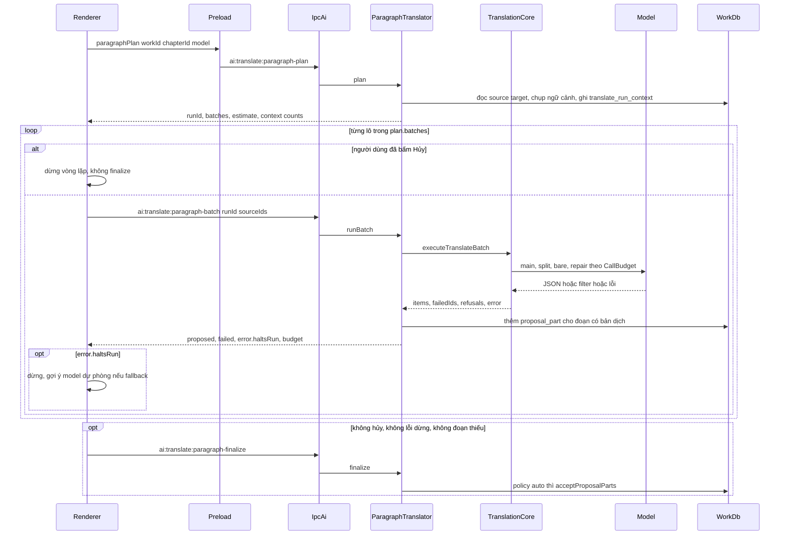

Đọc sơ đồ:
- Renderer điều phối vòng lặp lô ([useParagraphTranslate.ts](../../src/renderer/src/modules/workspace/translation/useParagraphTranslate.ts)
  `runBatches`). Lý do ghi ở đầu [aiTranslate.ts](../../src/shared/contracts/aiTranslate.ts): IPC chỉ có
  `invoke/handle`, nên tiến độ và Hủy chỉ đúng khi mỗi lô là một lời gọi riêng.
- `plan()` không gọi model; nó chia lô, cấp `CallBudget`, chụp ngữ cảnh và ước tính giá.
- Mỗi lô ghi ngay phần dịch được vào `proposal_part`; hủy hay lỗi giữa chừng không mất phần đã xong.
- `finalize()` chỉ chạy khi cả lượt sạch. Thiếu một đoạn thì mọi phần nằm lại hàng chờ duyệt, kể cả với
  chính sách `auto`.

### 3.2 Từ raw text tới đơn vị dịch

Kích hoạt khi nhập raw (dán/tệp/nguồn) → khi dịch, chương được cắt thành đơn vị gửi model.

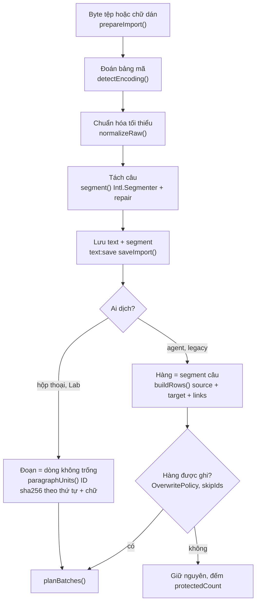

Đọc sơ đồ:
- `normalizeRaw` chỉ đổi BOM, xuống dòng, ký tự điều khiển, khoảng trắng thừa; giữ thụt đầu dòng vì đó là
  dấu đoạn của bản gốc ([rawText.ts](../../src/shared/text/rawText.ts)).
- `segment()` cắt theo dòng trước rồi theo câu, sửa ba lỗi ICU: dấu mở ngoặc kẹt cuối câu trước, viết tắt,
  dấu ba chấm giữa câu. Segment dài hơn 1000 đơn vị chỉ bị cảnh báo (`longSegments`).
- Có **hai cỡ đơn vị**: hộp thoại dịch theo **dòng** (`paragraphUnits`), agent dịch theo **câu**
  (`buildRows` trên `source.segments`). Xem mục 7.
- ID đoạn của hộp thoại là băm `order + text`: sửa một dòng đổi ID của nó, nên `runBatch` báo
  "Đoạn gốc đã đổi" thay vì dịch nhầm chỗ.

### 3.3 Lập kế hoạch: `ParagraphTranslator.plan()`

Kích hoạt khi hộp thoại chọn xong model (và mỗi lần đổi model hoặc bị `conflict`) → `ParagraphTranslationPlan`.

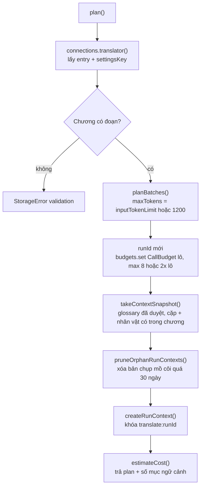

Đọc sơ đồ:
- `planBatches` ([translatePlanner.ts](../../src/shared/translation/translatePlanner.ts)) ước token bằng
  ký tự/1,5 (CJK) hoặc /3,8 (Latin). Không có `inputTokenLimit` thì trần 1200 token và 30 đơn vị; có thì
  bỏ trần số đơn vị. Đơn vị dài hơn trần đi trọn một lô riêng, không bị cắt.
- `CallBudget` sống trong bộ nhớ theo `runId`. App khởi động lại giữa lượt thì `budgetFor()` dựng lại
  ngân sách từ kế hoạch.
- Bản chụp lưu trong tệp `.mira` của tác phẩm nên mọi lô, kể cả lô thử lại hôm sau, dùng cùng ngữ cảnh.

### 3.4 Một lô: `ParagraphTranslator.runBatch()`

Kích hoạt bởi renderer cho từng nhóm `sourceIds` → `ParagraphBatchResult` và các `proposal_part` mới.

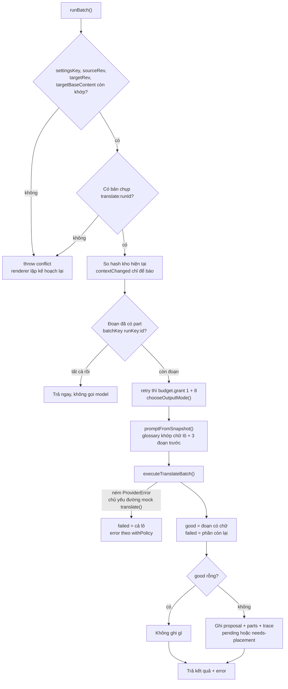

Đọc sơ đồ:
- Ba lớp chống lệch: `settingsKey` (cấu hình model không đổi giữa lượt), `rev` + `targetBaseContent`
  (không ai sửa chương), băm ID đoạn (bản gốc không đổi). Lệch thì `conflict`, không gọi model.
- `contextChanged` không chặn: lượt vẫn dùng bản chụp, hộp thoại chỉ báo "lập kế hoạch lại để áp dụng".
- Idempotent theo `batchKey = translate:<runId>:<paragraphId>`: gửi lại cùng lô không tạo part trùng.
- Part `pending` khi bản dịch đang trống (đặt ở đầu, `baseFrom = 0`), `needs-placement` khi chương đã có
  bản dịch: người dịch tự đặt chỗ trong editor.
- Trace mỗi lô (`context_json`) mang `contextHash`, `promptVersion`, `systemHash`, `snapshot`,
  `previous`, `budget` theo vòng, `refusals`, `outputMode`… đủ để `rebuildTranslateRequest` dựng lại
  request lượt chính.
- Lô không có lỗi từ lõi nhưng vẫn thiếu đoạn thì `runBatch` tự gán `invalid_response` "Thiếu bản dịch cho N đoạn".

### 3.5 Lõi một lô: `executeTranslateBatch()`

Gọi bởi cả ba đường (hộp thoại, agent, legacy) → `TranslateCoreBatchOutcome`.

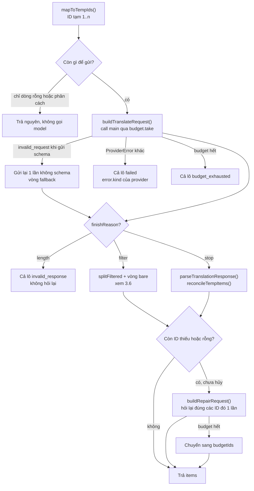

Đọc sơ đồ:
- Mọi lời gọi đi qua hàm `call(round, …)`: xin `budget.take(round)` trước, ghi số HTTP attempt và một dòng
  log (`translate.main|split|bare|repair|fallback`) sau. Cuối lô ghi thêm `translate.result` để so câu trả
  lời thô với cái app giữ lại.
- `mapToTempIds` không gửi dòng rỗng và dòng chỉ gồm ký tự phân cách (◇◇◇, ――――): chép nguyên, vì luật gạch
  dài của prompt từng biến "――――" thành "..." (commit `202e837`).
- Lỗi cuối lô xếp theo mức nặng: `refused` (thử lại vô ích) > `budget_exhausted` (thử lại có ích) >
  `invalid_response` (thiếu sau khi đã hỏi lại).
- Lượt hỏi lại dùng cùng `TranslatePromptContext` với lượt chính nên vẫn đủ glossary, xưng hô, và trúng
  cache system prompt. Lỗi ở lượt hỏi lại bị nuốt: không làm mất phần lượt chính đã dịch.
- Hủy (`signal.aborted`) chỉ chặn vòng hỏi lại, vòng chia và vòng bare. Đường hộp thoại không truyền
  `signal`, nên ở đó các kiểm tra này không có tác dụng (mục 3.8).

### 3.6 Model từ chối: chia đôi và gửi lại không ngữ cảnh

Kích hoạt khi lượt chính trả `finishReason = filter` (transport nhận mọi dạng `content_filter…`) → đoạn
vô can được cứu, đoạn còn bị chặn vào `refusals`.

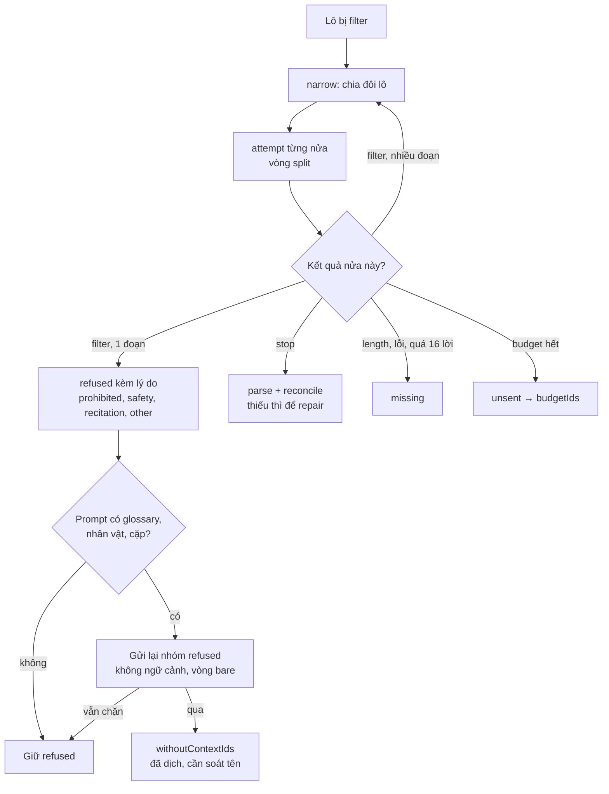

Đọc sơ đồ:
- Lý do: bộ lọc chặn **cả lô** (20–30 đoạn) dù chỉ vài câu kích hoạt. Chia đôi khoanh tới từng đoạn mà không
  đổi chữ hay chỉ dẫn ([content-refusals.md](../modules/context/content-refusals.md) mục 3).
- Vòng không ngữ cảnh là quyết định của chủ sản phẩm 2026-10-06: chỉ bỏ glossary, nhân vật, cặp xưng hô;
  giữ bản gốc, đoạn trước, chỉ dẫn. Không viết lại hay che bản gốc để lách bộ lọc.
- `refusedIds` nằm cả trong `failedIds`; tách riêng để báo "cần dịch tay hoặc model khác"
  (`describeRefusals`). `refused` không dừng lượt (`errorPolicy`).
- Chặn đến dưới dạng **HTTP 4xx** (có `blockReason`) thì provider ném `ProviderError` kind `refused`: nhánh
  `E1` của 3.5, cả lô thất bại, không chia (xem mục 7).
- `withoutContextIds` chưa có cờ trên giao diện ([content-refusals.md](../modules/context/content-refusals.md)).

### 3.7 Đọc câu trả lời: parse và đối soát

Gọi sau mỗi câu trả lời `stop` → danh sách `matched`, `missing`, `empty`, `extraneous`, `duplicate`.

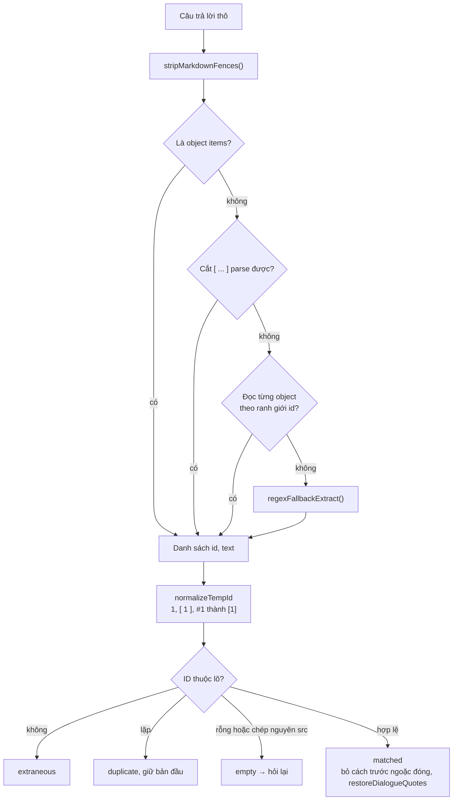

Đọc sơ đồ:
- Mỗi tầng dự phòng đến từ một lỗi thật: model chèn thẻ prompt vào khóa (`{"id><context>[14]…<dst":…}`),
  ngoặc kép không escape, viết thừa `"dst":` trước khóa nhãn. `stripLeakedTags` gỡ thẻ lọt vào bản dịch.
- `normalizeItem` nhận nhiều tên khóa (`dst`, `text`, `translation`, `vi`, `target`, cuối cùng `src`). Nếu
  "bản dịch" lấy từ `src` trùng bản gốc thì `reconcileTempItems` coi là rỗng để hỏi lại.
- Đối soát dựa vào ID tạm, không dựa vào thứ tự hay số lượng. Output lệch số đoạn (gộp, tách) thể hiện ra
  thành ID thiếu → hỏi lại một lần → vẫn thiếu thì `failed`.
- Nhãn `speaker_to_listener`, `self_ref`, `addr_ref` mà prompt bắt model khai bị parser bỏ đi; trong app
  chúng chỉ là giàn suy luận trước khi viết `dst`. Lab đọc lại chúng (`pairs` trong `scripts/lab/cli.ts`).
- `paragraphAlign` **không** nằm trong pipeline: ID tạm thay cho việc gióng đoạn. Gióng đoạn chỉ dùng ở
  bench, nơi so bản dịch không có ID (mục 3.10).

### 3.8 Hủy, thử lại, dịch tiếp bằng model khác, dịch lại một đoạn

Kích hoạt bởi nút trên hộp thoại → lô tiếp theo được gửi hoặc không.

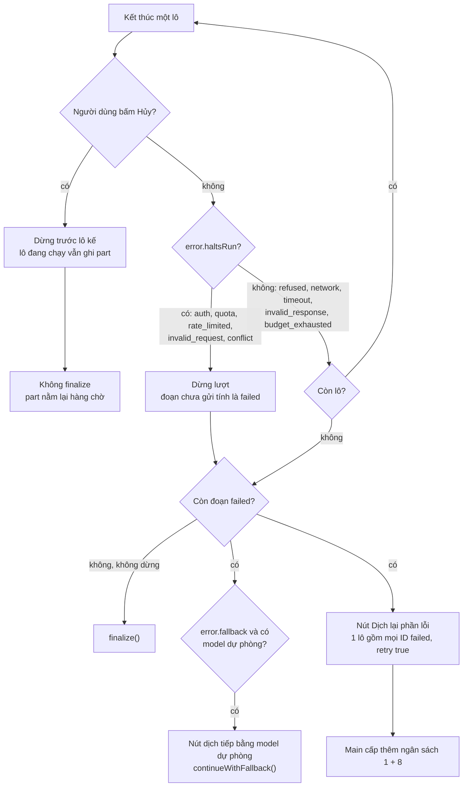

Đọc sơ đồ:
- Hủy chỉ có tác dụng **giữa các lô** (`stop.current` trong `runBatches`); không có `AbortSignal` qua IPC.
  Lô đang chạy chạy hết và vẫn ghi đề xuất.
- `haltsRun` và `fallback` do main quyết theo bảng `TABLE` trong
  [errorPolicy.ts](../../src/main/services/ai/errorPolicy.ts) (file [03](03-ket-noi-ai.md)); renderer chỉ làm theo.
- `continueWithFallback` lập kế hoạch mới (runId mới, bản chụp mới) cho model dự phòng, giữ nhóm lô của kế
  hoạch mới nhưng chỉ lấy các ID còn thiếu.
- **Dịch lại một đoạn:** không có kênh riêng trong vùng này. Có ba cách: (1) "Dịch lại phần lỗi" chỉ gửi các
  đoạn `failed` trong cùng `runId`; đoạn đã có part bị bỏ qua nhờ `batchKey`; (2) lập lượt mới cho cả chương
  (đoạn đã có bản dịch thành part `needs-placement`); (3) chế độ Sửa của trợ lý chat ([06](06-tro-ly-agent.md)).

### 3.9 Đường agent: `runChapterTranslation()`

Gọi bởi capability `translate_chapter` (chat, `protect`) và `TaskService` (task, `fill_untranslated`)
→ bản dịch được ghi thẳng vào chương, theo lô, có journal.

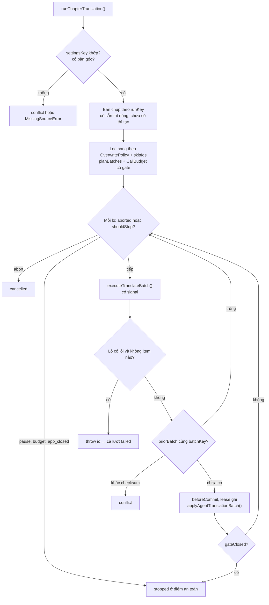

Đọc sơ đồ:
- Cùng lõi, cùng bản chụp, cùng ngân sách, nhưng **ghi thẳng** (`applyAgentTranslationBatch`, tác giả
  `RowAuthor` từ `originFor`) thay vì tạo hồ sơ đề xuất. Lịch sử, Undo và lease thuộc file [06](06-tro-ly-agent.md).
- Task tránh gọi lại các hàng đã có bản dịch nhờ `fill_untranslated` lọc trước khi lập lô. `batchKey`
  băm `[ID lô, source.rev, snapshotHash, settingsKey]`; kiểm `priorBatch` diễn ra **sau** lời gọi model:
  cùng checksum thì bỏ qua ghi, khác checksum thì conflict. Bản thân kiểm này không tránh lời gọi model.
- `gate` của `CallBudget` là trần của task (lời gọi, token, tiền) qua nhiều lượt; bị từ chối thì dừng
  `stopped/budget`, không phải lỗi.
- Hàng câu, không phải dòng: `previous` là 3 **câu** trước lô.

### 3.10 Kiểm tra chất lượng sau dịch

Kích hoạt khi xem cảnh báo của task (`TaskQuality`, file [06](06-tro-ly-agent.md)) hoặc khi chạy bench → cờ, không bao giờ sửa chữ.

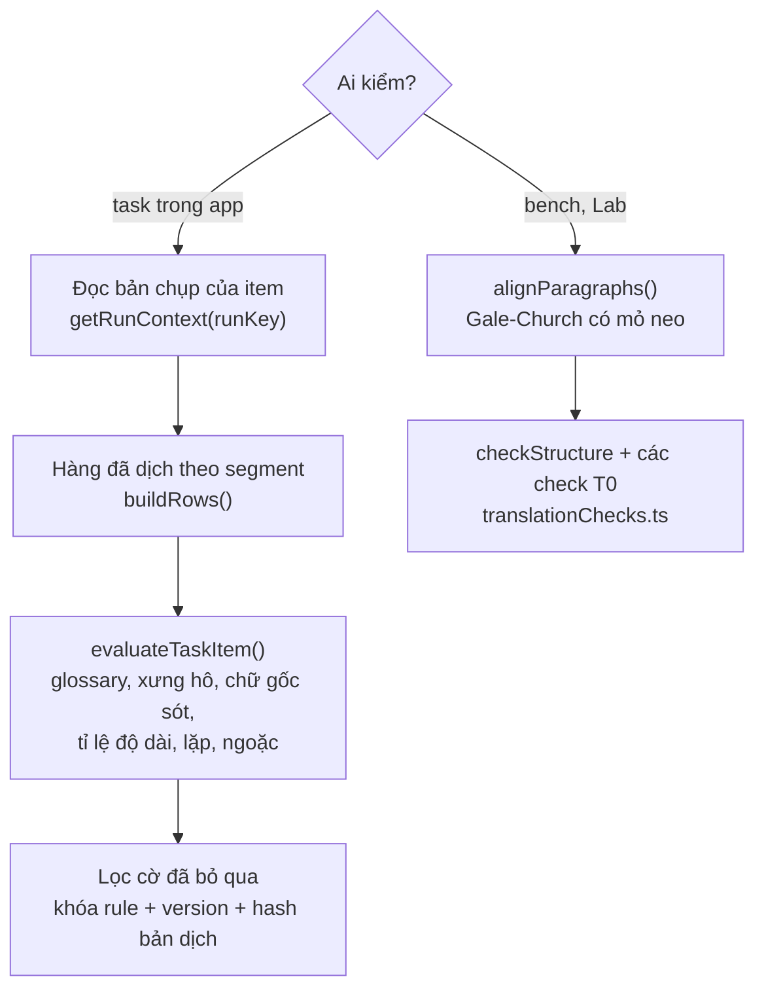

Đọc sơ đồ:
- Kiểm theo **bản chụp của item**, không theo kho hôm nay: sửa glossary sau đó không làm cờ cũ nhảy.
- Mỗi luật có `ruleVersion` (`QA_RULE_VERSIONS`); đổi logic thì tăng version, lời bỏ qua cũ hết khớp.
- Nguyên tắc: cờ checker không chứng minh lỗi, không chặn lưu, không tự sửa
  ([quality-and-evaluation.md](../modules/context/quality-and-evaluation.md)).
- Đường hộp thoại chưa có bước kiểm sau dịch; "kiểm → sửa có chủ đích" vẫn là đề xuất
  ([post-editing.md](../modules/context/post-editing.md) mục 3).

### 3.11 Trau chuốt (polish): soát rồi sửa + kiểm bằng code

Chỉ Lab gọi (`lab polish <ncode> --from <bản>`) → bản sửa mới cho các đoạn bị gắn nhãn lỗi. **Chưa có trong app.**

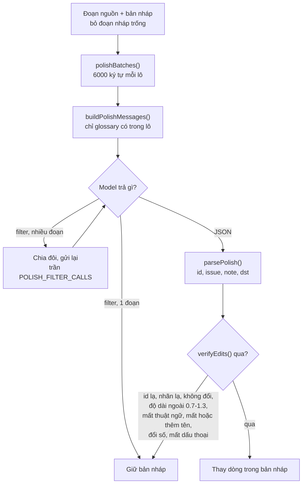

Đọc sơ đồ:
- Model phải **chẩn đoán trước** (nhãn `meaning|literal|awkward|repetition|voice|particle` + lý do), rồi
  mới viết lại, và chỉ trả đoạn đổi. Biến thể B trong
  [post-editing.md](../modules/context/post-editing.md) mục 5, theo bài học TEaR/GEMBA-MQM: chẩn đoán kém
  thì sửa ra ảo giác, nên chỉ một vòng.
- `verifyEdits` là lưới an toàn bằng code: lỗi `polish-v1` (thay "cô hầu gái" bằng tên người kể chưa
  biết) sinh ra luật "thêm tên không có trong bản gốc".
- `polish.ts` là hàm thuần (không mạng, không tệp); vòng chia khi bị lọc nằm trong Lab, không dùng
  `CallBudget`.

## 4. Dữ liệu và trạng thái

| Dữ liệu | Kiểu / file | Lưu ở đâu | Vòng đời |
| --- | --- | --- | --- |
| Văn bản chương + segment | `TextRecord`, `SegmentRecord` ([text.ts](../../src/shared/contracts/text.ts)) | `.mira` của tác phẩm ([02](02-luu-tru.md)) | `rev` tăng mỗi lần lưu; segment giữ ID qua `resegment` |
| Kế hoạch lượt | `ParagraphTranslationPlan` | memory renderer | sống tới khi đổi model, `conflict` hoặc đóng hộp thoại |
| Ngân sách lượt | `CallBudget` | `Map<runId>` trong `ParagraphTranslator`; biến cục bộ ở runner | xóa ở `finalize`; mất khi restart thì dựng lại |
| Lượt đã rơi khỏi schema | `fellBack: Map<runId, number>` | memory main | xóa ở `finalize` |
| Bản chụp ngữ cảnh | `ContextSnapshot` (`version: 1`) | bảng `translate_run_context` (khóa `translate:<runId>`, `agent:<opId>`, `task:<itemId>`) | mồ côi quá 30 ngày bị dọn khi plan lại cùng chương |
| Hồ sơ đề xuất | `proposal` (`origin='translate'`, `run_key` unique) + `proposal_part` | `.mira` | `context_json` nối trace mỗi lô; usage cộng dồn |
| Log lời gọi | dòng JSON `translate.<round>`, `translate.result` | `<dataDir>/logs/<workId>.jsonl` (`aiCallLog.ts`) | xóa dòng quá 30 ngày khi mở app; không vào backup/xuất |
| Cờ QA đã bỏ qua | `qaDismissals` | `.mira` | khớp theo rule + version + hash bản dịch |

Trạng thái của hộp thoại (`Stage` trong `useParagraphTranslate`):

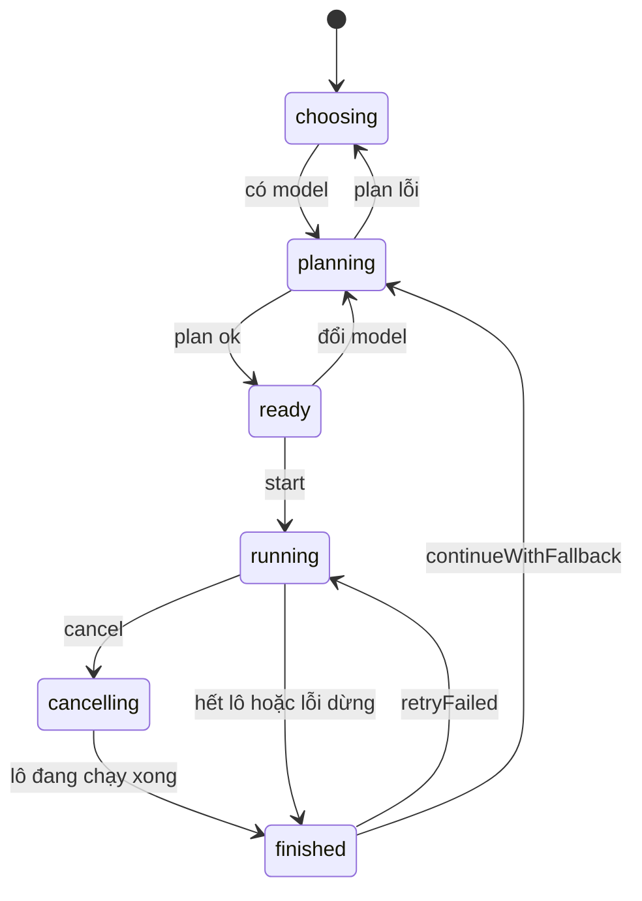

Part của lượt dịch: `pending` (bản dịch trống) hoặc `needs-placement` (đã có bản dịch) → `applied`
(auto ở `finalize`, hoặc người duyệt) / `rejected`; `conflict`, `stale` do luồng duyệt đặt
([06](06-tro-ly-agent.md)).

## 5. Tại sao code viết như vậy

- **Renderer lặp lô, main dịch một lô mỗi lời gọi.** IPC chỉ có `invoke/handle`; một job dài trong main
  sẽ không báo tiến độ và không hủy được. **[code]** đầu [aiTranslate.ts](../../src/shared/contracts/aiTranslate.ts), đầu `chapterTranslation.ts`.
- **System prompt chỉ phụ thuộc tác phẩm; mọi thứ theo lô nằm trong message user.** Để system giống
  từng byte giữa các lô và trúng cache; lượt hỏi lại dùng cùng system. **[code]** chú thích đầu
  `translatePrompt.ts`; **[docs]** [prompt-system.md](../modules/context/prompt-system.md).
- **Một bộ dựng prompt cho lượt chính, hỏi lại và hash.** Trước đây hash băm một prompt, request gửi prompt
  khác, và lượt hỏi lại không có glossary nên đoạn khó nhất bị dịch sai thuật ngữ. **[code]** `translatePrompt.ts`; **[docs]** prompt-system "Hiện trạng trước đợt này".
- **Cặp xưng hô và nhân vật lọc theo chương, glossary lọc theo lô.** Tiếng Nhật hay lược tên, một lô
  không nhắc ai vẫn có thể là lời của họ. Họ tên đầy đủ khớp theo từng phần ≥ 2 ký tự (`nameForms`) vì
  truyện viết ノエル chứ không viết ノエル・アーデン. **[code]** `dyadsMentionedIn`; **[commit]** `db2455f`.
- **`previous` lấy bản gốc, không lấy bản dịch lô trước.** Kết quả tất định, lô không phụ thuộc nhau.
  Số 3 là giá trị thử. **[docs]** prompt-system; **[code]** `PREVIOUS_PARAGRAPHS`.
- **Chụp ngữ cảnh một lần mỗi lượt.** Sửa glossary giữa lượt từng làm một chương mang hai phiên bản
  ngữ cảnh, và trace chỉ có hash. Lượt không có bản chụp bị từ chối `conflict`. **[commit]** `2fc6091`.
- **Ngân sách lời gọi chung.** Trước đó mỗi lô bị lọc có thể gọi 34 lần, gateway nhân ba. Mỗi lô giữ sẵn
  một lời gọi chính để lô đầu bị lọc nặng không ăn hết phần của lô sau; `take()` đồng bộ nên các lô chen
  nhau qua `await` không vượt quỹ. Retry HTTP của gateway không tính vào quỹ. **[commit]** `0eeaa23`; **[code]** `callBudget.ts`.
- **ID tạm `[1]…[n]` thay cho UUID.** Ngắn, model chép đúng; parser nhận cả `1`, `#1`. **[code]** `mapToTempIds`, `normalizeTempId`. Lý do tiết kiệm token là **[suy luận]**.
- **Hỏi lại đúng một lần.** Một vòng đủ cứu phần lớn ID thiếu; vòng thứ hai làm tăng chi phí mà nghiên cứu
  sửa lỗi cho thấy kém đi. **[code]** comment `executeTranslateBatch`; lý do chi phí là **[suy luận]**, bài học "vòng hai kém đi" từ **[docs]** post-editing mục 2.
- **Không cắt đơn vị dài.** Bộ cắt cũ tách đoạn > 1600 ký tự mà không đường nào ráp lại; caller quên tắt
  là mất bản dịch. **[commit]** `9ae5ebb`.
- **Phân biệt `refused` với `invalid_request`.** Mọi 4xx từng bị gọi là "nhà cung cấp từ chối", và vài
  đoạn bị lọc làm dừng cả chương. Main quyết `haltsRun`. **[commit]** `d5360e1`.
- **Sửa ngoặc thoại và dòng phân cách bằng code, không bằng prompt.** Hai chương mất mọi ngoặc ở nửa sau;
  luật gạch dài biến "――――" thành "...". **[commit]** `202e837`.
- **Schema JSON mặc định tắt.** Schema giữ cú pháp, không giữ nghĩa; cần đo lặp trước khi bật. Chế độ
  `array` giữ system prompt từng byte (có test hash). **[commit]** `9da7e5a`; **[code]** `outputMode.ts`.
- **Hồ sơ đề xuất thay vì ghi thẳng (hộp thoại).** Mọi chữ AI viết đi qua Accept/Deny; "Áp dụng thẳng" chỉ
  tự Accept khi cả lượt sạch. **[docs]** post-editing mục 1; **[code]** `useParagraphTranslate` điều kiện trước `paragraphFinalize`.
- **Không lách bộ lọc.** Không đổi model tự động, không che/viết lại bản gốc; chỉ chia lô và một vòng bỏ
  ngữ cảnh. **[docs]** [content-refusals.md](../modules/context/content-refusals.md) mục 1.

## 6. Đọc code bắt đầu từ đâu

1. [translationCore.ts](../../src/main/services/ai/translate/translationCore.ts) — toàn bộ nhánh của một lô nằm trong `runTranslateBatch` và `splitFiltered`.
2. [paragraphTranslation.ts](../../src/main/services/ai/paragraphTranslation.ts) — đường sản phẩm: plan, kiểm conflict, ghi đề xuất, finalize.
3. [translatePrompt.ts](../../src/main/services/ai/translate/translatePrompt.ts) — biết chính xác model nhận gì (`systemPrompt`, `build`).
4. [lenientParser.ts](../../src/shared/translation/lenientParser.ts) + [translateReconcile.ts](../../src/shared/translation/translateReconcile.ts) — câu trả lời thô biến thành bản dịch thế nào; test đi kèm là danh mục lỗi model thật.
5. [useParagraphTranslate.ts](../../src/renderer/src/modules/workspace/translation/useParagraphTranslate.ts) — phía renderer: vòng lô, hủy, thử lại, dự phòng.

## 7. Điểm đáng ngờ / nợ kỹ thuật

1. **Hai cỡ đơn vị dịch.** Hộp thoại dịch theo dòng (`paragraphUnits`), agent và đường legacy theo câu
   (`buildRows` trên segment). Cùng chương có thể được dịch ở hai độ hạt, `previous` lúc là 3 dòng lúc là
   3 câu, dù hằng tên `PREVIOUS_PARAGRAPHS`. Số đo Lab (đi qua `ParagraphTranslator`) không đại diện cho task.
2. **`ChapterTranslator` gần như chết.** Main vẫn đăng ký `ai:translate:plan|batch`, nhưng preload không
   phơi hai kênh này; chỉ `scripts/bench/translate.run.ts`, `liveGemini.test.ts` và test gọi. Nó đọc ngữ
   cảnh sống (không bản chụp), không có `CallBudget` của lượt, nuốt lỗi nạp ngữ cảnh. Runner agent lại
   import `isProtectedRow` từ file này.
3. **`provenanceFor` không ai gọi** ([provenance.ts](../../src/main/services/ai/provenance.ts)). Đường hộp thoại
   không ghi provenance theo hàng; nguồn gốc chỉ nằm ở `proposal.provider/model`.
4. **Hủy ở hộp thoại không ngắt lời gọi đang chạy.** `ParagraphTranslator.runBatch` không truyền `signal`
   vào `executeTranslateBatch`, nên các kiểm tra `signal?.aborted` trong lõi chỉ có tác dụng với agent.
5. **"Dịch lại phần lỗi" gửi mọi ID lỗi trong một lô** (`runBatches([again], plan, true)`), bỏ qua trần token
   của planner; và gửi lại cả đoạn `refused` dù thông báo nói thử lại vô ích (`tallyBatch` gộp `refusals`
   vào `failed`).
6. **Chặn dạng HTTP 4xx không được chia lô.** `splitFiltered` chỉ chạy khi `finishReason = filter`; `ProviderError`
   kind `refused` ở lượt chính làm cả lô thất bại với `refusedIds` rỗng.
7. **Agent mất phân loại refusal khi một lô lỗi không có item nào.** Nếu chưa abort hay đóng gate, runner
   ném `StorageError('io')` khi `outcome.error` và `items` rỗng, kể cả `refused` hay `network`. Task nhận
   lỗi thay vì kết quả nên item thành `failed(provider)`, không phải `waiting_user` hay `failed(refused)`.
   Các `refusedIds` runner đã gom không được trả lên để `skip_refused` sử dụng. Nhánh `failed(refused)`
   chỉ có khi runner trả được kết quả chứa `refusedIds` (`settleItem` trong `taskService.ts`).
8. **`finishReason = length` mất cả lô, không chia, không hỏi lại**, trong khi tài liệu cho phép đặt
   `inputTokenLimit` lớn để dịch cả chương một lô. Model cũng được yêu cầu khai `speaker_to_listener/self_ref/addr_ref`
   cho mọi câu thoại (tốn token đầu ra) mà app không đọc lại các nhãn này.

## 8. Liên kết

- Tài liệu module: [prompt-system.md](../modules/context/prompt-system.md),
  [context-assembly.md](../modules/context/context-assembly.md),
  [content-refusals.md](../modules/context/content-refusals.md),
  [post-editing.md](../modules/context/post-editing.md),
  [quality-and-evaluation.md](../modules/context/quality-and-evaluation.md),
  [vietnamese-addressing.md](../modules/context/vietnamese-addressing.md).
- Code-tour: [README](README.md) · [01 process và IPC](01-process-va-ipc.md) (handler, preload) ·
  [02 lưu trữ](02-luu-tru.md) (`translate_run_context`, `proposal`, `aiCallLog`) ·
  [03 kết nối AI](03-ket-noi-ai.md) (`connections.translator`, `mapFinishReason`, `filterReason`, `errorPolicy`) ·
  [05 ngữ cảnh dịch](05-ngu-canh-dich.md) (glossary, cặp, nhân vật, `matchContextEntries`) ·
  [06 trợ lý/agent](06-tro-ly-agent.md) (duyệt đề xuất, task, `translate_chapter`) ·
  [07 thư viện/nguồn](07-thu-vien-nguon-xuat.md) (nhập raw từ nguồn) ·
  [08 giao diện](08-giao-dien-renderer.md) (`AiTranslateDialog`) ·
  [09 đo lường](09-do-luong-va-cong-cu.md) (Lab `translate`, `polish`, bench).
