# Trợ lý AI, task dài và proposal legacy

> **Một câu:** vùng này nhận lệnh người dùng gõ cho Trợ lý, để model chọn capability đã đăng ký, kiểm
> quyền bằng policy trong code, ghi dữ liệu qua operation có journal và Undo, chạy task dịch nhiều chương
> bền qua lần khởi động lại, và giữ chat/proposal cũ theo tác phẩm còn chạy song song.
> Cập nhật: 2026-10-15 · Nguồn: đọc code tại commit db2455f.

## 1. Vì sao vùng này tồn tại

Mira cần một Trợ lý toàn ứng dụng: hỏi đáp về truyện, dịch hoặc sửa một chương, và giao việc dài như
"dịch chương 1–30". Model không được tự cấp quyền ghi hay tự bịa ID, nên mọi thao tác đi qua handle đích,
bảng policy thuần và capability có schema. Việc dài không để model tự lặp: model chỉ tạo task, còn
`AgentTaskService` chạy tuần tự, lưu bền, pause/cancel/retry được. Vùng này được renderer gọi qua
`window.mira.agent.*` (IPC `agent:*`) và `window.mira.ai.chat/proposals/sessions` (chat legacy). Nó gọi
xuống `ConnectionService` để lấy provider ([03](03-ket-noi-ai.md)), pipeline dịch batch và context
snapshot ([04](04-dich-chuong.md), [05](05-ngu-canh-dich.md)), và `LibraryStore` + journal trong work DB
([02](02-luu-tru.md)).

## 2. Bản đồ file

**Main — runtime agent mới** (`src/main/services/agent/`)

| File | Làm gì | Symbol chính để grep |
| --- | --- | --- |
| [agentService.ts](../../src/main/services/agent/agentService.ts) | Vòng model → tool → kết quả của một turn, continuation, cancel, undo, shutdown | `AgentService`, `acceptTurn`, `acceptContinuation`, `runExistingTurn`, `prepareCall`, `runWrite`, `MAX_MODEL_ROUNDS`, `LOOP_REPEATS` |
| [policy.ts](../../src/main/services/agent/policy.ts) | Bảng quyết định allow/deny/needs_user dạng hàm thuần | `decideToolCall`, `namedByUser`, `CONTEXT_HANDLE` |
| [registry.ts](../../src/main/services/agent/registry.ts) | Đăng ký capability, validate schema rồi gọi handler; đếm budget của turn | `CapabilityRegistry.execute`, `TurnBudgetTracker` |
| [types.ts](../../src/main/services/agent/types.ts) | Hợp đồng capability (`kind`, `parameters`, `targetPolicy`) | `CapabilityDefinition`, `CapabilityKind`; `AgentRunner` (`chưa dùng`) |
| [resolver.ts](../../src/main/services/agent/resolver.ts) | Mô tả tự nhiên → `ResolvedTarget` (work/chapter), hoặc ambiguous/not_found | `resolveTarget`, `TargetResolver.resolve` |
| [turnContext.ts](../../src/main/services/agent/turnContext.ts) | Xếp messages cho một vòng model, bỏ turn cũ khi vượt cửa sổ | `assembleTurnContext`, `contextLimitChars` |
| [writeCoordinator.ts](../../src/main/services/agent/writeCoordinator.ts) | Phát write intent tới mọi cửa sổ, chờ flush/ack trước khi ghi | `AgentWriteCoordinator.request/acknowledge/windowClosed` |
| [capabilities/readCapabilities.ts](../../src/main/services/agent/capabilities/readCapabilities.ts) | 7 capability đọc (list_works, read_chapter, search_work, list_glossary...) | `defaultReadCapabilities`, `TARGET_PARAM` |
| [capabilities/writeCapabilities.ts](../../src/main/services/agent/capabilities/writeCapabilities.ts) | `translate_chapter`, `edit_translation`, `undo_operation` | `createWriteCapabilities` |
| [capabilities/taskCapabilities.ts](../../src/main/services/agent/capabilities/taskCapabilities.ts) | Tạo/đọc/steer task từ chat | `createTranslationTaskCapability`, `steerTranslationTaskCapability`, `readTranslationTasksCapability` |
| [chapterTranslationRunner.ts](../../src/main/services/agent/chapterTranslationRunner.ts) | Dịch một chương theo batch có journal, lease, cancel fence; dùng chung cho chat và task | `runChapterTranslation`, `OverwritePolicy`, `RunStopReason`, `MissingSourceError` |
| [taskService.ts](../../src/main/services/agent/taskService.ts) | Task dịch dải chương: tạo, scheduler một item toàn app, control, steering, trần chi phí, shutdown/reconcile | `AgentTaskService`, `wake`, `runItem`, `extractTerms`, `settleItem`, `gateFor`, `reconcileOnStartup` |
| [taskQuality.ts](../../src/main/services/agent/taskQuality.ts) | Cảnh báo QA đọc từ snapshot đã pin của item; chỉ lưu "Bỏ qua" | `readTaskQuality`, `dismissFinding` |
| [operationReconciler.ts](../../src/main/services/agent/operationReconciler.ts) | Lúc khởi động, đối soát operation dang dở với journal work DB | `reconcileStartupOperations` |
| [agentUsage.ts](../../src/main/services/agent/agentUsage.ts) | Cộng usage provider, tính chi phí; thiếu thì `complete:false`/`null`, không điền 0 | `aggregateTokenUsage`, `calculateTurnCost` |
| [agentLegacyAdapter.ts](../../src/main/services/agent/agentLegacyAdapter.ts) | Import session cũ vào `library.db`, route Accept/Deny proposal cũ — **`chưa dùng`** ngoài test | `importLegacySession`, `getLegacyRefForTurn` |
| [agentTestKit.ts](../../src/main/services/agent/agentTestKit.ts) | Chỉ cho test: library hai tác phẩm + model theo kịch bản | — |

**Main — chat và proposal legacy**

| File | Làm gì | Symbol chính |
| --- | --- | --- |
| [ai/chatService.ts](../../src/main/services/ai/chatService.ts) | Chat theo tác phẩm (`legacy`, vẫn chạy): 6 vòng tool + 1 vòng trả lời, có fallback model | `ChatService.startWithSession`, `MAX_TOOL_ROUNDS`, `TOOL_CHARS_PER_TURN` |
| [ai/chatPrompt.ts](../../src/main/services/ai/chatPrompt.ts) | System prompt + khối vị trí cho chat legacy | `ROLE`, `TOOLS` |
| [ai/chatTools.ts](../../src/main/services/ai/chatTools.ts) | Tool đọc + `propose_edit`, `propose_translation`, `propose_glossary_term` | `CHAT_TOOL_DEFINITIONS`, `createChatTools`, `MAX_PROPOSALS_PER_TURN` |
| [ai/chatSearch.ts](../../src/main/services/ai/chatSearch.ts), [ai/chatToolText.ts](../../src/main/services/ai/chatToolText.ts) | Tìm trong tác phẩm, cắt trang văn bản cho tool | — |
| [proposals/proposalService.ts](../../src/main/services/proposals/proposalService.ts) | Accept/Deny/Accept all/Undo proposal trong một transaction work DB | `acceptProposalParts`, `acceptAllChapterParts`, `denyProposalPart`, `undoLatestAccept` |
| [proposals/proposalPlanner.ts](../../src/main/services/proposals/proposalPlanner.ts) | Lập kế hoạch part khi Accept (neo, xung đột) | `planProposalParts` |
| [proposals/chatProposalService.ts](../../src/main/services/proposals/chatProposalService.ts) | Đường duy nhất chat legacy tạo proposal | `createToolProposalInDb` |

**IPC và contract**

| File | Làm gì | Symbol chính |
| --- | --- | --- |
| [ipc/handlers/agent.ts](../../src/main/ipc/handlers/agent.ts) | Session/turn/operation/task/write-ack; chạy turn bằng `setImmediate` | `agentHandlers`, `CHANNELS.agentTurnSend` |
| [ipc/handlers/chat.ts](../../src/main/ipc/handlers/chat.ts), [proposals.ts](../../src/main/ipc/handlers/proposals.ts), [sessions.ts](../../src/main/ipc/handlers/sessions.ts) | Chat legacy, hàng đợi proposal, lịch sử `ai_session/ai_turn` theo tác phẩm | `chatHandlers`, `proposalHandlers`, `sessionHandlers` |
| [shared/contracts/agent.ts](../../src/shared/contracts/agent.ts) | State machine turn/operation/activity, stream event, write intent | `canTransitionTurn`, `agentStreamEventSchema`, `AgentWriteIntent` |
| [shared/contracts/agentTask.ts](../../src/shared/contracts/agentTask.ts) | State machine task/item, lệnh control, steering | `TASK_STATES`, `canTransitionTask`, `canTransitionItem` |
| [shared/contracts/aiChat.ts](../../src/shared/contracts/aiChat.ts), [aiProposals.ts](../../src/shared/contracts/aiProposals.ts) | Chunk chat legacy, proposal | `ChatChunk`, `ProposalQueueItem` |

**Renderer**

| File | Làm gì | Symbol chính |
| --- | --- | --- |
| [modules/agent/store/agentStore.ts](../../src/renderer/src/modules/agent/store/agentStore.ts) | Session, transcript, stream delta, pending, write-intent listener | `useAgentStore`, `handleStreamEvent`, `listenCoordinator`, `refresh` |
| [modules/agent/store/taskStore.ts](../../src/renderer/src/modules/agent/store/taskStore.ts) | Danh sách task, chi tiết, QA; refetch khi Main báo đổi | `useTaskStore`, `listen` |
| [modules/agent/adapter/workspaceAdapter.ts](../../src/renderer/src/modules/agent/adapter/workspaceAdapter.ts) | Cầu nối editor: chụp context, flush, khóa, reload | `WorkspaceAgentAdapter`, `captureContext`, `flushDirty`, `setLocked` |
| [modules/agent/components/](../../src/renderer/src/modules/agent/components/) | `AgentPanel`, `AgentTranscript`, `AgentComposer`, `PendingActionCard`, `OperationCard`, `ActivityTimeline`, `TaskList`, `OperationLog`, `DeltaBuffer` | `useAgentConnection`, `useAgentWriteIntents` |
| [modules/workspace/assistant/](../../src/renderer/src/modules/workspace/assistant/) | Chat cũ `AiPanel`, `useAiChat`, `ProposalCard` (`legacy`) | `AiPanel`, `useAiChat` |
| [app/screens/assistant/AssistantScreen.tsx](../../src/renderer/src/app/screens/assistant/AssistantScreen.tsx), [jobs/JobsScreen.tsx](../../src/renderer/src/app/screens/jobs/JobsScreen.tsx) | Màn Trợ lý; màn Tác vụ (tab Tác vụ + Nhật ký AI) | `AssistantScreen`, `JobsScreen` |

## 3. Luồng chính

### 3.1 Một turn chat: từ lúc gõ tới khi Main chạy

Người dùng gõ trong `AgentComposer` (màn Trợ lý hoặc side panel chương) → turn được lưu, trả ID ngay,
rồi Main chạy vòng model trong nền và đẩy event tới mọi cửa sổ.

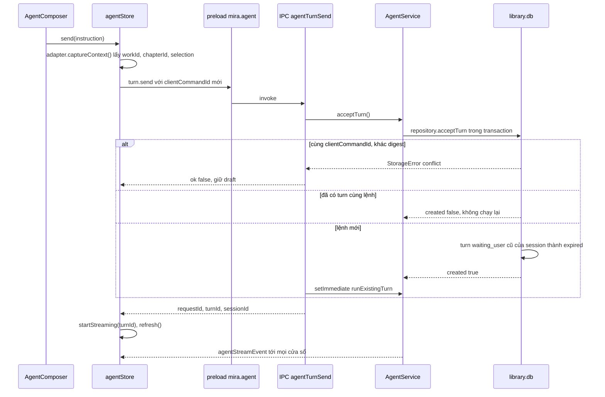

Đọc sơ đồ:
- `acceptTurn` idempotent theo `clientCommandId` + `digestPayload` (sha256 của JSON chuẩn hóa) — gửi lại
  cùng lệnh không tạo turn thứ hai ([agentService.ts](../../src/main/services/agent/agentService.ts)).
- Chưa có session thì tạo session mới với tiêu đề = 30 ký tự đầu của lệnh.
- Một lệnh mới (không phải câu trả lời) làm turn đang `waiting_user` của cùng session thành `expired`
  (`AgentRepository.acceptTurn`).
- Handler trả về trước khi model chạy; turn thuộc Main nên đóng cửa sổ gửi không hủy turn (comment D8 trong
  [agent.ts](../../src/main/ipc/handlers/agent.ts)). Event gửi qua `deps.windows` tới mọi cửa sổ.
- Lỗi trong `runExistingTurn` sau khi đã trả về chỉ được `console.error`; trạng thái thật nằm ở DB và event.

### 3.2 Vòng model → tool trong `runExistingTurn`

Kích hoạt bởi `setImmediate` ở 3.1 hoặc continuation ở 3.4 → turn kết thúc ở `completed`, `waiting_user`,
`failed` hoặc `cancelled`.

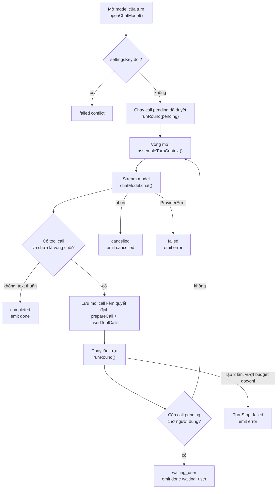

Đọc sơ đồ:
- Trợ lý mới **không** fallback model: provider lỗi thì turn `failed` với `describeProviderError`
  (khác chat legacy, xem 3.8).
- Tool definitions = `resolve_target` + mọi capability có `parameters` (`chatCapabilities`). Model báo
  `toolCall === false` thì chỉ có một vòng không tool và một activity giải thích.
- `MAX_MODEL_ROUNDS = 6`; vòng thứ 6 gửi không kèm tool để buộc trả lời. Vượt `maxCapabilityCalls` (20)
  đặt `forceFinal`, còn vượt dữ liệu đọc (100 000 ký tự) hoặc số write (3) là `TurnStop` dừng cứng.
- Phát hiện lặp: cùng `argsDigest` (tên + args) lần thứ `LOOP_REPEATS = 3` thì dừng, các call sau trong
  vòng thành `cancelled`.
- Mọi call được ghi vào `agent_tool_call` **trước** khi chạy; lưu thất bại là `TurnStop('persistence')`.
- Kết quả tool (kể cả lỗi `denied`, `validation`) quay lại model dưới dạng message `tool`
  (`roundMessages`), nên model thấy lỗi và tự sửa ở vòng sau.
- Text của vòng sau được nối với `\n\n` vào câu trả lời người dùng đã thấy.

### 3.3 Policy: một call được phép, bị từ chối hay cần duyệt

`decideToolCall` chạy hai lần cho mỗi call: lúc `prepareCall` (trước khi lưu) và lại trong `runRound`
ngay trước khi chạy — nên approval không bao giờ vượt được `deny`.

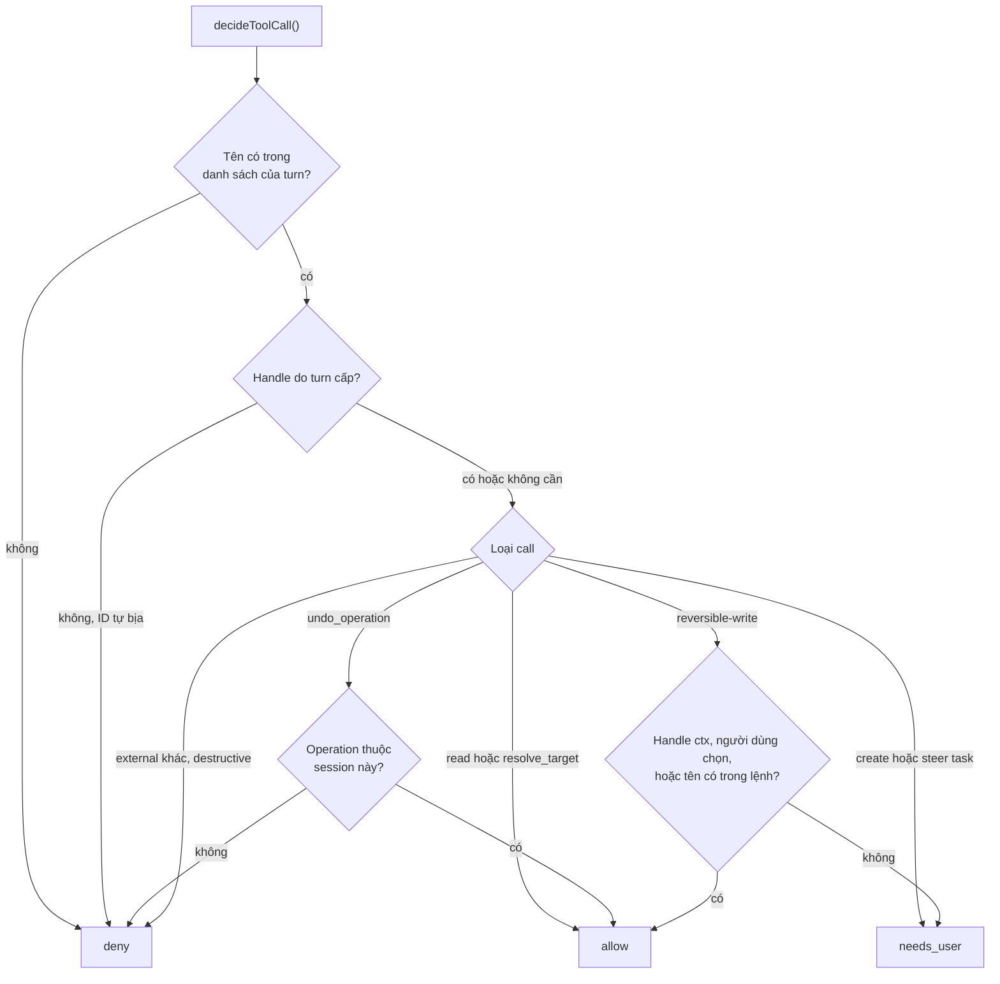

Đọc sơ đồ:
- "Người dùng nêu tên" chỉ so với `turn.instruction` đã lưu — không bao giờ với văn bản truyện, lịch sử
  hay kết quả tool ([policy.ts](../../src/main/services/agent/policy.ts), `namedByUser`). Đây là hàng rào
  chống prompt injection trong raw.
- `ctx` là handle của chip ngữ cảnh khi gửi từ màn chương; ghi vào `ctx` được allow luôn.
- Handle `t1`, `t2`... chỉ sinh ra từ `resolve_target`; model gửi ID thô sẽ bị `deny`.
- `create_translation_task` và `steer_translation_task` luôn cần duyệt vì tốn tiền / đổi cách dịch về sau.

### 3.4 Cần người dùng: chọn đích hoặc duyệt thao tác

Kích hoạt khi một vòng còn call `pending` (`needs_user`, hoặc `resolve_target` trả nhiều ứng viên) →
người dùng bấm trên `PendingActionCard` → cùng turn chạy tiếp.

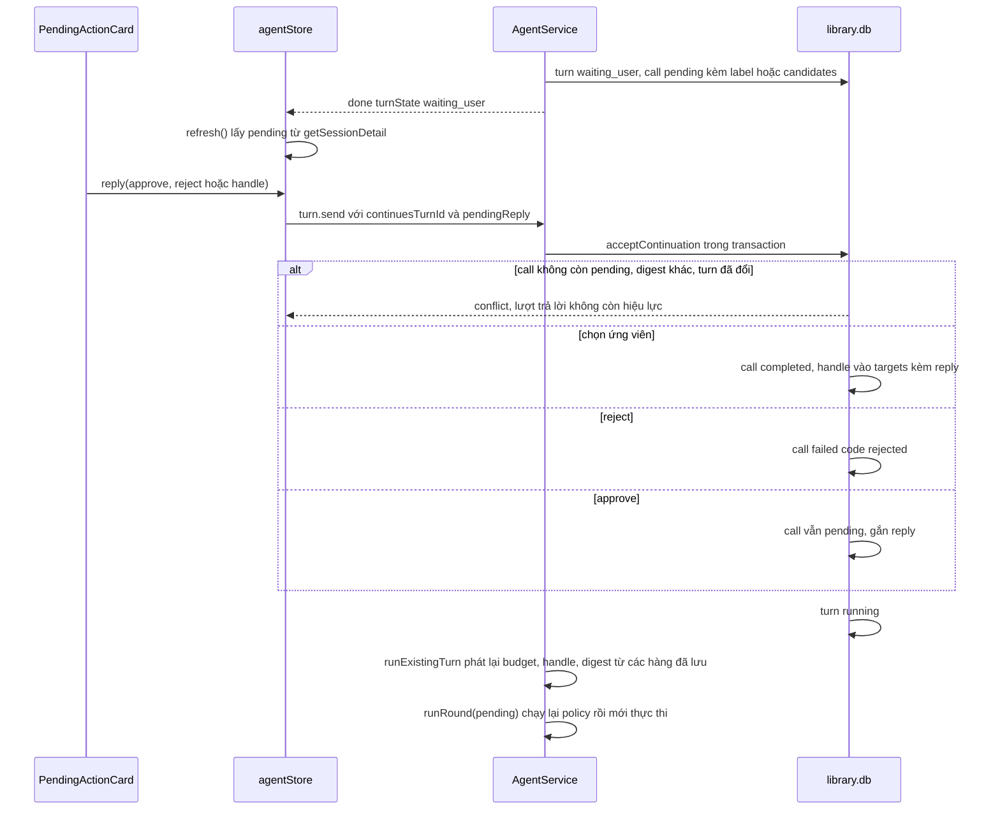

Đọc sơ đồ:
- Câu trả lời gắn đúng một call bằng `toolCallId` + `argsDigest` (bài học OpenAI Agents SDK trong
  [agent-spec-program.md](../modules/proposals/agent-spec-program.md)).
- Handle người dùng chọn được ghi vào tập `chosen` → policy coi như "do người dùng nêu".
- Sau restart, `waiting_user` vẫn giữ (reconcile chỉ đụng `queued/running`); handle được dựng lại từ
  `result.targets` của các hàng `agent_tool_call`.
- Hủy turn đang chờ: `cancelTurn` → `settleWaitingTurn(..., 'cancelled')`. Gửi lệnh mới: `expired`.

### 3.5 Ghi có điều phối: write intent → lease → journal → mở khóa editor

Kích hoạt khi call `reversible-write` (`translate_chapter`, `edit_translation`) được allow →
`AgentService.runWrite` tạo một `agent_operation` và ghi chương.

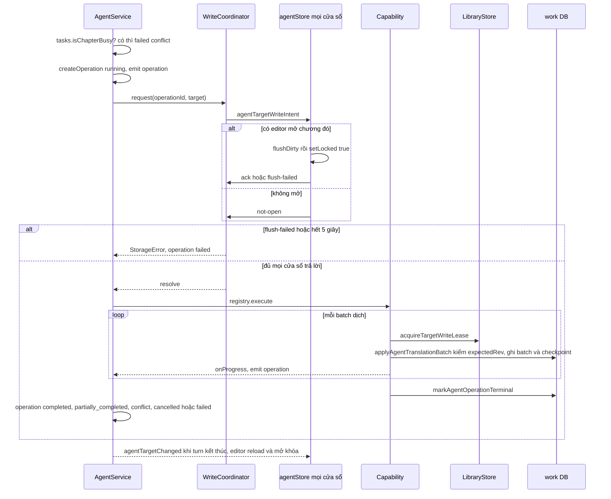

Đọc sơ đồ:
- Có **hai** lớp khóa: `AgentWriteCoordinator` (renderer flush + khóa editor, theo cửa sổ) và
  `LibraryStore.acquireTargetWriteLease` (khóa trong RAM theo `work:chapter:side`, trong Main).
- Cửa sổ đóng giữa chừng được tính là `not-open` (`windowClosed`, nối ở
  [registerIpc.ts](../../src/main/electron/registerIpc.ts)).
- Cancel fence: runner kiểm `signal.aborted` sau khi lấy lease, trước khi commit batch
  ([chapterTranslationRunner.ts](../../src/main/services/agent/chapterTranslationRunner.ts)).
- Chat dùng `OverwritePolicy 'protect'` (không đè bản dịch do người viết); task dùng `fill_untranslated`.
- `agentTargetChanged` của chat gom trong `targetsChanged` và chỉ gửi ở `finally` của turn.
- Kết quả ghi trả về model kèm `operationId`, để model có thể gọi `undo_operation` sau đó.

### 3.6 Undo

Kích hoạt bởi nút **Hoàn tác** trên `OperationCard` (IPC `agentOperationUndo`) hoặc model gọi
`undo_operation` → nội dung về revision trước operation.

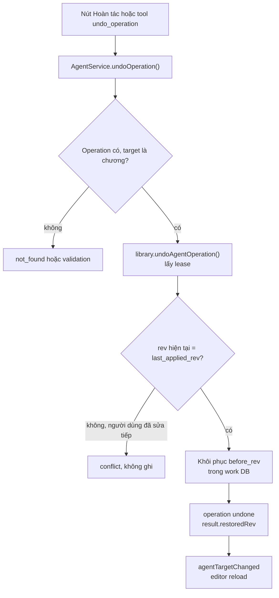

Đọc sơ đồ:
- Kiểm revision nằm trong journal (`undoAgentOperation` ở `agentOperationJournal.ts`).
- Chỉ chuyển được từ `completed`, `partially_completed`, `cancelled` sang `undone`, và chỉ khi có thay đổi
  (`canTransitionOperation`).
- Qua chat, policy chỉ allow undo operation của cùng session. Handler `undo_operation` trong
  `writeCapabilities.ts` không được gọi: `AgentService` xử lý trực tiếp.

### 3.7 Task dịch dải chương: tạo và chạy một item

Kích hoạt khi người dùng duyệt `create_translation_task` trong chat (hoặc IPC `agentTaskCreate`) →
`AgentTaskService.create` → `wake()` → mỗi lần chạy đúng một item trong toàn app.

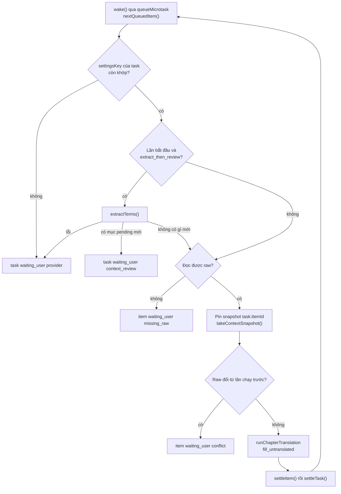

Đọc sơ đồ:
- Mỗi lần chạy item là **một operation mới** gắn `task_item_id`, ghi `agent_task_attempt`.
- Snapshot pin một lần (`run_context` khóa `task:<itemId>`); chạy lại dùng lại snapshot, và steering đã
  `accepted` thành `applied` đúng lúc pin.
- Task tránh gọi lại hàng đã có bản dịch nhờ `fill_untranslated` lọc trước khi lập lô. Khóa batch
  `item:<itemId>:<hash>` và `priorBatch` chống ghi trùng **sau** lời gọi model: cùng checksum thì bỏ qua
  ghi, khác checksum là `conflict`; bản thân kiểm `priorBatch` không bảo đảm tránh gọi model.
- `beforeCommit` gọi `flushEditors` → cùng `AgentWriteCoordinator` như chat; thất bại thành `conflict`.
- Các trần của `gateFor` là tùy chọn. `maxCalls` kiểm trước request kế tiếp; token/chi phí chỉ so usage
  đã báo (chi phí cần catalog có giá), không dự trù request sắp chạy nên có thể vượt sau một request.
  Với `maxTokens`, gate dừng khi đã gọi mà tổng usage là null; chưa kiểm `complete === false`, nên thiếu
  usage một phần chưa bảo đảm dừng. Gate đóng → item về `queued`, task `paused(budget)`.
- `settleItem`: khi runner trả được kết quả có `refusedIds` → `failed(refused)`; lỗi chỉ do trần →
  `failed(budget)`; còn lại `failed(provider)` hoặc `completed`. Riêng lô có lỗi nhưng không item nào,
  runner ném `StorageError('io')`: task nhận lỗi, ghi `failed(provider)` và mất danh sách refusal dùng
  cho `skip_refused`. Task kết thúc `completed` / `partially_completed` / `failed` theo số item xong.
- Sau mỗi run luôn gửi `agentTargetChanged` để editor bị khóa được mở, kể cả khi không ghi gì (commit `aa50041`).

#### 3.7b Điều chỉnh task từ một chương trở đi (steering)

Kích hoạt từ tool `steer_translation_task` sau khi duyệt hoặc form Điều chỉnh tác vụ →
`AgentTaskService.steer` trả chương bắt đầu có hiệu lực, không sửa các item đã ghim snapshot.

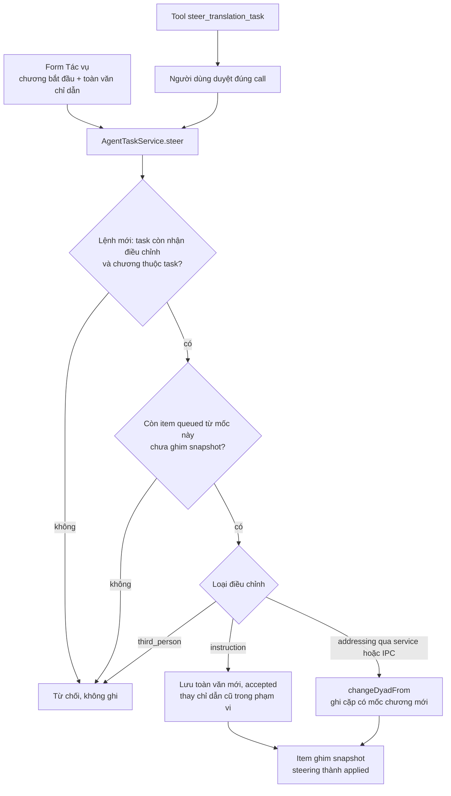

Đọc sơ đồ:
- `clientCommandId` + digest giữ idempotent: cùng lệnh trả steering cũ; dùng lại mã cho payload khác
  là conflict. Nhánh phát lại được xét trước guard trạng thái của lệnh mới.
- Điểm bắt đầu là item queued đầu tiên ở hoặc sau chương yêu cầu và chưa có `runKey`. Chương đang chạy,
  đã chạy hoặc retry với snapshot cũ giữ nguyên snapshot.
- Chỉ dẫn mới là **toàn văn thay thế**, không phải đoạn nối thêm. Nó thành applied lúc item ghim snapshot.
- Đổi cặp xưng hô có nhánh service/IPC `change.kind = addressing`; đổi ngôi ba theo chương bị từ chối
  vì chưa có phạm vi chương. Tool chat và form hiện chỉ gửi `instruction`.
- Task đã kết thúc/đang hủy, chương ngoài task hoặc không còn item phù hợp đều từ chối lệnh mới.
  Nguồn: `AgentService.runRound`, `AgentTaskService.steer/instructionFor`, `TaskList` và `taskStore`.

### 3.8 Đóng app và khởi động lại: reconcile

Kích hoạt bởi `app quit` (hàm trả về từ `registerIpc`) và `createServices` khi mở app → không gì tự chạy
lại, không gọi provider.

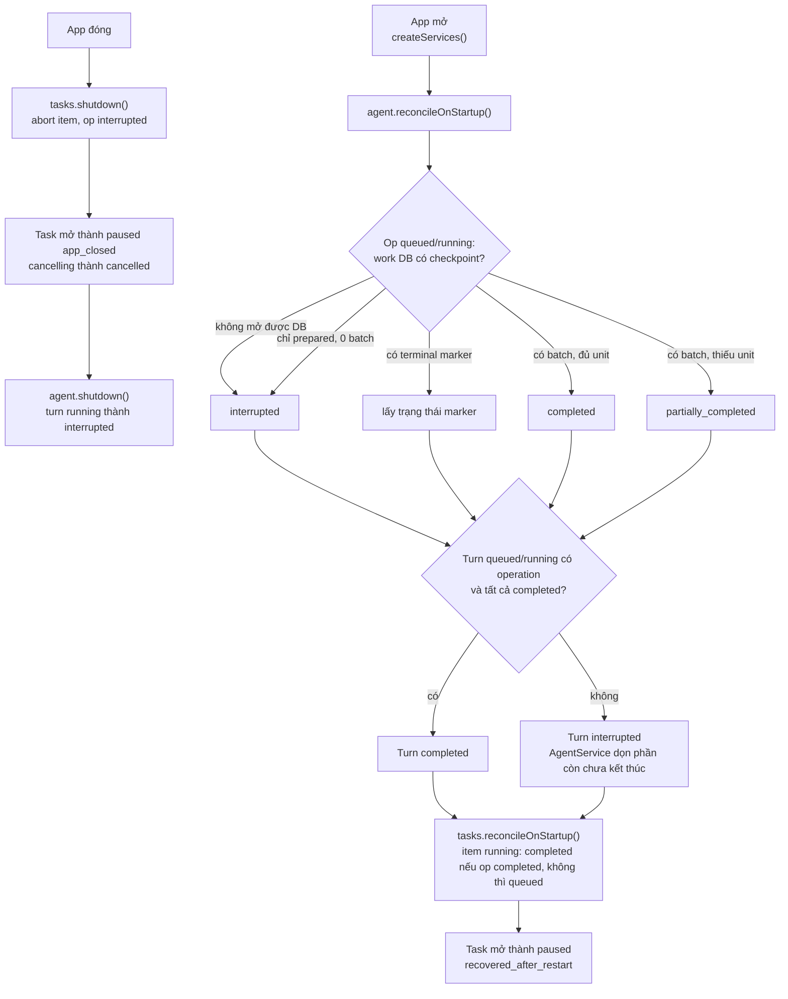

Đọc sơ đồ:
- Thứ tự cố định trong [createServices.ts](../../src/main/services/createServices.ts): operation trước
  (journal thắng), task sau. Comment: "neither calls a provider".
- Journal ở work DB là bằng chứng; library DB chỉ được cập nhật theo nó (`operationReconciler.ts`, luật 1–5
  trong comment đầu hàm).
- Lúc đóng, task ghi `paused(app_closed)` khi library còn mở — vì thế `tasks.shutdown()` chạy trước
  `agent.shutdown()` ([registerIpc.ts](../../src/main/electron/registerIpc.ts)).
- Chat legacy có reconcile riêng: `interruptAiTurns` trên từng work DB trong `createServices`.

### 3.9 Chat legacy theo tác phẩm và proposal

`AiPanel` (mở từ nút "đề xuất chờ duyệt" của thanh trạng thái chương) → `ai:chat` → `ChatService` → model
tạo proposal → người dùng Accept/Deny trên `ProposalCard`.

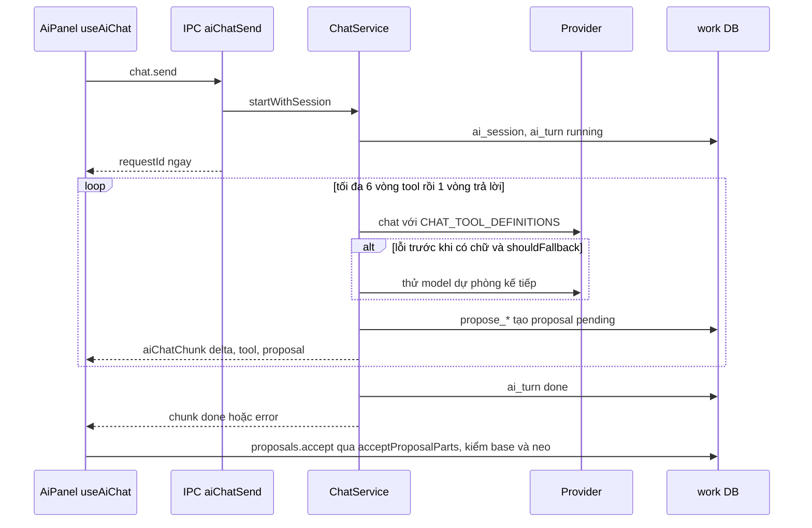

Đọc sơ đồ:
- Chunk chỉ về cửa sổ đã hỏi (`sink.send`); cửa sổ bị hủy thì `cancelAll()` (comment trong
  [chat.ts](../../src/main/ipc/handlers/chat.ts)).
- Chat legacy không ghi thẳng bản dịch: chỉ tạo proposal `policy: 'review'` hoặc thuật ngữ `pending`.
- Accept ghi nội dung, snapshot và trạng thái proposal trong một transaction; Undo dùng `text_snapshot`.

### 3.10 Event timeline đẩy về UI

Main phát bốn loại event; renderer gộp chúng vào Zustand store và đọc lại DB khi cần.

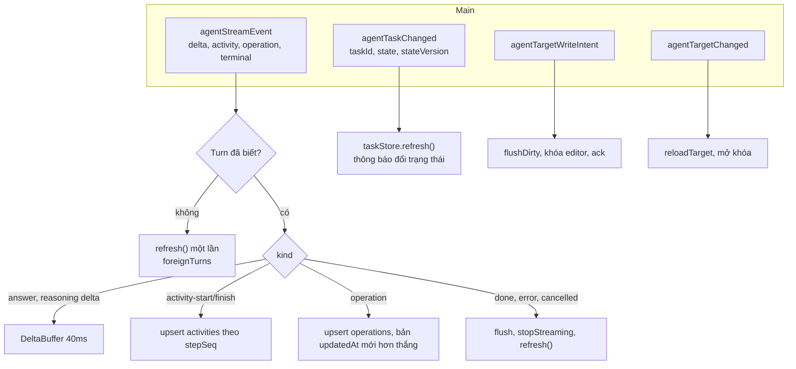

Đọc sơ đồ:
- Main đảm bảo `eventSeq` tăng dần và đúng **một** event kết thúc mỗi lần chạy (`emit` trong
  `runExistingTurn`); continuation là lần chạy mới nên có event `done` mới.
- Event không phải nguồn sự thật: khi kết thúc, store gọi `api.sessions.get` và `merge` theo
  `updatedAt` — câu trả lời đã lưu thắng chữ do delta vẽ.
- `useAgentWriteIntents` được gắn ở [AppContent.tsx](../../src/renderer/src/app/AppContent.tsx) nên
  mọi màn đều trả lời write intent (commit `aa50041`); `listenCoordinator` đếm số người nghe để chỉ
  subscribe một lần.
- `taskStore` không nhận payload chi tiết; chỉ refetch danh sách, có `refreshSeq` để bản trả lời cũ không
  ghi đè bản mới.

## 4. Dữ liệu và trạng thái

| Dữ liệu | Type | Nơi lưu |
| --- | --- | --- |
| Session, turn | `AgentSession`, `AgentTurn` ([agentRepository.ts](../../src/main/infra/storage/agentRepository.ts)) | `library.db`: `agent_session`, `agent_turn` (unique `client_command_id`, `context_json`, `usage_json`, `legacy_ref_json`) |
| Tool call | `AgentToolCall` (`round`, `callId`, `argsDigest`, `decision`, `state`, `result`) | `agent_tool_call` (library v11) |
| Operation, activity | `AgentOperation`, `AgentActivity` ([contracts/agent.ts](../../src/shared/contracts/agent.ts)) | `agent_operation` (có `turn_id` **hoặc** `task_item_id`), `agent_activity` |
| Journal ghi | checkpoint + batch | work DB: `agent_operation_checkpoint`, `agent_operation_batch` |
| Task | `AgentTaskView`, `AgentTaskItemView`, `AgentTaskSteeringView` | `agent_task`, `agent_task_item`, `agent_task_attempt` (v12), `agent_task_steering` (v13) |
| Snapshot ngữ cảnh | `run_context` khóa `agent:<opId>` (chat) hoặc `task:<itemId>` | work DB |
| QA | chỉ quyết định "Bỏ qua" | work DB `qa_dismissal` (v15); cảnh báo tính khi đọc |
| Legacy | `ai_session`, `ai_turn`, `proposal`, `proposal_part`, `text_snapshot` | work DB từng tác phẩm |
| Map import legacy | — | `agent_legacy_import`, `agent_legacy_turn_import` (không có writer ngoài test) |
| RAM Main | `activeControllers`, `AgentWriteCoordinator.pending`, `AgentTaskService.running`, `LibraryStore.writeLeases` | mất khi đóng app — vì thế mới cần reconcile |
| Renderer | `useAgentStore`, `useTaskStore`, `drafts` | Zustand, không phải nguồn phục hồi |

Turn (`canTransitionTurn`):

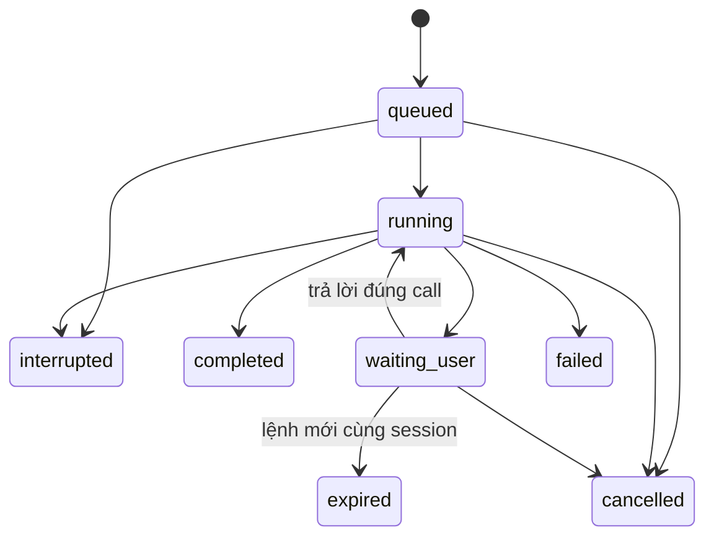

Operation (`canTransitionOperation`; `undone` cần `hasChanges`):

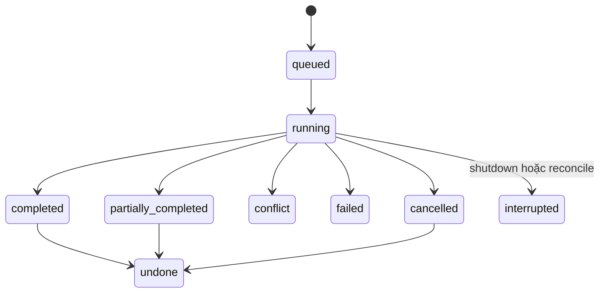

Task (`canTransitionTask`). Lý do (`reason`) chỉ có ở `waiting_user`, `paused`, `failed`:

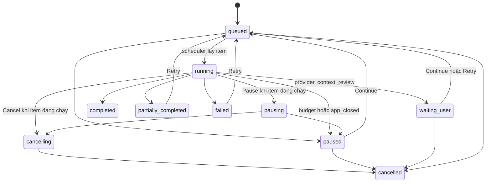

Item: `queued → running → completed | failed | waiting_user | queued (dừng an toàn) | cancelled`;
`waiting_user/failed → queued` khi Continue/Retry; `failed(refused) → completed` khi "Bỏ qua đoạn bị từ
chối"; `queued/waiting_user/failed → skipped`. Mọi lệnh control qua compare-and-set `stateVersion`.
"Chạy lại" (`run_again`) tạo task mới có `sourceTaskId`, không hồi sinh task cũ.

## 5. Tại sao code viết như vậy

- **Model chọn capability, code điều khiển việc dài.** Chat chỉ tạo task; vòng hàng chục chương là
  scheduler tất định. **[docs]** [decisions.md](../modules/proposals/decisions.md) mục 3–4.
- **Ghi tool call trước khi chạy, ghi kết quả trước event thành công.** Theo Hermes `turn_tool_round.py`;
  cho phép continuation và replay budget sau restart. **[docs]**
  [agent-spec-program.md](../modules/proposals/agent-spec-program.md); **[code]** `insertToolCalls` trước `runRound`.
- **Policy là hàm thuần, chạy lại trước khi thực thi.** Approval không vượt deny; quyền không lấy từ dữ liệu
  model đọc được. **[code]** comment "An approved call is judged again" trong `runRound`; D4 của
  `add-agent-conversation`.
- **Target chỉ qua handle.** Model không có cách gửi ID trực tiếp; `resolve_target` tất định, mơ hồ thì hỏi.
  **[docs]** [data-and-safety.md](../modules/proposals/data-and-safety.md) điều 1.
- **Không fallback model trong Trợ lý mới** (chat legacy thì có). **[docs]** quyết định xuyên suốt số 9 trong
  agent-spec-program; README module ghi rõ khác biệt.
- **Usage thiếu là unknown, không phải 0.** **[code]** `aggregateTokenUsage` giữ `complete:false` khi
  thiếu một phần, hoặc null khi chưa có số đo. **[docs]** decisions mục 6. Tuy nhiên `gateFor` hiện
  không kiểm cờ `complete`; không suy từ nguyên tắc này rằng mọi usage thiếu đều làm task dừng.
- **Work DB trước, library DB sau, journal thắng.** Crash giữa hai DB được reconcile theo checkpoint/batch.
  **[code]** comment `AgentTaskService` và `reconcileStartupOperations`.
- **`fill_untranslated` cho task.** Retry không gọi lại hay ghi đè những gì lần trước đã commit, kể cả hàng
  AI. **[code]** comment `OverwritePolicy`.
- **Không tự chạy lại sau restart.** Task về `paused(recovered_after_restart)`; người dùng bấm Continue.
  Lý do: không tiêu tiền ngầm. **[docs]** roadmap gate 2; **[suy luận]** về động cơ chi phí.
- **Một item toàn app, wake theo event, không poll.** **[code]** comment class `AgentTaskService`. Đơn giản
  hóa lease và trần chi phí; song song đã được hoãn có chủ ý (**[docs]** roadmap "Hoãn có chủ ý").
- **Turn thuộc Main, event tới mọi cửa sổ.** **[code]** comment D8 trong handler `agentTurnSend`; trái với
  chat legacy chỉ gửi về cửa sổ hỏi.
- **Cửa sổ ngữ cảnh ước lượng 2 ký tự/token.** Thấp có chủ ý vì CJK gần 1 token/ký tự. **[code]** comment
  `CHARS_PER_TOKEN` (ghi "shortcut").
- **`contextStrategy` tùy chọn từ 2026-10-14.** Tác phẩm chưa có glossary thì trích trước. **[code]**
  `create` trong taskService; **[commit]** `0d220c4`.

## 6. Đọc code bắt đầu từ đâu

1. [shared/contracts/agent.ts](../../src/shared/contracts/agent.ts) và [agentTask.ts](../../src/shared/contracts/agentTask.ts) — từ vựng trạng thái và event; đọc trước để hiểu mọi chuyển trạng thái.
2. [policy.ts](../../src/main/services/agent/policy.ts) — ngắn, nói rõ ai được ghi gì.
3. [agentService.ts](../../src/main/services/agent/agentService.ts) — đọc `runExistingTurn`, rồi `prepareCall`, `runWrite`, `acceptContinuation`.
4. [taskService.ts](../../src/main/services/agent/taskService.ts) — `control`, `runItem`, `settleItem`, `shutdown`, `reconcileOnStartup`.
5. [store/agentStore.ts](../../src/renderer/src/modules/agent/store/agentStore.ts) — `handleStreamEvent` và `subscribe` để thấy phía UI.

## 7. Điểm đáng ngờ / nợ kỹ thuật

1. **`agentLegacyAdapter.ts` là code chết.** `importLegacySession`, `getLegacyRefForTurn`,
   `acceptLegacyProposalParts`... chỉ được gọi trong test; `AgentRepository.recordLegacyImport/findLegacyImport`
   viết lại cùng SQL và cũng không ai gọi. Bảng `agent_legacy_import` không có writer khi app chạy. Thực tế
   proposal cũ được đọc/duyệt trực tiếp qua `ai:proposals` + `AiPanel`, không qua `legacyRef` như
   [sessions-and-jobs.md](../modules/proposals/sessions-and-jobs.md) mô tả.
2. **Tài liệu lệch code.** [README module](../modules/proposals/README.md) nói Chat cũ là "tab thứ ba" của side
   panel; [AssistantSidePanel.tsx](../../src/renderer/src/modules/workspace/chapter-screen/AssistantSidePanel.tsx)
   chỉ còn `TabsPanel value="legacy"` không có `TabsTab`, mở từ thanh trạng thái. Bảng đầu README vẫn ghi
   "lát 4–6 chưa" trong khi đoạn trên nói đã xong cả sáu; sessions-and-jobs.md vẫn ghi task "chưa triển khai".
3. **Hai bộ tool đọc song song.** `readCapabilities.ts` và `chatTools.ts` cùng có `list_chapters`,
   `read_chapter`, `read_segments`, `search_work`, `list_glossary`, `list_addressing` với code và giới hạn khác
   nhau (20 000 vs 80 000 ký tự/turn).
4. **Khóa editor có thể không được mở.** Trong `runWrite`, nhánh `catch` (coordinator timeout,
   `flush-failed` từ một cửa sổ, hoặc cancel ngay sau khi các cửa sổ đã ack và `setLocked(true)`) không thêm
   vào `targetsChanged`, nên không có `agentTargetChanged` để mở khóa. **[suy luận]** từ code, chưa thấy test.
5. **`TargetResolver.resolve(string)` xét `chương <tên>` trước `chương này`.** Regex `chapterTitleMatch`
   bắt "chương này" thành tên chương "này", nên nhánh `relative: 'current_chapter'` chỉ chạy với "đoạn này"/
   "hiện tại". Nó cũng chỉ hiểu "chương N", trong khi policy `mentionsChapter` hiểu cả `chapter`/`第`.
   Ảnh hưởng nhỏ vì model thường dùng handle `ctx` (**[suy luận]**).
6. **Contract có phần không ai dùng.** Event `activity-update` có trong schema và store nhưng Main không phát;
   `AgentRunner` (types.ts) và `validateAgentEventSequence` chỉ ở test; handler của `undo_operation` và
   `create_translation_task` không bao giờ được registry gọi (AgentService xử lý riêng), và `undo_operation`
   khai `targetPolicy: 'requires_target'` dù args không có target.
7. **Undo không đi qua write coordinator.** `undoOperation` (IPC và tool) không phát write intent để flush
   editor trước khi khôi phục; journal chỉ chặn khi revision đã lưu khác. Bản sửa chưa lưu trong editor có thể
   bị reload đè. **[suy luận]**
8. **Fallback model trong `translate_chapter` khác `defaultModelSelection`.** Handler lấy kết nối đầu tiên có
   model mà không kiểm `enabled`; đường chat luôn truyền `modelRef` nên nhánh này thực tế không chạy.

## 8. Liên kết

- Tài liệu module: [Trợ lý AI và đề xuất](../modules/proposals/README.md) ·
  [Quyết định](../modules/proposals/decisions.md) · [Roadmap](../modules/proposals/agent-roadmap.md) ·
  [Chương trình đặc tả](../modules/proposals/agent-spec-program.md) ·
  [Dữ liệu và an toàn](../modules/proposals/data-and-safety.md) ·
  [Duyệt proposal legacy](../modules/proposals/review-flow.md)
- OpenSpec đã archive: `openspec/changes/archive/2026-10-13-add-agent-conversation/design.md` (D1–D9),
  `2026-10-14-add-durable-translation-tasks`, `2026-10-14-add-agent-steering`,
  `2026-10-14-add-translation-task-qa`, `2026-10-14-add-agent-context-workflow`.
- Code-tour khác: [01 Process và IPC](01-process-va-ipc.md) (`createServices`, `registerIpc`, preload) ·
  [02 Lưu trữ](02-luu-tru.md) (`agentRepository`, `agentOperationJournal`, schema) ·
  [03 Kết nối AI](03-ket-noi-ai.md) (`provider.chat`, fallback, `describeProviderError`) ·
  [04 Dịch chương](04-dich-chuong.md) (`executeTranslateBatch`, prompt từ snapshot) ·
  [05 Ngữ cảnh dịch](05-ngu-canh-dich.md) (`takeContextSnapshot`, trích thuật ngữ, duyệt pending) ·
  [08 Giao diện renderer](08-giao-dien-renderer.md) (ChapterPanes, side panel, editor lock).
