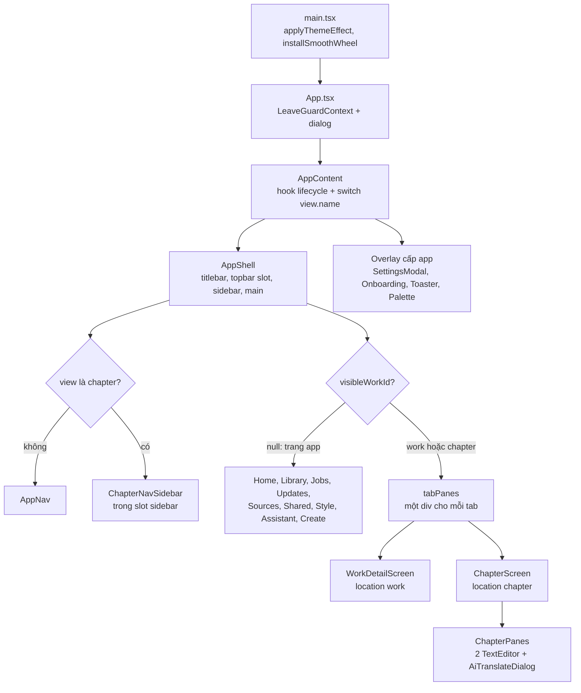
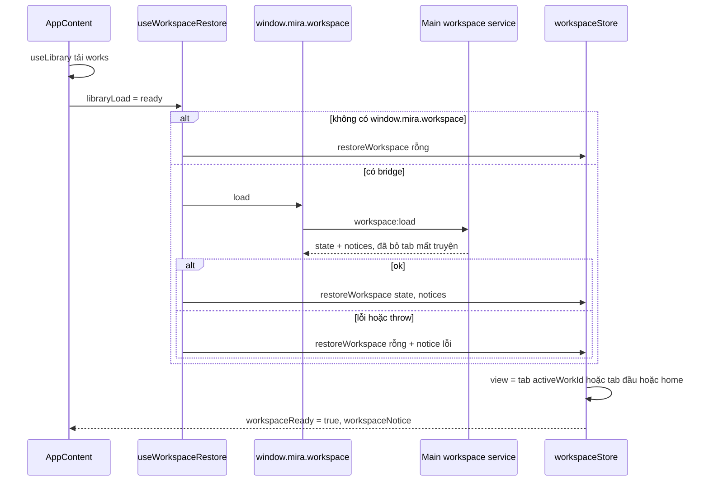
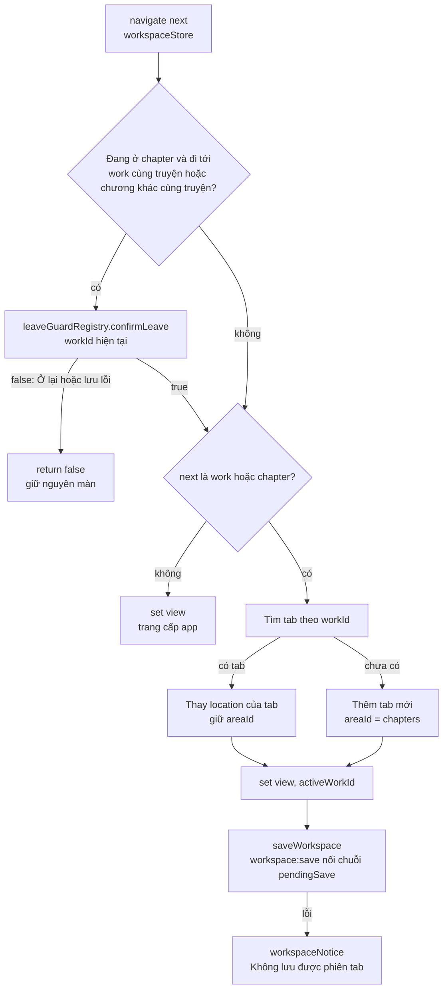
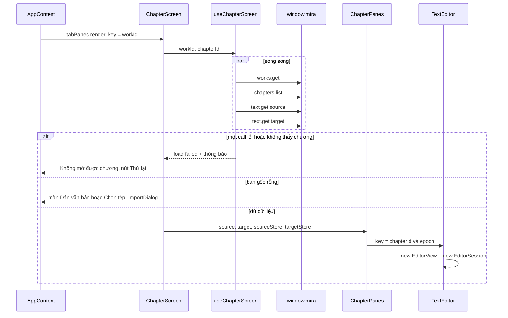
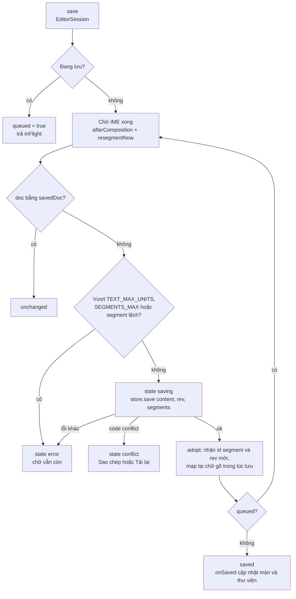
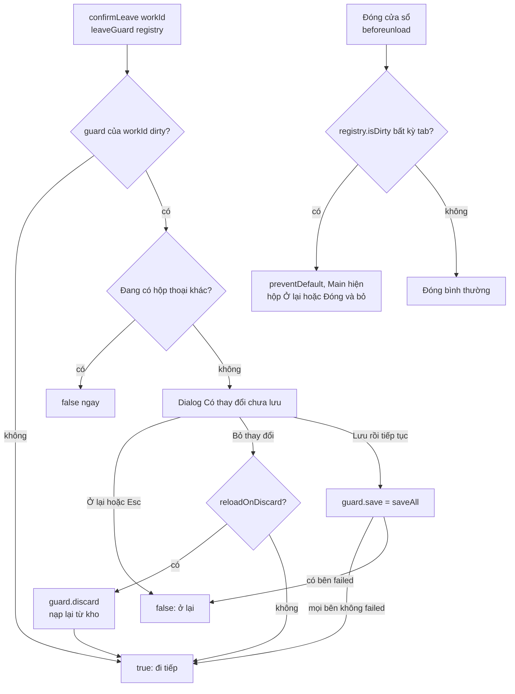
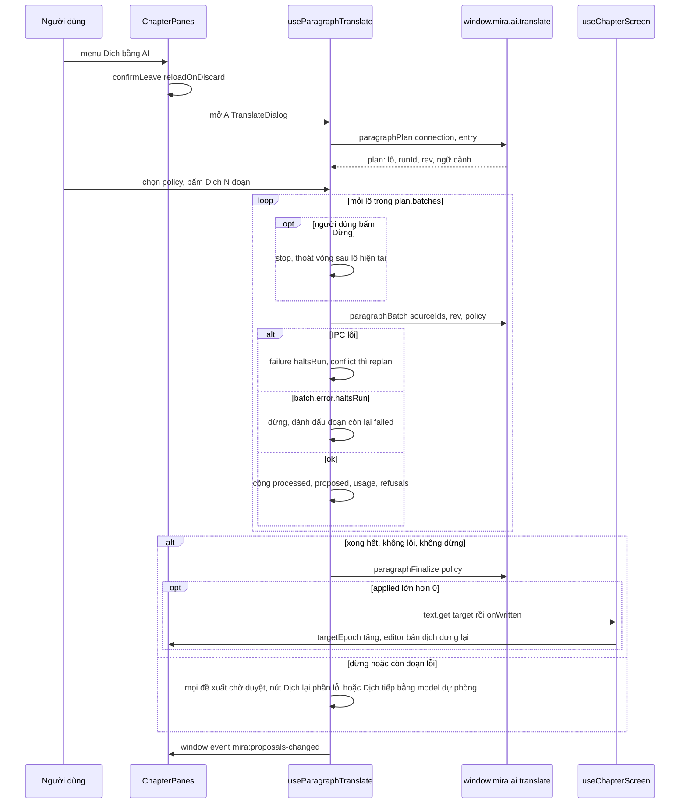
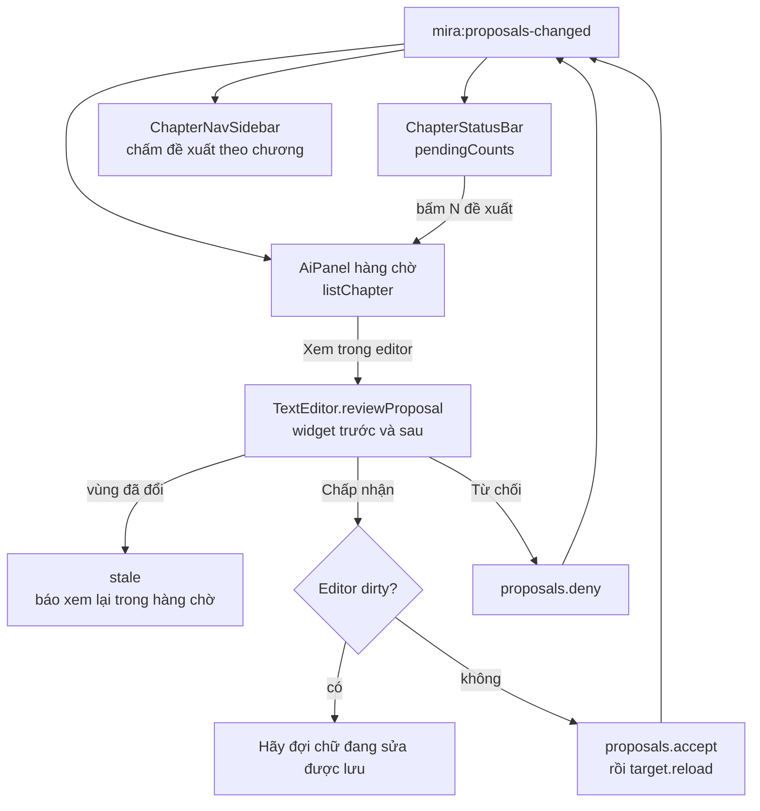
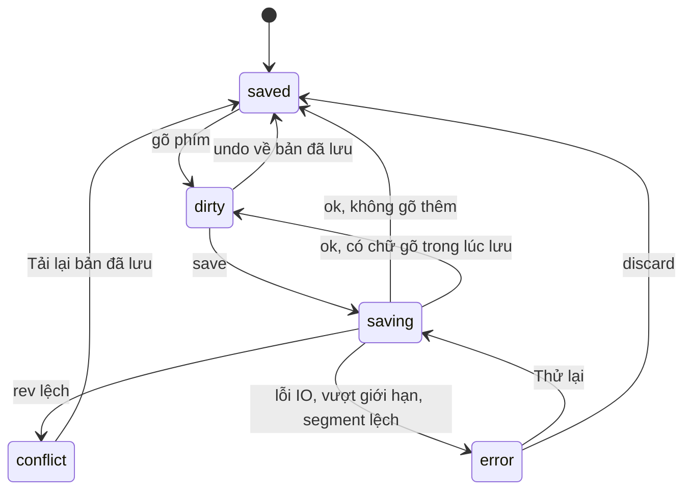
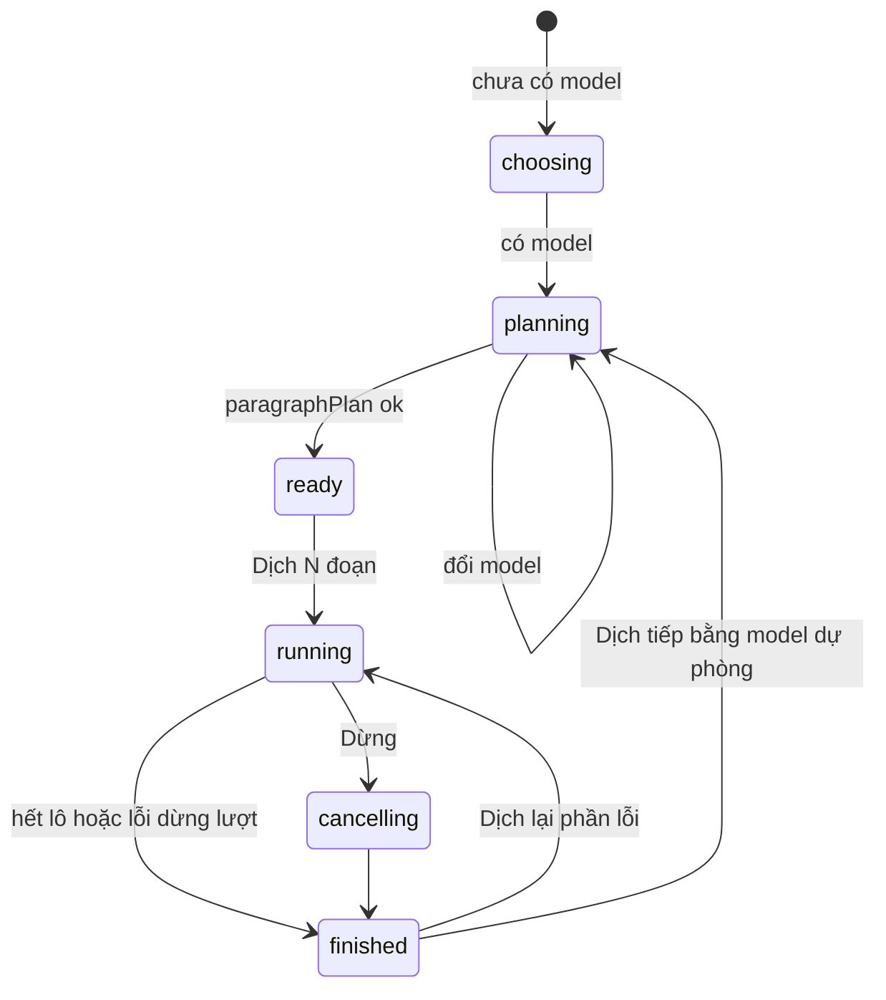

# Giao diện renderer: khung app, điều hướng và workspace

> **Một câu:** vùng này dựng cửa sổ React của Mira, chọn màn theo `View`, giữ tab truyện, mở chương vào
> hai editor CodeMirror, lưu có kiểm revision và chạy hộp thoại "Dịch bằng AI" từ phía renderer.
> Cập nhật: 2026-10-15 · Nguồn: đọc code tại commit db2455f.

## 1. Vì sao vùng này tồn tại

Mira là app Electron. Renderer là nơi duy nhất người dùng nhìn thấy, nhưng nó không có quyền đọc file
hay gọi AI; mọi thứ đi qua `window.mira` (xem [01-process-va-ipc.md](01-process-va-ipc.md)). Vùng này
giải quyết bốn việc: (1) lắp khung cửa sổ và chọn màn mà không dùng router; (2) giữ nhiều truyện mở
cùng lúc dưới dạng "tab" ẩn để không mất bản sửa khi chuyển truyện; (3) cho người dịch sửa bản gốc và
bản dịch trong editor có segment, lưu an toàn khi có xung đột hoặc IME đang gõ; (4) điều khiển lượt dịch
một chương theo lô từ UI. `App.tsx` là gốc, `app/` lo composition, `modules/workspace` sở hữu phiên làm
việc trên một truyện. Các module khác (library, sources, context, export, ai-connections, agent) chỉ cắm
vào qua `public.ts`.

## 2. Bản đồ file

Đường dẫn gốc: `src/renderer/src/`.

**Khởi động và khung app**

| File/thư mục | Làm gì | Symbol chính để grep |
| --- | --- | --- |
| [main.tsx](../../src/renderer/src/main.tsx) | Áp theme trước lần render đầu, bật cuộn mượt, mount `<App/>` trong `TooltipProvider` | `applyThemeEffect`, `installSmoothWheel` |
| [App.tsx](../../src/renderer/src/App.tsx) | Tạo registry LeaveGuard một lần cho cả app, render hộp thoại "Có thay đổi chưa lưu" | `useLeaveGuardRegistry`, `LeaveGuardContext` |
| [app/AppContent.tsx](../../src/renderer/src/app/AppContent.tsx) | Composition root thật: gọi các hook lifecycle, `switch (view.name)` chọn màn, dựng `tabPanes`, overlay | `AppContent`, `tabPanes`, `go`, `continueWork` |
| [app/AppShell.tsx](../../src/renderer/src/app/AppShell.tsx) | Khung lưới: titlebar, nav, topbar có slot, sidebar, `<main>`; Ctrl+B | `AppShell`, `TopBarSlotContext` |
| [app/AppNav.tsx](../../src/renderer/src/app/AppNav.tsx) | Thanh điều hướng trái (224px hoặc 48px) | `MAIN`, `RESOURCES`, `AppNav` |
| [app/CommandPaletteMock.tsx](../../src/renderer/src/app/CommandPaletteMock.tsx) | Bảng Ctrl+K, dữ liệu mẫu | `CommandPaletteMock` |
| [app/hooks/](../../src/renderer/src/app/hooks/) | Ctrl+K mở palette; theo dõi theme hệ thống | `useAppShortcuts`, `useSystemThemeSync` |
| [app/screens/](../../src/renderer/src/app/screens/) | Màn compose nhiều module: Trang chủ, Tác vụ, Trợ lý | `HomeScreen`, `JobsScreen`, `AssistantScreen` |
| [app/autosave.ts](../../src/renderer/src/app/autosave.ts) | Hàng đợi lưu debounce. **`chưa dùng`**: chỉ test gọi | `useAutosave`, `createSaveQueue` |
| [app/smoothWheel.ts](../../src/renderer/src/app/smoothWheel.ts) | Nội suy cuộn bánh xe chuột có khấc | `installSmoothWheel` |
| [app/architecture/](../../src/renderer/src/app/architecture/checkRendererBoundaries.test.ts) | Test cho bộ kiểm ranh giới import | `checkRendererBoundaries` |

**Module workspace** (`modules/workspace/`)

| File/thư mục | Làm gì | Symbol chính để grep |
| --- | --- | --- |
| [public.ts](../../src/renderer/src/modules/workspace/public.ts) | Mặt tiền duy nhất cho `app/` | (export list) |
| [store/workspaceStore.ts](../../src/renderer/src/modules/workspace/store/workspaceStore.ts) | `View`, tab, điều hướng có guard, lưu phiên tab | `navigate`, `restoreWorkspace`, `saveWorkspace` |
| [store/chapterStore.ts](../../src/renderer/src/modules/workspace/store/chapterStore.ts) | Danh sách chương của truyện đang hiển thị, cache theo truyện | `initWork`, `otherWorkChapters`, `latestLoadTicket` |
| [store/paneLayoutStore.ts](../../src/renderer/src/modules/workspace/store/paneLayoutStore.ts) | Thu gọn pane, tỉ lệ rộng, cuộn cùng (localStorage) | `mira.paneLayout`, `clampRatio` |
| [store/aiChatStore.ts](../../src/renderer/src/modules/workspace/store/aiChatStore.ts) | Phiên chat cũ theo truyện, nhận chunk stream | `startListening`, `earlyChunks` |
| [hooks/useWorkspaceLifecycle.ts](../../src/renderer/src/modules/workspace/hooks/useWorkspaceLifecycle.ts) | Gắn registry vào store, `beforeunload`, listener chat, reload chương khi agent ghi; khôi phục tab | `useWorkspaceLifecycle`, `useWorkspaceRestore` |
| [work-detail/](../../src/renderer/src/modules/workspace/work-detail/) | Màn tác phẩm: header, các khu Chương/Ngữ cảnh/Bản raw/Tác vụ | `WorkDetailScreen`, `workAreas`, `useChapters`, `useWorkDetail` |
| [work-detail/SourcesAreaMock.tsx](../../src/renderer/src/modules/workspace/work-detail/SourcesAreaMock.tsx) | **`chưa dùng`**: không file nào import | `SourcesAreaMock` |
| [chapter-screen/ChapterScreen.tsx](../../src/renderer/src/modules/workspace/chapter-screen/ChapterScreen.tsx) | Tải chương; chưa có bản gốc thì màn nhập, có rồi thì `ChapterPanes` | `ChapterScreen`, `makeStore` |
| [chapter-screen/useChapterScreen.ts](../../src/renderer/src/modules/workspace/chapter-screen/useChapterScreen.ts) | Đọc work + chapters + 2 bên text song song; `epoch` để ép editor dựng lại | `fetchAll`, `applyTarget`, `targetEpoch` |
| [chapter-screen/ChapterPanes.tsx](../../src/renderer/src/modules/workspace/chapter-screen/ChapterPanes.tsx) | Màn hai pane (khoảng 940 dòng): phím tắt, cuộn cùng, menu chương, trợ lý, dịch, xuất | `saveAll`, `useRegisterLeaveGuard`, `handleNavigateChapter` |
| [chapter-screen/ChapterNavSidebar.tsx](../../src/renderer/src/modules/workspace/chapter-screen/ChapterNavSidebar.tsx) | Cột danh sách chương khi đang mở chương | `ChapterNavSidebar`, `parseQuery` |
| [chapter-editor/TextEditor.tsx](../../src/renderer/src/modules/workspace/chapter-editor/TextEditor.tsx) | Bọc CodeMirror 6 cho một bên; handle `save/discard/reviewProposal` | `TextEditor`, `TextEditorHandle` |
| [chapter-editor/editorSession.ts](../../src/renderer/src/modules/workspace/chapter-editor/editorSession.ts) | Máy trạng thái lưu: revision, IME, xung đột, hàng đợi | `EditorSession`, `SaveState`, `adopt` |
| [chapter-editor/leaveGuard.tsx](../../src/renderer/src/modules/workspace/chapter-editor/leaveGuard.tsx) | Registry guard theo `workId` và hộp thoại Lưu/Bỏ/Ở lại | `createLeaveGuardRegistry`, `confirmLeave` |
| [chapter-editor/](../../src/renderer/src/modules/workspace/chapter-editor/) (còn lại) | Extension CodeMirror: segment, live preview, ảnh, liên kết đoạn, xem đề xuất | `segmentDecorations`, `ProposalReview`, `idleResegment` |
| [translation/](../../src/renderer/src/modules/workspace/translation/) | Hộp thoại "Dịch bằng AI" và vòng lặp lô | `AiTranslateDialog`, `useParagraphTranslate`, `targetsOf` |
| [assistant/](../../src/renderer/src/modules/workspace/assistant/) | Chat cũ theo chương và hàng chờ đề xuất. Xem [06](06-tro-ly-agent.md) | `AiPanel`, `useAiChat` |

**Nền tảng dùng chung**

| File/thư mục | Làm gì | Symbol chính để grep |
| --- | --- | --- |
| [components/ui/](../../src/renderer/src/components/ui/) | ~45 primitive trung lập domain, nhiều cái bọc Base UI: Button, Dialog, Tabs, DropdownMenu, Tooltip, Toast… | `variants.ts`, `reicon.ts`, `ICON` |
| [components/ui/topBarSlot.ts](../../src/renderer/src/components/ui/topBarSlot.ts) + [TopBarActions.tsx](../../src/renderer/src/components/ui/TopBarActions.tsx) | Màn con portal nút/tiêu đề lên topbar của shell; tab ẩn không portal | `TopBarSlotContext`, `WorkTabActiveContext` |
| [components/ui/themeStore.ts](../../src/renderer/src/components/ui/themeStore.ts) | Theme sáng/tối/hệ thống, ghi `data-theme` và màu nút cửa sổ | `useThemeStore`, `mira.theme` |
| [components/ui/notificationStore.ts](../../src/renderer/src/components/ui/notificationStore.ts) | Toast (tối đa 4) | `notify`, `notifyError` |
| [lib/](../../src/renderer/src/lib/) | `cn` (gộp class Tailwind), `MOCK_FEATURES`, `registerStoreReset` cho test | `cn`, `SOON_LABEL` |
| [styles/tokens/](../../src/renderer/src/styles/tokens/) | Token 3 tầng: foundation → semantic → component; `theme.css` map sang class Tailwind | `--mira-*` |

Thư mục `hooks/` ở gốc renderer mà [ARCHITECTURE.md](../../ARCHITECTURE.md) nhắc tới **chưa tồn tại**.

## 3. Luồng chính

### 3.1 Cây component cấp cao

Kích hoạt khi app mở → kết quả là một cây cố định, chỉ phần nội dung đổi theo `view.name`.

Đọc sơ đồ:
- `App.tsx` chỉ tạo registry LeaveGuard. Mọi quyết định khác nằm trong `AppContent`.
- Trang cấp app đến từ module khác qua `public.ts`: `LibraryScreen`, `CreateWorkScreen` (library, xem
  [07](07-thu-vien-nguon-xuat.md)); `SourcesScreen`, `UpdatesScreen` (sources); `SharedGlossaryMock`,
  `StyleProfilesMock` (context, xem [05](05-ngu-canh-dich.md)); `SettingsModal`, `Onboarding` (ai-connections,
  xem [03](03-ket-noi-ai.md)); `TaskList`, `AgentTranscript` (agent, xem [06](06-tro-ly-agent.md)).
- Màn work/chapter **không** render qua biến `content` mà qua `tabPanes`. Mỗi tab là một `div hidden inert`.
  Tab chương không hoạt động và không dirty trả về `null`, tức là bị tháo khỏi cây.
- Ở màn chương, `nav` là `null`. Nút theme và Cài đặt chuyển lên topbar (`nav === null` trong `AppShell`).
- Màn con đặt tiêu đề và nút lên topbar bằng `TopBarTitle` / `TopBarActions` (portal vào slot của shell).

### 3.2 Khôi phục workspace khi mở app

Kích hoạt khi thư viện tải xong (`library.load === 'ready'`) → app mở thẳng vào truyện/chương của tab
hoạt động lần trước, hoặc về Trang chủ.

Đọc sơ đồ:
- Trước khi `workspaceReady`, `AppContent` hiện "Đang khôi phục phiên làm việc…". `view` ban đầu là `home`.
- Main kiểm ID tab và trả `notices` (truyện mất, chương mất). Renderer chỉ hiện chúng trong banner
  `workspaceNotice`. Phần Main thuộc [07](07-thu-vien-nguon-xuat.md).
- Lỗi khôi phục không chặn Thư viện: mọi nhánh lỗi đều gọi `restoreWorkspace` với state rỗng.
- `saveWorkspace` không làm gì khi `workspaceReady` còn false. Vì vậy điều hướng sớm không ghi đè phiên cũ.
- Nếu thư viện tải lỗi, restore không bao giờ chạy và tab không được lưu trong phiên đó.

### 3.3 Điều hướng giữa các màn và tab truyện

Kích hoạt khi bấm mục AppNav, mở truyện, mở chương, nút back hoặc Alt+↑/↓ → `workspaceStore.navigate(next)`.

Đọc sơ đồ:
- Chỉ rời chương **trong cùng truyện** mới hỏi. Đi sang trang app hay truyện khác thì không hỏi, vì tab cũ
  vẫn được giữ (dirty thì vẫn mount). Xem rủi ro ở mục 7.
- `saveWorkspace` nối promise vào `pendingSave` nên các lần ghi phiên tab đi tuần tự, không đè nhau.
- `closeTab` và `activateTab` có trong store nhưng hiện **không UI nào gọi** (mục 7). Cách duy nhất để
  "chuyển tab" là mở lại truyện từ Thư viện/Trang chủ, khi đó `navigate` tìm thấy tab cũ.
- `openParagraph` = `navigate` chương + đặt `reveal`. `ChapterPanes` thấy `reveal` thì cuộn hai editor
  tới đoạn đó rồi `clearReveal`. Màn Tác vụ dùng nó cho nút "Mở đoạn".
- Alt+↓ (`handleNavigateChapter`) đọc lại danh sách chương. Nếu số chương nhảy cóc và nguồn raw có chương
  thiếu, nó hỏi tải chương đó trước (`gapPrompt`, gọi `sources.catalog.download`).

### 3.4 Mở chương vào editor

Kích hoạt khi `view` thành `chapter` → hai `TextEditor` dựng xong, mỗi bên có một `EditorSession`.

Đọc sơ đồ:
- `latest` ticket trong `useChapterScreen` bỏ kết quả của lần fetch cũ khi chương đổi nhanh.
- `makeStore` tạo `TextStore` gói `text.save` / `text.get` cho một bên. `EditorSession` chỉ biết interface này.
- Editor bản gốc mặc định khóa (`readOnly={!unlocked}`). Người dùng bấm "Sửa bản gốc" mới mở.
- `TextEditor` đọc `record` **một lần** lúc mount. Muốn nạp nội dung mới từ ngoài thì đổi `key`
  (`sourceEpoch` / `targetEpoch`), không đẩy prop.
- Chương mở từ sidebar không gọi `chapters.open`. Chỉ "Tiếp tục" (Trang chủ, header tác phẩm) gọi để Main ghi `lastChapter`.

### 3.5 Sửa và lưu một bên văn bản

Kích hoạt khi bấm Ctrl+S, "Lưu rồi tiếp tục" hoặc agent cần `flush` → `EditorSession.save()`.
Editor **không tự lưu**. Riêng "Xuất chương" trong `ChapterPanes` chỉ thử lưu editor bản dịch
rồi mở hộp Xuất trong `finally`, không kiểm kết quả lưu; các điểm xuất khác không nhất thiết gọi
editor. `ExportService` đọc bản `target` đã lưu trong DB, không đọc trực tiếp bản sửa trong editor.

Đọc sơ đồ:
- `expectedRev` là khóa lạc quan. Main trả `conflict` khi revision đã đổi, ví dụ bản gốc vừa bị nhập lại
  hoặc agent đã ghi. Pipeline lưu phía Main thuộc [02](02-luu-tru.md).
- Chữ gõ trong lúc request đang bay được gom vào `since` rồi `applyEdits` map lại vị trí segment. Editor
  không bị khóa khi lưu.
- Segment có id không còn trong `knownIds` (ví dụ undo khôi phục segment đã xóa) được gửi như segment mới (`id: null`).
- Ở trạng thái `error`, banner có nút "Thử lại". Ở `conflict`, banner có "Sao chép văn bản của tôi" và
  "Tải lại bản đã lưu" (hỏi xác nhận rồi `session.reload()`).
- `onSaved` → `noteSaved` / `noteTargetSaved` → `works.get` → `onWorkChanged` cập nhật thư viện.

### 3.6 Rời chương khi còn bản sửa chưa lưu

Kích hoạt khi điều hướng trong cùng truyện, đổi chế độ, mở "Dịch bằng AI", hoặc đóng cửa sổ.

Đọc sơ đồ:
- Guard đăng ký theo `LeaveGuardScopeContext` = `workId` của tab. Mỗi truyện có tối đa một guard.
- `reloadOnDiscard: true` dùng khi màn vẫn mở sau khi hỏi (đổi chế độ, mở hộp thoại dịch). Khi rời màn thì
  không cần nạp lại vì editor sắp bị tháo.
- Lưu lỗi trả `false` nên người dùng ở lại, banner lỗi/xung đột của editor vẫn hiện.
- Đóng cửa sổ: renderer chỉ `preventDefault` trong `beforeunload`; hộp thoại thật là
  `will-prevent-unload` trong [src/main/index.ts](../../src/main/index.ts). Không lưu được lúc đóng, chỉ chọn ở lại hay bỏ.

### 3.7 Bấm "Dịch bằng AI" cho một chương

Kích hoạt khi chọn menu ⋯ → "Dịch bằng AI" trong `ChapterPanes` → đề xuất vào hàng chờ, hoặc áp thẳng
vào bản dịch rồi editor bản dịch dựng lại. Pipeline Main thuộc [04-dich-chuong.md](04-dich-chuong.md).

Đọc sơ đồ:
- **Renderer giữ vòng lặp lô.** Main không chạy cả chương trong một call; UI gọi `paragraphBatch` từng lô
  và cập nhật thanh tiến độ sau mỗi lô. "Dừng" chỉ có hiệu lực giữa hai lô.
- `confirmLeave({ reloadOnDiscard: true })` trước khi mở: AI ghi thẳng vào kho, nên bản sửa trong editor phải
  được lưu hoặc bỏ trước, nếu không lần lưu sau sẽ `conflict`.
- Model mặc định do `targetsOf` chọn: model chính trong Cài đặt nếu còn dùng được, không thì mục mặc định của
  kết nối bật đầu tiên. Đổi model thì `paragraphPlan` chạy lại.
- `continueTargetOf` chỉ đề xuất "Dịch tiếp bằng…" khi lỗi cho phép fallback (`failure.fallback`) và còn
  đoạn thiếu. Bấm vào thì đổi model, chờ plan mới, rồi chạy riêng các đoạn thiếu (`pendingContinue`).
- "Dịch lại phần lỗi" gửi `retry: true` để Main cấp thêm ngân sách lời gọi.
- Đóng hộp thoại giữa chừng: effect cleanup đặt `stop.current = true`, vòng lặp dừng sau lô đang chạy.
- Không có store Zustand cho lượt dịch. Mọi state nằm trong hook và mất khi đóng hộp thoại. Đồng bộ với phần
  còn lại của UI bằng **DOM event** `mira:proposals-changed`.

### 3.8 Từ hàng chờ đề xuất đến bản dịch ("merge view")

Kích hoạt khi thanh trạng thái báo "N đề xuất chờ duyệt" → người dùng xem từng phần ngay trong editor.

Đọc sơ đồ:
- "Merge view" ở Mira là widget CodeMirror của `ProposalReview` đè lên vùng đích, không phải một màn diff riêng.
- Chấp nhận do Main ghi vào kho. Editor bản dịch sau đó `discard()` để nạp lại bản đã có thay đổi.
- Hàng chờ và nút chấp nhận nằm trong `AiPanel` (tab "legacy" của `AssistantSidePanel`). Chi tiết ở [06](06-tro-ly-agent.md).

## 4. Dữ liệu và trạng thái

**Kiểu chính**

| Type | File | Ý nghĩa |
| --- | --- | --- |
| `View`, `AppPage` | `workspaceStore.ts` | Màn đang hiển thị. Thay cho router |
| `WorkspaceTab`, `WorkspaceState` | [src/shared/contracts/workspace.ts](../../src/shared/contracts/workspace.ts) | Tab = `workId`, `areaId`, `location` (`work` hoặc `chapter`). Lưu version 1 trong bảng `meta` của `library.db` |
| `TextRecord` | [src/shared/contracts/text.ts](../../src/shared/contracts/text.ts) | `content`, `rev`, `segments` của một bên chương |
| `SessionStatus`, `SaveState` | `editorSession.ts` | Trạng thái lưu của một editor |
| `LeaveGuard`, `LeaveGuardRegistry` | `leaveGuard.tsx` | Ba hàm `isDirty/save/discard` theo `workId` |
| `ParagraphTranslationPlan` | [src/shared/contracts/aiTranslateProposals.ts](../../src/shared/contracts/aiTranslateProposals.ts) | Kế hoạch lô và `runId` của một lượt dịch |

**Bản đồ Zustand store**

| Store | Giữ gì | Bền ở đâu | Ai ghi | Ai đọc |
| --- | --- | --- | --- | --- |
| `useWorkspaceStore` (workspace) | `view`, `tabs`, `activeWorkId`, `workspaceReady/Notice`, `sidebarOpen`, `navCollapsed`, `paletteOpen`, `reveal`, `leaveGuardRegistry` | tab: `workspace:save` → `library.db`; `navCollapsed`: localStorage `mira.navCollapsed` | `AppContent`, `useWorkspaceRestore`, `useAppShortcuts`, `ChapterPanes`, `AssistantSidePanel`, `AiPanel`, `openGlossaryReview`, màn Tác vụ | `AppContent`, `ChapterPanes` (`reveal`) |
| `useChapterStore` (workspace) | Danh sách chương của **một** truyện đang hiển thị; snapshot truyện khác trong `otherWorkChapters` | memory | `useChapters` (`initWork` khi tab hoạt động), CRUD chương, `useWorkspaceLifecycle` (agent ghi → `reload`), `ChapterPanes` (sau tải chương thiếu) | `ChaptersArea`, `ChapterNavSidebar`, `SourcesArea` |
| `usePaneLayoutStore` (workspace) | Thu gọn pane, `sourceRatio`, `syncScroll` | localStorage `mira.paneLayout` | `ChapterPanes` (thu gọn, kéo chia, cuộn cùng) | `ChapterPanes` |
| `useAiChatStore` (workspace) | Phiên chat cũ theo truyện, chunk đến sớm | memory | `startListening` (một lần ở lifecycle), `useAiChat` | `AiPanel` qua `useAiChat` |
| `useThemeStore` (components/ui) | `theme`, `themePreference` | localStorage `mira.theme` | `AppContent` (`toggleTheme` truyền xuống nút ở AppNav/AppShell), `AppearancePanel`, `useSystemThemeSync` | `AppContent`, `main.tsx` |
| `useNotificationStore` (components/ui) | Danh sách toast | memory | `notify`, `notifyError` ở mọi nơi | `Toaster` |
| Store của module khác | `useLibraryStore` ([07](07-thu-vien-nguon-xuat.md)); `useConnectionStore`, `useAiOverlayStore` ([03](03-ket-noi-ai.md)); `useAgentStore`, `taskStore` ([06](06-tro-ly-agent.md)) | | | `AppContent` đọc `connectionStore` (chấm cảnh báo Cài đặt) và `overlayStore` (Cài đặt đang mở) |

State **không** nằm trong Zustand:
- Registry LeaveGuard: closure tạo một lần trong `useLeaveGuardRegistry` (App), rồi đưa vào store qua
  `setLeaveGuardRegistry` để `navigate` dùng được ngoài React.
- `EditorSession`: một instance class cho mỗi editor. React đọc qua `useSyncExternalStore`.
- Dữ liệu màn chương (`useChapterScreen`), màn tác phẩm (`useWorkDetail`), lượt dịch (`useParagraphTranslate`):
  `useState` cục bộ, mất khi tháo màn.
- Đồng bộ chéo màn: DOM event `mira:proposals-changed`; IPC push `agent.coordinator.onTargetChanged`.

**Vòng đời trạng thái lưu của một editor**

Lưu ý: khi ở `conflict` hoặc `error`, `onUpdate` không đổi state khi gõ thêm (chỉ `saved`/`dirty` mới
chuyển qua lại). Banner lỗi đứng yên cho tới khi lưu lại hoặc tải lại.

**Vòng đời hộp thoại dịch** (`Stage` trong `useParagraphTranslate`)

## 5. Tại sao code viết như vậy

- **Không dùng router; `View` là union trong Zustand.** App là desktop một cửa sổ, cần giữ màn ẩn sống
  (tab) và chặn điều hướng bằng hộp thoại async. `navigate` trả `Promise<boolean>` để gọi được từ ngoài React
  (agent, màn Tác vụ). **[code]** `workspaceStore.ts`; **[docs]** [design work-tabs](../../openspec/changes/archive/2026-10-05-work-tabs/design.md).
- **Chỉ giữ mounted tab chương đang dirty.** Tháo mọi tab ẩn thì mất undo và chữ chưa lưu. Giữ hết thì tốn
  CodeMirror/DOM khi mở nhiều truyện. **[docs]** design work-tabs mục 3; **[code]** điều kiện
  `!registry.isDirty(tab.workId)` trong `tabPanes`.
- **Tab ẩn dùng `hidden` + `inert` + `WorkTabActiveContext`.** Mọi phím tắt trong `ChapterPanes` kiểm
  `tabActive`, `TopBarActions` không portal khi tab ẩn, `useChapters` chỉ `initWork` khi tab hoạt động.
  Thiếu một chỗ là tab ẩn nhận Ctrl+S hoặc vẽ nút lên topbar. **[code]** `topBarSlot.ts`.
- **Quy ước `event.defaultPrevented` cho phím tắt.** Handler cấp app nhường cho handler gần hơn đã xử lý.
  Ví dụ Ctrl+B trong editor bản dịch là in đậm, không phải đóng sidebar. **[commit]** `e481ae7`; **[code]** `AppShell`.
- **Lưu thủ công với revision, không autosave.** Main từ chối khi `expectedRev` lệch; nhánh conflict
  giữ nội dung đang sửa trong editor hiện tại. Đây không phải bảo đảm giữ bản sửa qua mọi luồng
  điều hướng hoặc khi editor bị tháo; xem mục 7.2. **[code]** `EditorSession.once`, `navigate`.
- **Chờ IME trước khi lưu.** Lưu lúc đang gõ tiếng Nhật/Trung sẽ cắt ký tự đang ghép. **[code]**
  `afterComposition` trong `once()`; ca kiểm thử ở [imeCases.md](../../src/renderer/src/modules/workspace/chapter-editor/imeCases.md).
- **Ép editor dựng lại bằng `key`/epoch thay vì đẩy prop.** `TextEditor` đọc `record` một lần. Đồng bộ nội
  dung mới vào EditorState đang sửa dễ lẫn undo/selection. **[code]** comment biome-ignore trong `TextEditor`.
- **Renderer điều khiển vòng lặp lô dịch.** Cho tiến độ từng lô, dừng giữa chừng, thử lại phần lỗi và đổi
  model mà không cần kênh push. Ngữ cảnh được đóng băng lúc plan, nên đổi glossary giữa lượt chỉ sinh
  `contextNotice`. **[commit]** `2fc6091`, `0eeaa23`; **[suy luận]** về lý do không dùng push.
- **DOM event thay vì store chung cho đề xuất.** Ba nơi đếm/hiện đề xuất tự gọi IPC khi nghe
  `mira:proposals-changed`. Đơn giản nhưng không có kiểu và không ai thấy nó trong store. **[suy luận]**.
- **`chapterStore` cache theo truyện và dùng ticket.** Phản hồi `chapters.list` đến muộn của truyện khác bị bỏ.
  **[docs]** [workspace README](../modules/workspace/README.md) ("bỏ phản hồi IPC đến muộn").

### Quy tắc `module/public.ts`

**[docs]** [ARCHITECTURE.md](../../ARCHITECTURE.md), **[code]** [scripts/check-renderer-boundaries.mjs](../../scripts/check-renderer-boundaries.mjs):

- Mỗi module trong `modules/` có một `public.ts` export **tường minh** những gì bên ngoài được dùng. Đây là
  boundary, không phải barrel gom hết.
- `app/` chỉ được import module qua `public.ts` (`app-deep-imports-module`).
- Module A chỉ import module B qua `B/public.ts` (`module-deep-imports-module`), và đồ thị module không được có
  chu trình (`module-cycle`).
- Module không import `app/` (`module-imports-app`). `components/ui`, `lib`, `hooks` không import `app` hay
  module (`foundation-imports-owner`).
- Thư mục cũ `features/`, `stores/` mà tồn tại là lỗi (`legacy-tree-exists`).
- Checker chạy trong `node scripts/check.mjs`. Đồ thị hiện tại: `workspace → agent, ai-connections, context,
  export, library`; `agent → ai-connections`; các module còn lại là lá.
- Hệ quả: hook lifecycle mà app cần (`useWorkspaceLifecycle`, `useWorkspaceRestore`) phải nằm trong module và
  export qua `public.ts`, còn `app/` chỉ gọi.

## 6. Đọc code bắt đầu từ đâu

1. [app/AppContent.tsx](../../src/renderer/src/app/AppContent.tsx): thấy toàn bộ màn, cách chọn màn và `tabPanes`.
2. [store/workspaceStore.ts](../../src/renderer/src/modules/workspace/store/workspaceStore.ts): `navigate`, tab, lưu phiên.
3. [chapter-editor/leaveGuard.tsx](../../src/renderer/src/modules/workspace/chapter-editor/leaveGuard.tsx): hợp đồng dirty/save/discard mà mọi điều hướng dựa vào.
4. [chapter-editor/editorSession.ts](../../src/renderer/src/modules/workspace/chapter-editor/editorSession.ts): toàn bộ logic lưu, đọc kèm `TextEditor.tsx`.
5. [translation/useParagraphTranslate.ts](../../src/renderer/src/modules/workspace/translation/useParagraphTranslate.ts): vòng lặp dịch từ UI, rồi nhảy sang [04](04-dich-chuong.md).

## 7. Điểm đáng ngờ / nợ kỹ thuật

1. **Tab bar đã biến mất nhưng tài liệu và store vẫn coi nó là có.** Thanh tab trong titlebar và Ctrl+Tab bị
   xóa khỏi `AppShell` ở commit `8e2e602` (2026-10-08). `closeTab` và `activateTab` trong `workspaceStore`
   không còn ai gọi. [docs/modules/workspace/README.md](../modules/workspace/README.md) (cập nhật 2026-10-05)
   vẫn mô tả "Thanh tab nằm trong titlebar… Ctrl+Tab". Hệ quả: tab không đóng được, `tabs` chỉ tăng, và
   `WorkDetailScreen` của mọi tab "work" vẫn mount ẩn.
2. **Có thể mất bản sửa khi đổi location của tab dirty từ ngoài truyện** **[suy luận, chưa chạy thử]**.
   `navigate` chỉ hỏi khi đang đứng trong chương của **cùng** truyện. Ví dụ: chương X của truyện A đang dirty,
   người dùng mở mục trong `AgentPanel` trỏ sang truyện B, rồi từ Thư viện mở lại truyện A. Lúc đó `view` là B,
   nên `navigate({work A})` không hỏi, đổi `location` tab A thành `work`, và `ChapterScreen` bị tháo cùng
   CodeMirror. Nút "Tiếp tục" ở Trang chủ trỏ chương khác cũng đi đường này.
3. **Ctrl+K có hai chủ** **[suy luận]**. `useAppShortcuts` (mở palette mock) đăng ký listener `window` khi
   app mount. Handler Ctrl+K "Hỏi AI" của `ChapterPanes` đăng ký sau, mà handler app gọi `preventDefault`
   trước. Vậy trong màn chương, Ctrl+K nhiều khả năng mở palette chứ không mở trợ lý.
4. **Nhánh `content` chết cho `work`/`chapter`** trong `AppContent`. `switch` dựng `WorkDetailScreen`/`ChapterScreen`
   vào `content`, nhưng `content` chỉ render khi `visibleWorkId === null`, tức là không bao giờ với hai view
   này. Màn thật đến từ `tabPanes`, và hai bản JSX lệch props (`areaId` chỉ có ở `tabPanes`).
5. **Code không dùng:** [app/autosave.ts](../../src/renderer/src/app/autosave.ts) (chỉ test import;
   `useAutosave` thêm ở `8b2a9ab`), [SourcesAreaMock.tsx](../../src/renderer/src/modules/workspace/work-detail/SourcesAreaMock.tsx),
   hook `useTheme` (chỉ type `Theme` được import), `useAiChatStore` export trong `public.ts` mà ngoài module
   không ai dùng. (Chế độ "Từng câu" từng nằm sau `SENTENCE_MODE_ENABLED = false`; đã gỡ cùng IPC `rows:*`.)
6. **Tên "Mock" sai nghĩa:** `ContextAreaMock` render `GlossaryScreen`/`AddressingScreen` thật (kèm vài tab
   mẫu), và id khu vực lấy từ `MOCK_FEATURES.contextArea.id`/`sourcesArea.id` dù hai khu đã thật.
7. **Kiến trúc trên giấy lệch cây thật.** [ARCHITECTURE.md](../../ARCHITECTURE.md) mô tả `app/navigation/`,
   `app/shell/` và root `hooks/`, nhưng code để `AppNav.tsx`, `AppShell.tsx` thẳng trong `app/` và không có
   `hooks/`. Chat cũ (`modules/workspace/assistant`) và agent (`modules/agent`) cùng tồn tại; `ChapterPanes`
   dựng cả hai trong `AssistantSidePanel` (tab `legacy`).
8. **`ChapterPanes.tsx` khoảng 940 dòng** gom phím tắt, cuộn cùng, nhảy chương có tải raw thiếu (gọi thẳng
   `window.mira.sources.*`), agent adapter, trợ lý, dịch và xuất. Biến module `foldedByHand` là state toàn cục
   ngoài React. `handleNavigateChapter` gọi `chapters.list` mỗi lần Alt+↓ thay vì đọc `chapterStore`.

## 8. Liên kết

- Tài liệu module: [workspace](../modules/workspace/README.md), [chapter-panes](../modules/workspace/chapter-panes.md),
  [chapter-sidebar-ux](../modules/workspace/chapter-sidebar-ux.md),
  [frontend-architecture](../modules/frontend-architecture/README.md), [ARCHITECTURE.md](../../ARCHITECTURE.md),
  [DESIGN.md](../../DESIGN.md), [OpenSpec work-tabs](../../openspec/changes/archive/2026-10-05-work-tabs/design.md).
- Code-tour liên quan: [README](README.md) · [01 process và IPC](01-process-va-ipc.md) (`window.mira`, preload) ·
  [02 lưu trữ](02-luu-tru.md) (`text:save`, revision) · [03 kết nối AI](03-ket-noi-ai.md) (Cài đặt, chọn model) ·
  [04 dịch chương](04-dich-chuong.md) (`ai:translate:paragraph-*`) · [05 ngữ cảnh](05-ngu-canh-dich.md)
  (khu Ngữ cảnh) · [06 trợ lý agent](06-tro-ly-agent.md) (AiPanel, AgentPanel, đề xuất, TaskList) ·
  [07 thư viện, nguồn, xuất](07-thu-vien-nguon-xuat.md) (`workspace:load/save`, Library, Sources, Export).
